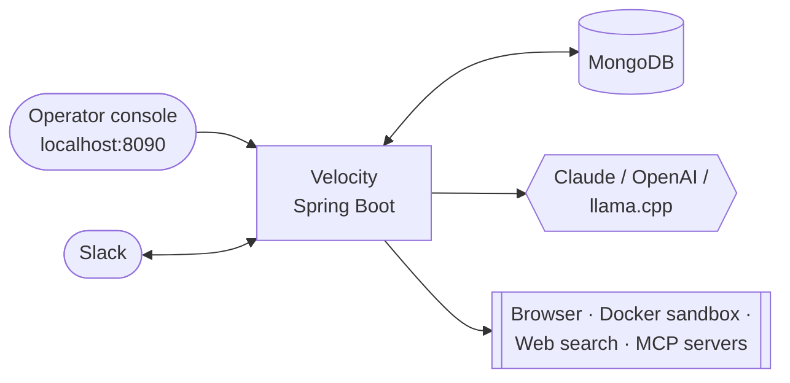

# Velocity

Velocity is a single-installation AI agent service built with Java 25 and Spring Boot 4.1.1. It
runs durable agent tasks — conversations between a configured model (Claude, OpenAI or a local
llama.cpp server) and Java-registered tools — and keeps every step in MongoDB so work survives
restarts without repeating uncertain side effects.

Tasks come from a local React operator console, from Slack (optional), or from saved schedules
and monitors (optional). Every installation gets knowledge, memory, skills, background learning,
research and cited reports, scheduling, monitoring, a credential vault and task history. Feature
modules add browser automation, sandboxed Python execution, Tavily web search, and the tools of
external MCP servers; new features plug into the same extension points.



## Quick start

Requirements: JDK 25, MongoDB, and Node.js 22.12+ for the console build.

1. Copy [`.env.example`](.env.example) to `.env` in the repository root and adjust it (see
   [getting started — minimal .env](docs/getting-started.md#minimal-env)).
2. Start MongoDB, then from the repository root:

   macOS / Linux:

   ```sh
   sh ./mvnw -Pfrontend -pl velocity-modules/velocity-app -am spring-boot:run
   ```

   Windows (PowerShell):

   ```powershell
   .\mvnw.cmd -Pfrontend -pl velocity-modules/velocity-app -am spring-boot:run
   ```
3. Open `http://localhost:8090/`. `curl http://localhost:8090/velocity/hello` returns
   `Hello from Velocity!`.
4. Configure an inference provider to run tasks
   ([getting started — enable agent tasks](docs/getting-started.md#enable-agent-tasks)).

The console acts as one configured account. To share it with your Slack user, read
[the local account](docs/getting-started.md#the-local-account).

## Documentation

| Guide | What it covers |
| --- | --- |
| [Architecture](docs/architecture.md) | System context, modules, runtime components, task lifecycle, concurrency, durability and extension points, with diagrams. |
| [Getting started](docs/getting-started.md) | Prerequisites, minimal `.env`, first run, the local account, enabling tasks and integrations. |
| [Startup and shutdown](docs/startup-and-shutdown.md) | Boot sequence, configuration loading, fail-fast checks, recovery, lifecycle order, shutdown, isolated runs, troubleshooting. |
| [Configuration reference](docs/configuration.md) | Every setting, environment variable and default. |
| [Agent runtime](docs/agent-gateway.md) | Gateway, run loop, tool execution, budgets, compaction, delegation, recovery, wiring contributions. |
| [Inference](docs/inference.md) | Providers, profiles and limits, token counting, cloud continuation, the `InferenceService` API. |
| [Security model](docs/security.md) | Accounts and ownership, local operator boundary, tool authorization, destination policies, encryption. |
| [Operator console](docs/operator-console.md) | Screens, building, development loops. |
| [Operator API](docs/operator-api.md) | Every HTTP route. |
| [Data and storage](docs/data-storage.md) | MongoDB collections, the execution document, snapshot format, backups. |
| [Knowledge, memory and learning](docs/knowledge-memory-learning.md) | Datasets, facts, skills, history search, background learning. |
| [Scheduling and monitoring](docs/scheduling-and-monitoring.md) | Saved prompts and messages, timing, recovery, ongoing monitors. |
| [Usage and costs](docs/usage-costs.md) | Usage ledger, prices, reports. |
| [Observability](docs/observability.md) | Actuator health, Micrometer and Prometheus metrics, execution IDs in logs. |
| [Slack](docs/slack.md) | App setup, ingress, delivery, reports. |
| [Browser and saved logins](docs/browser.md) | Browser Use runtime, tools, network boundary, credential vault. |
| [Code execution](docs/code-execution.md) | Docker-sandboxed Python, artifacts, PDF and Excel skills. |
| [Web search](docs/web-search.md) | The Tavily-backed `web_search` tool. |
| [MCP connector](docs/mcp.md) | External Model Context Protocol servers registered as `mcp_<server>_<tool>` tools. |
| [Adding a feature](docs/adding-a-feature.md) | New module step by step, extension points, checklist. |
| [Development](docs/development.md) | Build commands, formatting, verification policy. |
| [Contributor instructions](AGENTS.md) | Repository rules and runtime constraints. |

Each module also has a short `README.md` that points to its guide.

## Repository layout

| Path | Contents |
| --- | --- |
| `velocity-modules/velocity-core/` | Kernel: agent gateway, run loop, tool execution, execution persistence, inference, local operator boundary, usage ledger, extension contract (`agent.spi`). |
| `velocity-modules/velocity-platform/` | Platform capabilities on the kernel: knowledge, memory, skills, learning, research, scheduling, monitoring, secrets, task history, operator console. |
| `velocity-modules/velocity-slack/` | Slack Socket Mode connection, ingress and delivery; Slack app manifest. |
| `velocity-modules/velocity-browser/` | Browser tools and saved-login tools. |
| `velocity-modules/velocity-code-execution/` | Python sandbox tool and document skills. |
| `velocity-modules/velocity-web-search/` | Tavily-backed `web_search` tool. |
| `velocity-modules/velocity-mcp/` | Connector for operator-configured external MCP servers. |
| `velocity-modules/velocity-example-feature/` | Template module, packaged only with `-Pexample-feature`. |
| `velocity-modules/velocity-app/` | `VelocityApplication`, web routes, `application.properties`; builds the JAR. |
| `frontend/` | React + TypeScript + Vite operator console. |
| `runtime/` | Separately installed browser and Python-sandbox runtimes. |
| `config/` | Formatter and Checkstyle configuration. |
| `docs/` | Guides listed above. |

## Development

macOS / Linux:

```sh
sh ./mvnw compile                    # compile + Java formatting/brace checks
sh ./mvnw -Pfrontend clean verify    # full build with console and all format checks
java -jar velocity-modules/velocity-app/target/velocity-0.0.1-SNAPSHOT.jar
```

Windows (PowerShell):

```powershell
.\mvnw.cmd compile                    # compile + Java formatting/brace checks
.\mvnw.cmd -Pfrontend clean verify    # full build with console and all format checks
java -jar velocity-modules\velocity-app\target\velocity-0.0.1-SNAPSHOT.jar
```

Automated tests are paused; see [development](docs/development.md#verification-policy).
Contributions are welcome: read [CONTRIBUTING.md](CONTRIBUTING.md) first.

## License

Velocity is released under the [Apache License 2.0](LICENSE).
