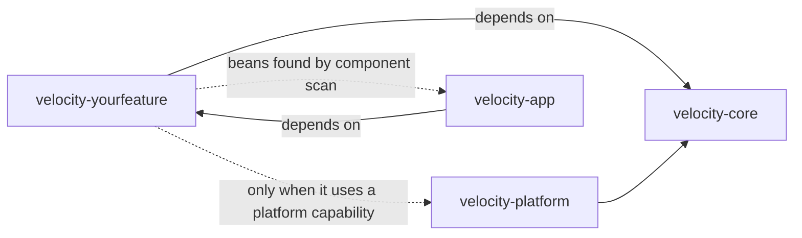

# Adding a feature

A feature is its own Maven module that plugs into the small extension points in `velocity-core`'s
`agent.spi` package. Adding one never requires editing `velocity-core` or `velocity-platform`. The in-repo module
[`velocity-example-feature`](../velocity-modules/velocity-example-feature) is a compiled, commented template: copy it,
rename it and replace its tool. Every full reactor build compiles it, so an extension-point
change that breaks the template fails the build.

A feature brings its own unit tests under `src/test/java` (see the
[verification policy](development.md#verification-policy)): offline JUnit 5 tests of its tool
metadata, schemas, parsers and handlers, with no Spring context, database, network or inference.
The template's `ExampleToolsTest` shows the shape.

- [When to create a module](#when-to-create-a-module)
- [Files a feature touches](#files-a-feature-touches)
- [Steps](#steps)
- [Extension points](#extension-points)
- [Choosing @Order values](#choosing-order-values)
- [Permanent names](#permanent-names)
- [Compatibility](#compatibility)
- [What not to do](#what-not-to-do)
- [Verifying](#verifying)
- [Reviewer checklist](#reviewer-checklist)

## When to create a module

Create a module when the feature brings its own tools, settings, persistence, routes or
third-party libraries. A small addition to an existing feature belongs in that feature's module.
Heavy libraries belong to the module that uses them; `velocity-core` bans POI, PDFBox and the Slack
SDK through the Enforcer plugin.

A module depends on `velocity-core`, and on `velocity-platform` only when it uses a platform capability
(schedules, research, secrets, skills, the status page's platform sections), plus any feature it
declares; each allowed module is listed in its `keep-feature-modules-independent` Enforcer rule.
Its packages stay under `net.velocity.<feature>` so `VelocityApplication`'s component scan finds
them.

## Files a feature touches

| File | When |
| --- | --- |
| `velocity-modules/velocity-<feature>/pom.xml` (copy the [example POM](../velocity-modules/velocity-example-feature/pom.xml)) | always |
| Root [pom.xml](../pom.xml): one `<module>` and one `dependencyManagement` entry, appended | always |
| [velocity-modules/velocity-app/pom.xml](../velocity-modules/velocity-app/pom.xml): one `<dependency>` | to ship it |
| `<Feature>Properties` record (`@ConfigurationProperties`, no defaults) | if it has settings |
| [application.properties](../velocity-modules/velocity-app/src/main/resources/application.properties) default and a [metadata](../velocity-modules/velocity-app/src/main/resources/META-INF/additional-spring-configuration-metadata.json) entry | if it has settings |
| `<Feature>Configuration` — one always-loaded `@Configuration` | always |
| Tool class building `ToolRegistry.Definition` values | if it has tools |
| `<Feature>Prompts` | if it has prompts |
| `@RestController` under `/api/operator/<feature>` | if it has an API |
| Unit tests under `src/test/java/net/velocity/<feature>` (copy [ExampleToolsTest](../velocity-modules/velocity-example-feature/src/test/java/net/velocity/example/ExampleToolsTest.java)) | always |
| `docs/<feature>.md`, a row in the [README](../README.md#documentation), rows in the [order tables](agent-gateway.md#wiring-contributions), a module `README.md` | always |
| Frontend page under `frontend/src` | if the console shows it |

Anything else that seems necessary is a missing extension point — stop and propose one in its
own reviewed change.

## Steps

1. **Copy the template.** Rename artifact, package and classes. Keep it a plain jar: no Boot
   repackage plugin, no `application*.properties`, no auto-configuration imports.
2. **Register the module** in the root POM (as `velocity-modules/velocity-<feature>`) and add the
   dependency to `velocity-modules/velocity-app/pom.xml`. Order only matters for libraries that must
   shadow core's (Tyrus must precede `tomcat-embed-websocket`; check `BOOT-INF/classpath.idx`).
3. **Add settings.** The default lives only in `application.properties` as `${ENV:default}`. New
   features are off by default. Add the metadata entry and a row in
   [configuration](configuration.md).
4. **Add beans** for the extension points you need. Constructor injection; `@Lazy` repositories
   behind `ObjectProvider<MongoTemplate>`; the tool provider checks the enabled flag itself.
5. **Write tools** with explicit bounded schemas, trusted metadata, category, scoping, timeout and
   monitoring access (model it on `ExampleTools`). Scoped tools enforce `ownerAccountId`.
   Mutations persist intent before external effects and receipts before settlement.
6. **Write prompts** in `<Feature>Prompts`. Never add feature text to `SystemPrompts`.
7. **Add routes** under `/api/operator/<feature>`, resolving the owner with `LocalAccountScope`
   and parsing with `StrictRequests`.
8. **Document** and **verify** (below).

Template commands: `sh ./mvnw compile` builds it; `sh ./mvnw -Pexample-feature package` packages it;
`EXAMPLE_ENABLED=true` turns on its `example_echo` tool, `GET /api/operator/example` and the
`example` status section.

## Extension points

| Type (package) | Purpose | Ordering | Declare as |
| --- | --- | --- | --- |
| `ToolProvider` (`agent.spi`) | Register tools after kernel tools | `@Order` | `@Bean` |
| `ContextContributor` + `ToolGuidanceContributor.whenRegistered` (`agent.spi`) | Model guidance when tools exist | `@Order` (model-visible) | `@Bean` taking `ToolRegistry` |
| `GatewayCustomizer` (`agent.spi`) | Deletion barriers, settlement checks, deletion listeners | `@Order` | `@Bean` |
| `AuthorizationPolicyDecorator` (`agent.spi`) | Add denials for the feature's tools | `@Order`, first innermost | `@Bean` |
| `DelegationProfile` (`agent.spi`) | Fixed child capability | `@Order` (model-visible) | `@Bean` |
| `OperatorRouteContributor` (`agent.spi`) | Protect a root outside `/api/operator` | set union | dependency-free `static @Bean` |
| `UsageActivityContributor` (`agent.spi`) | Usage activity names | set union | dependency-free `static @Bean` |
| `SystemStatusContributor` (`agent.spi`) | One status section | `@Order` (JSON key order) | `@Bean` |
| `OutputFileSource` (`agent.spi`) | Resolve an owned task file for `task_attach_file` | set union | `@Bean` |
| `ReservedDestinationPolicy` (`agent.spi`) | Block destinations for browser and credentials | any policy blocks | dependency-free `static @Bean` |
| `BundledSkillSource` (`agent.skills`, `velocity-platform`) | Bundled skills | `@Order` | dependency-free `static @Bean` |

Every extension point validates at startup and fails closed. A disabled feature registers no
tools and adds no guidance; its status section, routes, usage activities, skills and reserved
destinations stay registered so stored data remains readable and protected.

## Choosing @Order values

Tool and guidance order is visible to the model and status order is part of the API. Always set
an explicit `@Order`, pick a value unused for that type (normally the next free hundred), and add
the row to the [order tables](agent-gateway.md#wiring-contributions) in the same change. Append new
status keys after the last one.

## Permanent names

Once released these are stored or depended on; do not rename or remove them while data can carry
them:

- Tool names (`[a-zA-Z0-9_-]{1,64}`) — stored in calls and receipts.
- Usage activity names (`[a-z][a-z_]{1,39}`) — stored in usage records.
- Delegation profile names — stored in child runs; removing one makes those executions corrupt.
- Bundled skill IDs and released versions — install receipts hold a digest of the text.
- Route roots, status keys, setting names, MongoDB collection names (prefix with the feature).

## Compatibility

- Each task stores its admitted tool contracts. Changing a released tool's description or schema,
  or disabling the tool, makes in-flight tasks fail with `admitted_tool_incompatible`.
- Only the current execution snapshot format is readable. A shape change in your own collections
  needs its own version or wipe plan, stated in your guide.
- Follow the runtime rules in [AGENTS.md](../AGENTS.md#runtime-constraints-to-preserve).

## What not to do

- Edit `velocity-core` or `velocity-platform`, or name the feature anywhere in them.
- Add static registries or singletons; contribute beans instead.
- Widen visibility of core types.
- Put defaults in the properties record, `@DefaultValue` or an `EnvironmentPostProcessor`.
- Mount controllers outside `/api/operator/<feature>` without a route contribution (startup fails).
- Let a request body or model argument choose an identity.

## Verifying

1. `sh ./mvnw spotless:apply`, add missing braces, then `sh ./mvnw test` (the module's unit tests
   run with everything else; `sh ./mvnw -pl velocity-modules/velocity-<feature> test` runs them alone).
2. `git diff --stat <base> -- velocity-core velocity-platform` is empty and
   `grep -rniE "<feature>|<tool_prefix>" velocity-modules/velocity-core/src velocity-modules/velocity-platform/src` finds nothing.
3. `sh ./mvnw clean package` and check `jar tf velocity-modules/velocity-app/target/velocity-0.0.1-SNAPSHOT.jar` for
   `BOOT-INF/lib/velocity-<feature>-`.
4. Optional live boot (with maintainer approval) against a **disposable** database using the
   [isolated settings](startup-and-shutdown.md#safe-isolated-starts). Confirm startup (route audit
   and extension validation run then), the new status section, that your route rejects a foreign
   Host or Origin, and that your tool appears in a new task's admitted tools. Copy only the
   `accounts` collection into the disposable database if you need to submit a task, and drop only
   that database afterwards.

Unit tests and builds do not prove behavior against the live application; say so in the change
description.

## Reviewer checklist

- [ ] Module POM: parent `velocity-parent`, depends on `velocity-core` (and `velocity-platform` only if it
      uses a platform capability), no repackage plugin.
- [ ] Root and `velocity-app` POM changes are single appended lines; Tyrus order unchanged.
- [ ] No change under `velocity-core` or `velocity-platform`; the feature is not named there.
- [ ] Settings: record without defaults, default in `application.properties`, metadata, docs; off
      by default.
- [ ] Disabled feature registers no tools or guidance; every ordered bean has a unique documented
      `@Order`.
- [ ] Tools: bounded schemas, trusted metadata, timeout, category, scoping; mutations follow
      receipt and reconciliation rules.
- [ ] Routes under `/api/operator/<feature>`, `LocalAccountScope`, strict parsing, `no-store` when
      sensitive.
- [ ] Prompts in `<Feature>Prompts`; released tool text unchanged.
- [ ] Permanent names chosen deliberately.
- [ ] Docs, README table, order tables and module README updated; links resolve.
- [ ] Unit tests under `src/test/java` cover the tools' metadata, schemas and parsing; build, test
      and formatting results reported.
