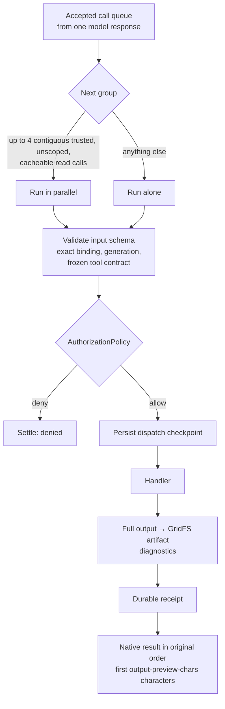

# Agent runtime

The agent runtime turns a trusted request into a durable conversation between a pinned model
and Java-registered tools. This guide covers admission, the run loop, tool execution, budgets,
delegation, recovery and the extension contracts features use. Code lives in
`velocity-modules/velocity-core/src/main/java/net/velocity/agent/`; the contract itself is the `agent.spi`
package.

- [Responsibilities](#responsibilities)
- [Admission](#admission)
- [Root queue](#root-queue)
- [The run loop](#the-run-loop)
- [Tool execution](#tool-execution)
- [Task deadline and limits](#task-deadline-and-limits)
- [Context sizing, compaction and reporting](#context-sizing-compaction-and-reporting)
- [Steering, answers, cancellation and deletion](#steering-answers-cancellation-and-deletion)
- [Delegated child runs](#delegated-child-runs)
- [Outcome reporting](#outcome-reporting)
- [Recovery](#recovery)
- [Core tools](#core-tools)
- [Wiring contributions](#wiring-contributions)
- [Shared implementations](#shared-implementations)

## Responsibilities

| Class | Responsibility |
| --- | --- |
| `AgentGateway` | The only entry point for task lifecycle: `create`, `createScheduled`, `continueTask`, `approve`, `steer`, `answer`, `cancel`, `delete`, `recover`. Every public method is synchronized on the gateway, which is also the lock the queue uses. |
| `RootQueue` | The durable FIFO of admitted roots, the virtual-thread workers, the 50 ms coordinator, queue capacity and deadlines, and the external settlement checks. Asks the gateway (`RootQueue.Runtime`) whether a task is admissible and runs the worker body. |
| `ExecutionAuthority` | The trusted account, schedule and monitoring verifiers; the defaults refuse scheduled and monitoring work until the platform installs its verifiers. |
| `ConversationRunner` | Runs one task. Each loop iteration picks the next `RunPhase`, requests model turns and accepts native responses. |
| `ContextPreparer` | Sizes one model request at a settled boundary, commits a compact view when the conversation outgrows its allowance, and hands a long llama.cpp conversation to the cloud profile. |
| `ToolCallExecutor` | Validates, authorizes, dispatches accepted tool calls and classifies their outcomes. |
| `CallSettlement` | Receipt-before-settlement: writes the durable receipt, then the native result in accepted order; also owns exact binding and delegation classification. |
| `ToolCallRecovery` | Settles calls interrupted by a crash or stop from their receipts, child runs or the handler's destination receipt; never starts a provider, child or handler. |
| `DelegationService` | Runs `delegate_work` children with their own runner and executor over a child view of the same execution. |
| `ExecutionProgress` | Active-time checkpoints, usage accounting and the per-execution `BudgetPolicy`. |
| `ConversationContext` | Freezes the admission context and builds each request's instructions and tool list. |
| `ContextSizingPolicy`, `ConversationCompactor`, `CloudHandoff` | Fit requests to the profile's input allowance. |
| `ToolRegistry`, `AuthorizationPolicy`, `ContextHooks` | Tool definitions, allow/deny decisions and trusted instructions. |

The model chooses tools and wording. Java owns admission, schemas, permissions, call bindings,
budgets, cancellation, dispatch order and storage. There is no planner graph, finish tool or
answer-review loop.

## Admission

Every ingress adapter builds an internal `StartRequest` and calls the gateway:

| Field | Source |
| --- | --- |
| `request` | The user's text. |
| `conversationId` | Optional opaque label; defaults to the execution ID. Grants nothing. |
| `scope` (`TrustedScope`) | Built by the adapter: workspace, requester, channel, bot, origin (`local`, `slack`, `scheduler`) and `ownerAccountId`. |
| `instructions`, `history`, `attachments`, `sourceMessages` | Adapter-supplied context such as a Slack thread. |
| `uploads` | Files the requester attached (local console, or a Slack message). Stored through `AttachmentStore` under the new execution ID before the snapshot is persisted, discarded if admission fails, and listed as metadata in the first user message; contents reach the model only through tool results. A continuation receives copies of its source task's files. `steer` and `answer` take the same list for a later turn: the files are stored on the execution (`AttachmentStore.attach`, counting its earlier files against the `agent.uploads.*` limits) before the correction is saved and listed in that turn's text or trusted source message. The store cannot remove one file, so a storage failure partway through a later turn leaves the files already saved listed on the task although the turn was not applied. |
| `sourceTurn` | Deduplication identity (for example a Slack message). A retried source turn returns its original execution. |
| `limits`, `monitoring`, `automaticResumption` | Trusted overrides for scheduler and monitoring admissions. |

`admit` then:

1. Verifies the owner account is registered and matches its Slack identity.
2. Refuses admission if no `default` inference profile exists (the HTTP adapter returns 503
   "Inference is not configured").
3. Returns the existing execution for a duplicate `sourceTurn`.
4. Checks root queue capacity (`AdmissionCapacityException`, HTTP 429 `agent_queue_full`).
5. Builds the snapshot: a fresh UUID (or the occurrence-derived ID for schedules), queue
   ticket, **inference binding** pinned to the `default` profile and, for llama.cpp tasks, the
   admitted cloud-fallback binding.
6. Validates scheduler and monitoring associations.
7. Applies limits: ordinary tasks get the server limits reduced to *time only*; monitoring
   tasks get the minimum of server and requested limits.
8. Freezes the **admission context**: system instructions, tool contracts, memory facts and
   skill index as of now. Later changes to memory, skills or tool registration do not alter an
   admitted task.
9. Persists the snapshot, then launches it.

Every admission uses task purpose `generic`. The value is persisted so that a future purpose can
select its own `BudgetPolicy` without the run loop branching on it.

## Root queue

All roots share one FIFO in the gateway. A coordinator thread runs every 50 ms to expire
queued tasks whose time allowance has run out, reap finished workers and drain the queue.

- `max-active-roots` (default 4) tasks run at once; `queue-capacity` (default 100) more may wait.
- A queued task has `status: running` and a non-null `queuedAt`. Queue time is charged to the
  task's active time when it starts, is cancelled, or expires.
- A task can expire with `active_time_limit` while still queued, without ever using a slot or
  calling a provider.
- Before a queued task starts, the gateway re-verifies the account, schedule and monitoring
  authority and the pinned inference profile.
- A task that pauses for `ask_user` releases its slot and gets a new ticket when resumed.
- Children run inside their root's slot; roots hold no provider permit while waiting on tools.

## The run loop

`ConversationRunner.run` repeats `iterate` until the task leaves `running`. Each iteration
checkpoints active time, consumes the durable inbox and cancellation, then asks
`RunPhase.next` — a pure, ordered decision over the snapshot. The first applicable phase wins.

| # | Phase | Applies when | Effect |
| ---: | --- | --- | --- |
| 1 | `STOP_NOT_RUNNING` | Status is not `running`. | Leave the loop. |
| 2 | `STOP_AT_TIME_LIMIT` | No active time remains. | Settle accepted calls without dispatch; stop `partial` / `active_time_limit`. |
| 3 | `STOP_AT_TOKEN_CEILING` | Ordinary task reached `task-token-ceiling`. | Settle accepted calls; stop `partial` / `task_token_ceiling`. |
| 4 | `WAIT_FOR_QUESTION` | A question is pending. | Record `waiting_for_user` and leave. (A call held for [approval](#per-call-approval) reaches the same state through phase 7.) |
| 5 | `STOP_REPORTING_ATTEMPTED` | The one-turn reporting request already ran. | Reject its calls; stop `partial`. |
| 6 | `SETTLE_REPORTING_CALLS` | In reporting mode with accepted calls. | Reject them, decide again. |
| 7 | `PROCESS_ACCEPTED_CALLS` | Accepted or dispatched calls are unsettled. | Run `ToolCallExecutor`, then restart the iteration. |
| 8 | `ADMIT_SOURCE_MESSAGES` | New source messages arrived while idle. | Append them, decide again. |
| 9 | `AWAIT_REPORTING_SETTLEMENT` | Reporting mode. | Wait for in-flight work to settle. |
| 10 | `STOP_MODEL_BUDGET` | Monitoring run exhausted its request or token budget. | Stop `partial` / `model_budget_limit`. |
| 11 | `MODEL_TURN` | Nothing else applies. | Size context, persist the request intent and reservation, call the model, save the native response and its accepted-call queue in one update. |

Exceptions map to terminal states: an unavailable profile → `blocked`; a provider queue
rejection or child capacity error → `partial`; a token-count failure → `failed`;
cancellation → `cancelled`; the hard deadline → `partial`; anything else → `failed`
(`execution_failed:<ExceptionClass>`). Every path first settles dispatched calls as uncertain
and undispatched calls without running them, so each accepted call keeps exactly one result.

**Transient provider failures.** A root task's model turn or token count that fails with a
rate limit, overload, server error or dropped connection is retried rather than failing the
task. The runner waits 2, 4, 8, then 16 seconds (plus up to 25% jitter, or the provider's
`Retry-After` when longer), then restarts the loop, so each attempt is a new model turn with
its own usage record and reservation. A refused request releases its reservation; a dropped
connection keeps it, because the provider may have charged. Each failure writes a diagnostic.
After four retries, or when the next wait would outlast the remaining active time, the task
stops `failed` with the failure code (for example `provider_overloaded`). Waits count as
active time and end immediately on cancellation. Delegated children and the single reporting
turn do not retry; a child's failure is returned to its parent.

A response may carry at most 16 tool calls with fresh, nonempty IDs. A truncated or unusable
response never dispatches; monitoring runs fail after two consecutive unusable responses.

**Skill self-check.** When a root generic task that loaded a skill answers without tool
calls, `SkillSelfCheck` appends one fixed user notice and restarts the loop instead of
accepting the answer (`agent.skills.self-check-enabled`). The next `MODEL_TURN` may patch a
skill; when the model then answers without calls, the final answer is the assistant text
recorded before the notice. The notice runs once per task and only with at least 60 seconds
of active time left; see [learning](knowledge-memory-learning.md#skills).

## Tool execution

### Definitions

Tools are `ToolRegistry.Definition` records registered by trusted Java:

| Field | Meaning |
| --- | --- |
| `name` | `[a-zA-Z0-9_-]{1,64}`, unique; duplicates fail startup. |
| `inputSchema`, `outputSchema` | Bounded JSON Schema subset (types, properties, required, `additionalProperties`, items, enum, numeric/string/array bounds). Unsupported keywords fail registration. Both input and output are validated. |
| `category` | `system.read`, `repository.read`, `network.read`, `repository.write`, `network.write`, `system.execute`, `agent.question`. Reads are eligible for parallelism and monitoring. |
| `trusted` | Only trusted tools pass the strict authorization policy. |
| `scoped` | The handler enforces account- or execution-scoped access. |
| `cacheable` | Eligible for parallel read groups and one transient retry. |
| `timeoutMillis` | Ordinary tasks use the remaining task deadline; monitoring caps it. |
| `monitoringAccess` | `denied`, `observation`, or `restricted` with a trusted input filter. |
| `handler` | `execute(Context, input)`. The context carries the execution ID, `TrustedScope`, cancellation handle, progress and usage reporters, and the accepted call ID and binding. |

### Execution order



- **Authorization.** `AuthorizationPolicy.strict()` allows trusted tools for an owned scope.
  Features can only narrow it through decorators. The model never asks for permission;
  `ask_user` is for missing information. Per-call approval, when enabled, is a Java-owned hold
  applied after authorization (below).
- **Bindings.** Each accepted call is bound to a hash of the tool name, normalized input, call
  ID and every trusted scope field. Receipts match on that binding.
- **Results.** The model sees the first `agent.limits.output-preview-chars` (24,576)
  characters of output, without a truncation marker. The full output is an artifact readable
  through `task_evidence_read` after compaction. Tools that must not be cut use a
  complete-result handler; an oversized result settles as `result_capacity`.
- **Retries.** Eligible transient reads retry once after 250 ms within the deadline. Nothing
  else retries.
- **Uncertainty.** A handler can throw an uncertain-outcome exception with safe diagnostics.
  An uncertain mutation, or a mutation with invalid output, blocks further mutations; recovery
  never replays it.
- **Questions.** A successful `ask_user` saves the question with its settlement and pauses
  before later calls. An answer supersedes undispatched calls.

### Per-call approval

With `agent.approval.enabled=true`, `ToolApprovalPolicy` holds an accepted call for the
requester's decision before it is dispatched. The decision uses trusted registration metadata
only: a tool named in `agent.approval.tools` always needs approval, one in
`agent.approval.exempt-tools` never does, reads, `agent.question` and `agent.delegation` never
do, and otherwise the tool's category decides (`agent.approval.categories`, by default
`browser.interaction`, `system.execute` and `network.write`, which covers browser actions,
`code_run` and tools that write to external services). Model arguments cannot influence the hold.

A tool can also ask for confirmation on its own: a registration whose handler implements
`ToolRegistry.ConfirmingHandler` is held for an attended requester even while the policy is
disabled, and only an exemption switches that off. The handler's `preview` renders, from the
validated arguments and read-only state, a plain-language description of what the call will do;
`ToolCallExecutor` stores it on the hold as `approval.summary` (an additive field, so the
snapshot format is unchanged), and the Slack card and console show it in place of the raw
arguments. The [knowledge](knowledge-memory-learning.md#confirmed-writes) write tools use this.
The approval guidance is injected into new tasks while the policy is enabled or any registered
tool confirms.

```mermaid
sequenceDiagram
  participant X as ToolCallExecutor
  participant DB as Snapshot
  participant U as Requester
  X->>X: eligible (schema, binding, authorization)
  X->>DB: call.approval = pending
  X-->>DB: status waiting_for_user
  U->>DB: approve or decline (console, Slack reply)
  DB-->>X: relaunch; status running
  alt approved
    X->>X: dispatch as usual
  else declined
    X->>DB: settle declined, never run
  end
```

- Calls are held in queue order: earlier calls of the same response run first, the held one
  stops the queue, and the task records `waiting_for_user` with no pending question. The hold
  is written on the call itself (`approval.state`), so a crash between the hold and the status
  change is recovered by reading the queue again.
- `approve(id, callId, approved)` (`POST /api/agent/executions/{id}/approvals`, or a Slack reply
  of `approve` / `decline` from the requester, which decides every held call at once) records
  the decision with its time and origin and relaunches the task. A declined call settles as
  `declined` with a fixed result telling the model not to retry or work around it; an approved
  call dispatches with the normal checkpoint and receipt. Answers are refused while only an
  approval is pending; a steering correction supersedes held calls like any other undispatched
  call.
- `approve(id, callId, approved)` is also reached from the Slack Approve and Decline buttons,
  which are bound like the Cancel button and decide every held call at once.
- Monitoring runs and delegated children cannot obtain approval, so a call the policy holds
  settles as `denied` without running. A call held only because its tool confirms runs there
  without a pause, and likewise in scheduled occurrences (origin `scheduler`), since no requester
  is present and the delivered result reports the write. The hold itself applies to every task
  at dispatch time.

### Live output

Every acknowledged write of an execution document is published to `ExecutionEvents`, and
`GET /api/agent/executions/{id}/events` streams them to the console as server-sent events
([operator API](operator-api.md#live-task-events)). With `agent.live-output.model-streaming`
(default on) a root task's model turn uses the provider's stream when it has one: assistant
text is relayed as it is generated and kept, bounded, until the saved response carries it. The
streamed response is assembled by the provider adapter and committed exactly as a complete
response would be; a stream that fails after generation started is treated as a transient
failure with uncertain usage, so the runner retries it with a new request identity. Children
and the reporting turn never stream.

## Task deadline and limits

`ExecutionProgress` picks a `BudgetPolicy` per execution:

| Policy | Used for | Stops on |
| --- | --- | --- |
| `DeadlineOnlyPolicy` | Ordinary tasks and all their children | Active-time deadline; task token ceiling. Every other counter is accounting only. |
| `CumulativeLimitsPolicy` | Monitoring runs | Active time, model requests, tool calls and tokens, with a tools-disabled final report turn and a reserve for it sized by the monitoring output reserve; two unusable responses. |

**Active time.** `agent.limits.active-millis` (30 minutes) covers queue waits, token counting,
inference, tools and children. Waiting for a user answer does not consume it. Children share the
parent's remaining deadline; no operation renews it. At the deadline outstanding work is
interrupted and no further model request starts.

**Token ceiling.** `agent.limits.task-token-ceiling` (5,000,000; `0` disables) bounds the root's
cumulative charged tokens, including children and unsettled reservations. It is checked at the
start of every root and child iteration and before each tool group. Work already in flight
finishes, so the total can exceed the ceiling by that amount. Calls queued in later groups
settle undispatched with `task_token_ceiling`. The value is read at run time, so changing it
affects running tasks after a restart.

`agent.limits.total-tokens`, `model-turns`, `tool-calls` and `tool-timeout-millis` only cap
monitoring runs. Learning reviews use `agent.learning.*`.

**Reporting reserve.** A monitoring run's limits carry an output reserve
(`agent.monitoring.output-reserve`, 16,000 tokens, never above the pinned profile's `max-tokens`).
It is the most one model turn may generate: the request is sent with that output cap, and the
turn's reservation is its counted input plus the reserve. Before every working turn after the
first, the remaining token budget must cover that request and a final report of the same size;
otherwise the next turn is the tools-disabled reporting turn (`final_reporting_reserve`). Sizing
the reserve by what a turn can actually emit, rather than by the provider's output maximum, keeps
a large `max-tokens` from forcing the report after a few turns.

## Context sizing, compaction and reporting

Before each model turn `ContextSizingPolicy` counts the exact request (messages, native blocks,
instructions and tool schemas) with the provider's own token-count endpoint and adds 2,048
tokens of headroom. The result must fit the profile's input allowance and, for a monitoring run,
the remaining token budget less the output reserve. Count failures stop the
task as `failed` (transient ones only after the retries described in
[the run loop](#the-run-loop)); they never fall back to estimates or trigger cloud continuation.

When the request no longer fits, the runner tries in order:

1. **Compaction** (root tasks). At 80% of the input allowance, `ConversationCompactor` builds a
   deterministic, extractive request view: original user constraints and corrections verbatim,
   at least six recent messages expanded to whole call/result boundaries, blockers, report
   references and excerpts of the last 16 settlements, with a summary capped at 16,384
   characters. No model call is made. The view is persisted at a settled boundary and reused
   after restart; canonical history is never edited. Requires the admitted
   `task_evidence_read` tool.
2. **Cloud continuation** (llama.cpp tasks admitted with a fallback). A one-way switch to the
   hosted profile at a settled boundary, with a portable handoff of visible text and settled
   tool records. See [inference](inference.md#cloud-continuation).
3. **Reporting turn.** One persisted tools-disabled request asking the model to report done and
   unfinished work. Calls it proposes settle without dispatch, and a reply that proposes calls or
   contains raw tool-call markup (Qwen and Hermes style `<tool_call>` tags, `<function=…>`
   wrappers) is unusable: it is kept in the conversation, recorded as the
   `reporting_response_unusable` diagnostic, answered with a notice that no tools exist and only
   the report may be returned, and the model gets exactly one further reporting request. A second
   unusable reply ends the task `partial` with a fixed final answer saying no report was produced.
   The retry is marked by the snapshot's `unusableResponses` counter, which the mode resets on
   entry and holds at one; restart never repeats an attempted reporting request whose response was
   not committed. A monitoring run also enters this turn when its
   [reporting reserve](#task-deadline-and-limits) requires it.
4. Otherwise the task stops `partial`, keeping all saved evidence.

## Steering, answers, cancellation and deletion

| Operation | Who | Rules |
| --- | --- | --- |
| `steer(id, text)` | The owning account | Nonterminal task. Writes a correction to the inbox, increments `goalGeneration`, clears staged reports; a waiting task resumes. |
| `answer(id, answers, expectedRevision)` | The owning account | Task must be `waiting_for_user` with a pending question. Supersedes undispatched calls. |
| `approve(id, callId, approved, expectedRevision)` | The owning account | Task must be `waiting_for_user` with the call held for approval; a null `callId` decides every held call. Resumes the task once nothing is held. See [per-call approval](#per-call-approval). |
| `cancel(id)` | Owner, or the local operator administratively | Persists `cancellationRequested` before signalling. A queued or idle task settles immediately. Never rolls back remote effects. |
| `continueTask(id, instruction)` | The owning account | See [continuing a stopped task](#continuing-a-stopped-task). |
| `delete(id, expectedUpdatedAt)` | Local operator | Task must be terminal and **settled**, and the timestamp must match exactly. Runs deletion barriers, then listeners, then tombstones the execution. |

A task is *settled* when its worker has finished and every registered settlement check
(for example a code-execution sandbox) confirms no external work remains. Delivery and
deletion wait for settlement; an interrupt alone does not prove an external call ended.

Deletion removes execution-owned snapshots, inbox, receipts, artifacts, research files and
delivery journals. Usage records, schedules, knowledge, skills and remote Slack messages stay.

### Continuing a stopped task

A terminal task can't resume, so `continueTask` admits a **new** task that picks up from it.
The source must belong to the actor, be a generic non-monitoring task, have stopped `partial`,
`failed`, `blocked` or `cancelled`, and be settled.

`TaskContinuation` builds the seed deterministically, with no model request:

- The request text holds the source's original request, its corrections and the optional new
  instruction, verbatim. They are the owner's own words.
- One attached `task_continuation_handoff` JSON envelope (at most 48,000 characters) is marked
  `untrusted_historical_data`. It holds the source's status and stop reason, blockers, model
  outcome, answer excerpt, last visible assistant text, report metadata, and the most recent 24
  calls with input and result excerpts. Provider reasoning and native state are not carried
  over.

The new task goes through ordinary admission: the current `default` profile, fresh limits,
the same `conversationId`, and a newly frozen admission context. Its immutable `continuedFrom`
names the source. Recorded calls are history, not actions to replay. The handoff tells the model
to check current state before repeating any external effect.

Each source has at most one live continuation. A repeated request returns the existing one,
and a stopped continuation is continued in turn. Deleting the continuation frees the source to
be continued again. The source is never modified.

## Delegated child runs

`delegate_work` (registered when `agent.delegation.enabled` and at least one
`DelegationProfile` exists) runs a focused child conversation:

- One level deep, one active child per root, at most `max-children` (8) over the task's life.
- Java selects a fixed, versioned profile: its tool allowlist and instructions. No shipped
  module contributes a profile; a feature adds one with a `DelegationProfile` bean, and without
  any profile the tool is not registered.
- The child has fresh native history, never sees the parent transcript or Slack thread, and
  inherits the parent's account, pinned profile, deadline and token ceiling.
- Only a bounded, validated result envelope (`max-result-bytes`) returns to the parent, marked
  untrusted. Malformed results get at most one repair attempt.
- Child state lives inside the root document (`max-child-state-bytes`,
  `max-aggregate-state-bytes`) and counts toward the 16 MiB limit.
- Monitoring executions cannot delegate.

## Outcome reporting

A generic root task's final answer may end with a fenced `velocity-task-outcome` JSON block. Java
validates it and saves `taskOutcome`: `status` (`completed`, `partial`, `blocked`, `failed`),
`criteria`, `evidence`, `limitations`, plus server-owned `basis: model_report`,
`goalGeneration` and `reportedAt`. The block is removed from `finalAnswer`; native blocks keep
it. A missing or malformed block leaves `taskOutcome` null ("Not reported"). It is the model's
declaration, not verification.

## Recovery

See [startup and shutdown — recovery](startup-and-shutdown.md#recovery-at-startup) for the
startup order. The guarantees:

- The ordering is **accepted queue → dispatch checkpoint → external call → artifact and
  receipt → settled snapshot**.
- A receipt matching the accepted binding is reused. A dispatch without a receipt is
  uncertain and blocks further mutation. Nothing is replayed blindly.
- Recovery verifies the saved inference binding before any provider request; saved history is
  never sent to a replacement model.
- `agent.automatic-resumption=false` blocks interrupted tasks instead of relaunching them.
- Corrupt or unsupported snapshots fail explicitly; there is no silent reset.

## Core tools

The kernel registers `ask_user`, `date_time`, `task_evidence_read` and (order 900) `delegate_work`
in `AgentConfiguration.toolRegistry`; the platform registers the rest through `ToolProvider` beans
at orders 20 to 70 and 700, before feature tools:

| Tool(s) | Notes |
| --- | --- |
| `ask_user` | Pause for missing information or options. |
| `date_time` | Server clock; optional IANA zone or offset, default the application zone. |
| `data_catalog`, `data_query`, `data_aggregate`, `data_get`, `data_save`, `data_update`, `data_delete` | Account-scoped [knowledge](knowledge-memory-learning.md#knowledge); the writes confirm with the requester. |
| `schedule_execution`, `schedule_message`, `schedule_list`, `schedule_get`, `schedule_update`, `schedule_pause`, `schedule_resume`, `schedule_cancel` | [Scheduling](scheduling-and-monitoring.md). |
| `task_list`, `task_get` | The account's other executions; content is untrusted data. |
| `task_search`, `task_messages`, `task_message_window` | When `agent.history.search-enabled`. |
| `task_evidence_read` | The current task's own artifacts and messages, in bounded chunks. |
| `memory_inspect`, `memory_update`, `memory_proposal`, `memory_control` | When `agent.memory.enabled`. |
| `skill_list`, `skill_load`, `skill_reference`, `skill_create`, `skill_patch` | When `agent.skills.enabled`. |
| `monitor_create`, `monitor_list`, `monitor_get`, `monitor_update`, `monitor_pause`, `monitor_resume`, `monitor_close`, `monitor_run_now` | [Monitoring](scheduling-and-monitoring.md#monitoring). |
| `document_read`, `report_create`, `task_attach_report` | When `agent.research.enabled` (order 700). |
| `task_attach_file` | When `agent.research.enabled` (order 700). Saves text the model writes, or a copy of an owned task file (`source_id`: attached file, document, evidence, report, earlier output file, or a code run artifact through `OutputFileSource`), as an `output` artifact and stages it for delivery with the final answer. Reports and files share ten slots. See [Slack](slack.md#reports-files-and-tables). |
| `task_file_list`, `task_file_open` | When `agent.research.enabled`. Files attached to the request: list them, and extract one into an immutable `document` (once; later calls return it) for `document_read`. Spreadsheets are not extracted; their `file_id` works as a `code_run` input artifact. |
| `delegate_work` | When delegation is enabled and a profile exists (order 900). |

Feature tools are listed in each feature guide.

## Wiring contributions

`AgentConfiguration` never references a platform or feature class. Platform capabilities and
features contribute beans of these types, all in `net.velocity.agent.spi` except where the
table says otherwise; the kernel collects them with `ObjectProvider.orderedStream()`.

| Type | Package | Consumed by | Contract |
| --- | --- | --- | --- |
| `ToolProvider` | `agent.spi` | `toolRegistry` bean, after kernel tools | Registers the module's tools; checks its own enabled flag. Registration grants no authority. |
| `GatewayCustomizer` | `agent.spi` | `agentGateway`, before `recover` | Installs deletion barriers, deletion listeners, settlement checks, or (platform) the schedule and monitoring verifiers, the skill self-check and the admission learning context. |
| `ContextContributor` | `agent.spi` | `ComposedContextHooks` | Supplemental instructions and `completed`/`deleted` callbacks. Use `ToolGuidanceContributor.whenRegistered(registry, text, toolNames...)` for guidance shown only when its tools exist. Order is model-visible. |
| `AuthorizationPolicyDecorator` | `agent.spi` | `authorizationPolicy`, over `strict()` | May only narrow. First decorator is innermost. |
| `DelegationProfile` | `agent.spi` | `DelegationProfileRegistry` | Fixed child capability: name, tool allowlist, instructions. Order is model-visible. Removing a profile requires deleting executions that have children of that profile. |
| `OperatorRouteContributor` | `agent.spi` | `OperatorRoutes` | Adds a protected `/api/...` root, optionally sensitive (no-store, zeroed bodies). Declare as a dependency-free `static` bean. |
| `SystemStatusContributor` | `agent.spi` | `GET /api/operator/status` (platform) | One camel-case top-level section with safe flags and counts only. |
| `UsageActivityContributor` | `agent.spi` | `UsageActivities` | Permanent activity names (`[a-z][a-z_]{1,39}`) for usage records. Dependency-free `static` bean. |
| `ReservedDestinationPolicy` | `agent.spi` | `ReservedDestinations` | Reserves hosts and credential destinations for a server-owned integration. Fails closed. |
| `OutputFileSource` | `agent.spi` | `task_attach_file` (platform) | Resolves a feature's owned task file by ID into bytes the tool copies into a deliverable output file. Must verify execution and owner and return empty for anything else. |
| `BundledSkillSource` | `agent.skills` (`velocity-platform`) | `BundledSkills` | Installable bundled skills. Released versions must not change. |
| `AttachmentStore`, `ChildReferenceValidator` | `agent`, `agent.delegation` | `agentGateway` | Not contribution lists: the kernel takes the single bean of each type if present (the platform research service implements both) and otherwise refuses uploads and delegated references. |

Ordered types use Spring `@Order` (lower first; unordered beans last). Values in use:

| Order | `ToolProvider` | `GatewayCustomizer` | `ContextContributor` | `DelegationProfile` |
| ---: | --- | --- | --- | --- |
| 10 | | | tool approval guidance (kernel, only while `agent.approval.enabled`) | |
| 20 | knowledge `data_*` tools (platform) | | | |
| 30 | scheduling tools (platform) | | | |
| 40 | task-history tools (platform) | | | |
| 50 | memory tools (platform, while enabled) | | | |
| 60 | skill tools (platform, while enabled) | | | |
| 70 | monitoring tools (platform) | | | |
| 100 | | learning deletion barrier (platform) | | |
| 200 | | code execution settlement check and deletion barrier | | |
| 300 | | history and research deletion listeners (platform) | code execution guidance | |
| 400 | | | storage guidance (platform) | |
| 450 | | | output file guidance (platform, `task_attach_file`) | |
| 500 | | scheduled execution verifier (platform) | scheduling guidance (platform) | |
| 600 | code execution | monitoring execution verifier (platform) | monitoring guidance (platform) | |
| 700 | research and report tools (platform) | skill self-check switch (platform) | | |
| 800 | | learning admission context and callbacks (platform) | task-history guidance (platform) | |
| 900 | `delegate_work` (kernel) | | | |
| 1000 | browser and credential tools (with `browser_screenshot`) | | browser page-reading guidance | |
| 1050 | | | browser screenshot guidance | |
| 1100 | `example_echo` (example module) | | example guidance | |
| 1200 | `web_search` (web search module) | | web search guidance | |
| 1300 | `mcp_<server>_<tool>` (MCP module) | | MCP guidance | |
| 2000 | | | browser session lifecycle | |

`SystemStatusContributor` orders: 100 `generatedAt`, 200 `timezone`, 300 `localScope`,
400 `inference`, 500 `slack`, 600 `browser`, 700 `scheduling`, 1000 `secrets`, 1100 `mongo`,
1200 `executionLimits`,
1300 `automaticResumption`, 1400 `codeExecution`, 1500 `example`, 1600 `webSearch`, 1700 `mcp`.

No shipped module contributes an `AuthorizationPolicyDecorator`; one can only deny more than
the strict policy does. `OperatorRouteContributor`, `UsageActivityContributor`, `ReservedDestinationPolicy` and
`OutputFileSource` are set unions, so order does not change their result.

Pick an unused order value for a new contribution, or leave it unordered to run last. See
[adding a feature](adding-a-feature.md).

## Shared implementations

Change the authoritative class when changing a shared rule.

| Rule | Authoritative implementation |
| --- | --- |
| Tool-call interpretation from native blocks | `inference/objects/InferenceToolCalls` |
| Accepted-call projection, binding, validation, result construction | `agent/ToolCallContracts`, `agent/CallBindings` |
| Receipt before native result; result order | `agent/CallSettlement` |
| Trusted account, schedule and monitoring verification of saved authority | `agent/ExecutionAuthority` |
| Pinned profile resolution and compatibility | `agent/PinnedInference`, `InferenceBinding.matches` |
| Bounded token counting and usage observation | `agent/BoundedInference`, `ContextSizingPolicy` |
| Credential encryption | `crypto/AesGcm` (used by the secrets vault; a feature with its own tokens adds a separate keyring) |
| Strict request parsing | `agent/http/StrictRequests` |
| Operator path normalization and protected roots | `agent/security/OperatorPaths`, `OperatorRoutes` |
| Bounded HTTP response collection | `agent/io/HttpIO`, `ErasingByteArrayOutputStream` |
| Active external work registries | `agent/io/ActiveWork` |
| JobRunr registration and bootstrap retry | `agent/scheduling/JobRunrQueue`, `BootstrapRecovery` |
| Task usage coverage | `usage/UsageReports.expectedTaskRequests` |
| Stored text safety for facts and skills | `agent/text/StoredTextSafety` |
| Digests and BSON/JSON normalization | `util/Sha256`, `util/BsonJson` |
