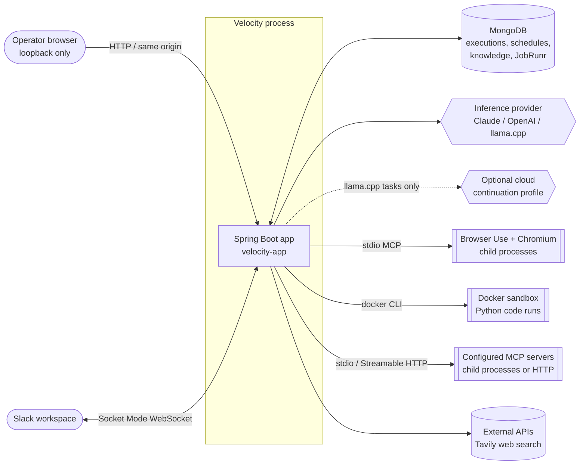
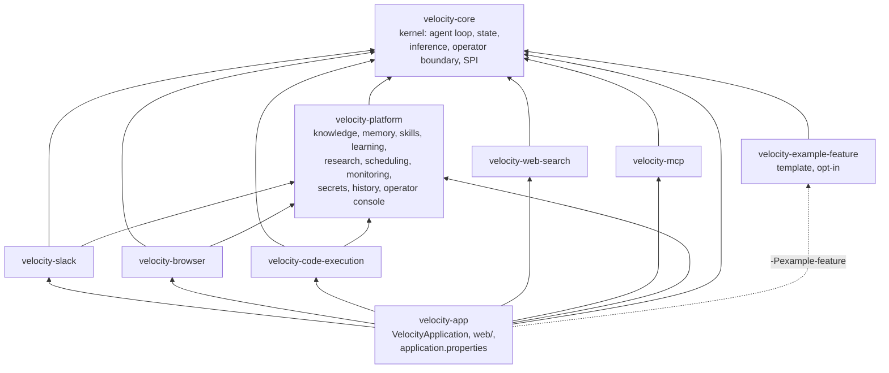
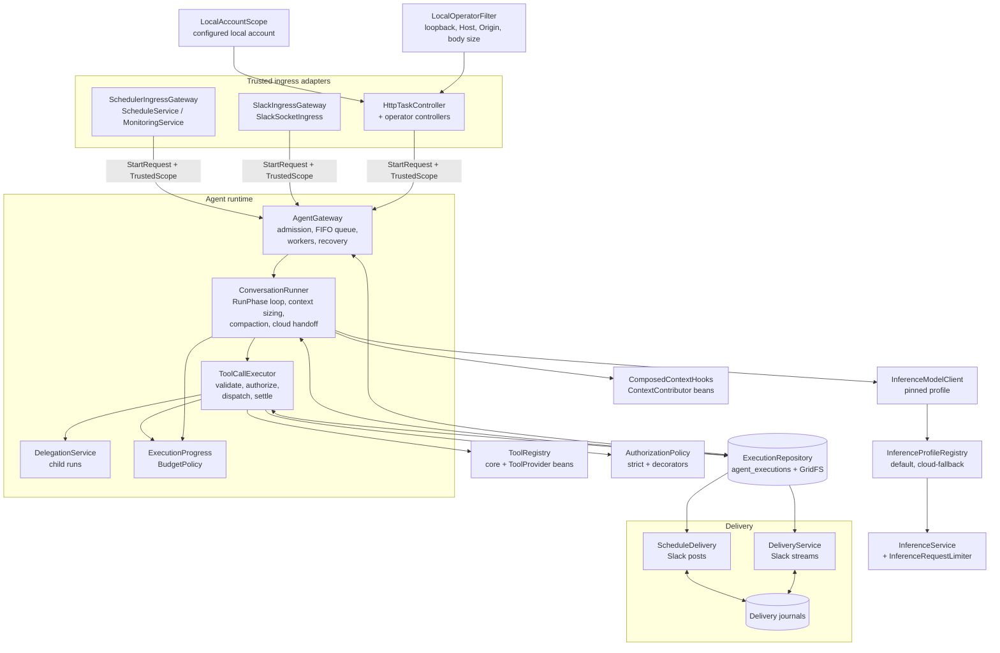
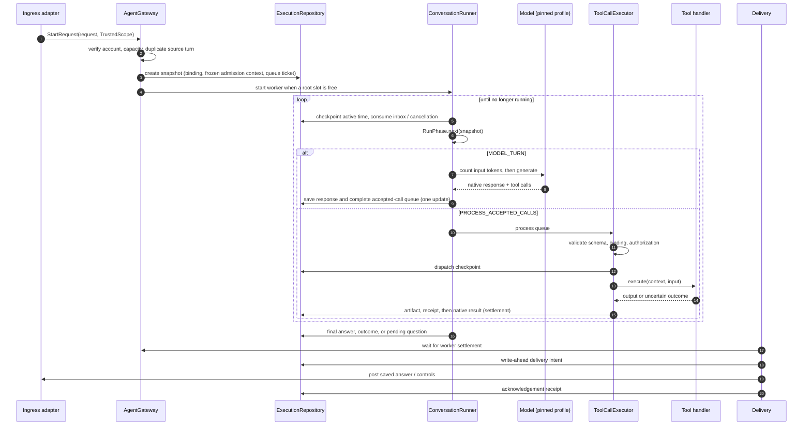
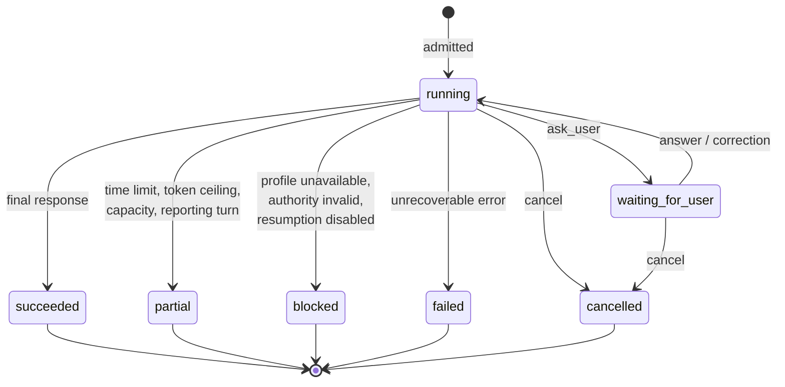
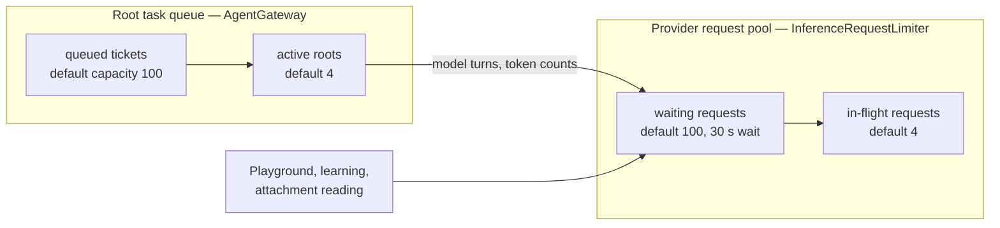
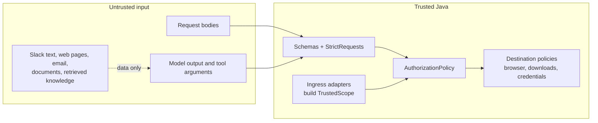
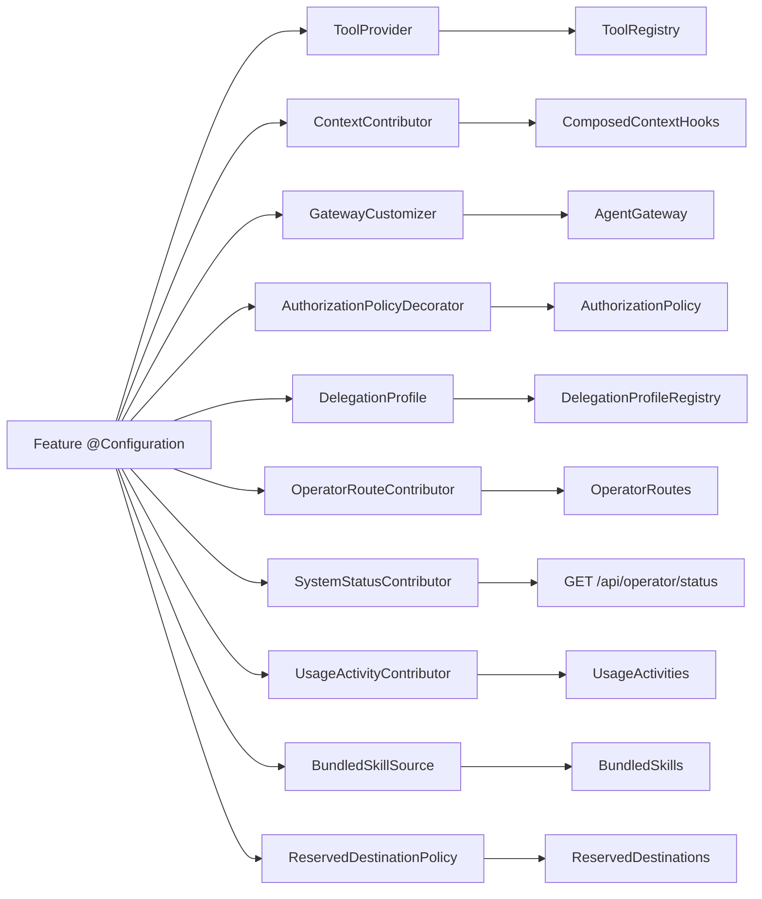

# Architecture

This guide describes how Velocity is put together: the systems it talks to, the Maven modules,
the components inside the running process, how a task flows through them, and where state
lives. Read it before the area guides; they assume the vocabulary introduced here.

- [What Velocity is](#what-velocity-is)
- [System context](#system-context)
- [Module structure](#module-structure)
- [Runtime components](#runtime-components)
- [Task lifecycle](#task-lifecycle)
- [Execution states](#execution-states)
- [Concurrency model](#concurrency-model)
- [Durability model](#durability-model)
- [Trust boundaries](#trust-boundaries)
- [Extension points](#extension-points)
- [Background work](#background-work)
- [Design rules](#design-rules)

## What Velocity is

Velocity is a single-process Java 25 / Spring Boot 4.1.1 MVC service that runs durable AI agent
tasks for one installation. A task is a conversation between a configured model (Claude,
OpenAI or a local llama.cpp server) and a set of Java-registered tools. Java owns admission,
schemas, authorization, budgets, dispatch order and persistence; the model chooses tools and
final wording.

Tasks arrive from three trusted entry points:

- the **local operator console** and its HTTP API, served on loopback only;
- **Slack** mentions and direct messages over Socket Mode (optional);
- **saved schedules and monitors**, dispatched by JobRunr (optional).

Everything the agent does is recorded in MongoDB so that a restart resumes unfinished work
without replaying uncertain external effects.

## System context

Only MongoDB is required to boot. Every other dependency is enabled and validated by its own
settings; an unconfigured integration reports itself as disabled or unavailable rather than
blocking the rest of the application. See [startup and shutdown](startup-and-shutdown.md).

## Module structure

The build is a Maven reactor (`velocity-parent`) with every module under `velocity-modules/`, in three
layers. `velocity-core` is the kernel: the agent loop, execution state and persistence, inference,
the local operator boundary and the extension contract in `agent.spi`. `velocity-platform` holds the
capabilities every installation gets (knowledge, memory, skills, learning, research, scheduling,
monitoring, secrets, task history, the operator console), built on the kernel through the
same extension points a feature uses. Each feature lives in its own module that depends on
`velocity-core`, and on `velocity-platform` only when it uses a platform capability. `velocity-app`
assembles the executable JAR.

| Module | Java packages (under `net.velocity`) | Responsibility |
| --- | --- | --- |
| `velocity-core` | `agent`, `agent.spi`, `agent.state`, `agent.persistence`, `agent.delegation`, `agent.delivery`, `agent.accounts`, `agent.http`, `agent.security`, `agent.config`, `agent.tools`, `agent.io`, `agent.mcp`, `agent.text`, `inference`, `usage`, `config`, `crypto`, `util` | The kernel: gateway, root queue, conversation runner, tool executor, delegation, execution snapshots and their MongoDB repository, delivery journals, accounts, the local operator boundary and task controllers, protected routes, kernel tools (`ask_user`, `datetime_now`, `task_evidence_read`, `delegate_work`), inference providers, usage ledger, and the extension contract (`agent.spi`). |
| `velocity-platform` | `agent.knowledge`, `agent.memory`, `agent.skills`, `agent.learning`, `agent.research`, `agent.scheduling`, `agent.monitoring`, `agent.secrets`, `agent.history`, `operator` | Installation-wide capabilities built on the kernel through `agent.spi`: stored data, facts, skills, the learning loop, research (downloads, document reading, uploads, reports, output files), JobRunr schedules, monitoring, the credential vault, task history and search, and the operator console (status, health, playground). Each package carries its own configuration, tools and operator controllers. |
| `velocity-slack` | `slack`, `agent.slack` | Socket Mode connection, Slack ingress, thread history, delivery streams and scheduled Slack posts. Ships the Slack app manifest. |
| `velocity-browser` | `agent.browser` | Browser Use tools over stdio MCP, network guard, saved-credential login tools. |
| `velocity-code-execution` | `agent.codeexecution` | Docker-sandboxed Python `code_run` tool, artifacts, PDF and Excel skills. |
| `velocity-web-search` | `websearch` | Tavily-backed `web_search` tool. |
| `velocity-mcp` | `mcp` | Operator-configured external MCP servers over stdio or Streamable HTTP, registered as `mcp_<server>_<tool>` tools. |
| `velocity-example-feature` | `example` | Compiled template for [adding a feature](adding-a-feature.md); packaged only with `-Pexample-feature`. |
| `velocity-app` | root, `web` | `VelocityApplication`, liveness and console routes, `application.properties`, configuration metadata. |

Module boundaries are enforced by the Maven Enforcer plugin:

- `velocity-core` may not depend on any `net.velocity` module, and may not pull in POI, PDFBox or
  the Slack SDK.
- `velocity-platform` may depend on `velocity-core` only (`keep-platform-on-kernel-only`), with the same
  library bans.
- Each feature module carries a `keep-feature-modules-independent` rule that rejects any other
  `net.velocity` dependency except the ones it declares: `velocity-core`, `velocity-platform` when it uses
  a platform capability (Slack, browser and code execution do), and any feature it names.

Because every module shares the `net.velocity` base package, `@SpringBootApplication`
component scanning picks up every `@Configuration` class on the classpath. A feature is
"installed" simply by being a dependency of `velocity-app`.

Non-Java parts of the repository:

| Path | Contents |
| --- | --- |
| `frontend/` | React 19 + TypeScript + Vite operator console. Built into `target/frontend/`. |
| `runtime/browser-use-runtime/` | Pinned Browser Use Python bridge, Chromium launcher and network guard. |
| `runtime/code-execution-runtime/` | Dockerfile and supervisor for the Python sandbox image. |
| `config/` | Eclipse formatter profile and Checkstyle rules shared by all modules. |

## Runtime components

| Component | Owns |
| --- | --- |
| `AgentGateway` | Task admission, steering, answers, approvals, cancellation, settled deletion and startup recovery. `RootQueue` owns the durable FIFO, the virtual-thread workers and the coordinator; `ExecutionAuthority` holds the trusted account, schedule and monitoring verifiers. |
| `ConversationRunner` | One loop per running task. Each iteration asks the ordered `RunPhase` enum what to do next: stop, wait, settle calls, admit new messages, or request a model turn. `ContextPreparer` sizes each request, commits compaction and hands long llama.cpp conversations to the cloud profile. |
| `ToolCallExecutor` | Every accepted tool call: schema validation, exact call binding, authorization, dispatch, output artifacts and outcome classification. `CallSettlement` writes receipts before native results; `ToolCallRecovery` settles calls interrupted by a crash. |
| `DelegationService` | `delegate_work` child conversations that run inside the parent execution's slot, deadline and storage. |
| `ExecutionProgress` / `BudgetPolicy` | Active time, token accounting and stopping rules. `DeadlineOnlyPolicy` for ordinary tasks, `CumulativeLimitsPolicy` for monitoring runs. |
| `ToolRegistry` | Tool definitions with explicit JSON schemas, trusted execution metadata, timeouts and handlers. |
| `AuthorizationPolicy` | Allow/deny for each accepted call. The strict default allows trusted registered tools; feature decorators can only narrow it. |
| `ContextHooks` | Trusted instructions and tool guidance added to the conversation, plus lifecycle callbacks (`completed`, `deleted`). |
| `InferenceService` | Provider-neutral request/stream API with capability checks, a shared concurrency limiter and a usage ledger. |
| `ExecutionRepository` | Versioned execution snapshots, correction inbox, receipts and tombstones in MongoDB, with large outputs in GridFS. |
| Delivery services | Write-ahead journals for every Slack write, so uncertain posts are reconciled rather than repeated. |

The details of each live in [agent runtime](agent-gateway.md) and [inference](inference.md).

## Task lifecycle

Key properties of this flow:

- **Admission persists before launch.** A crash after `create` returns leaves a durable
  `running` task that recovery relaunches.
- **Model responses and their tool calls are saved together.** Every accepted call later gets
  exactly one native result, in original order, even when it is denied, superseded or
  cancelled.
- **Receipts precede settlement.** A tool's durable receipt is written before its result is
  added to the conversation. On restart, a matching receipt is reused; a dispatched call with
  no receipt becomes *uncertain* and is never blindly replayed.
- **Delivery is separate from execution.** A task can be `succeeded` while its Slack answer is
  still being delivered, or paused as uncertain.

## Execution states

Only `running` and `waiting_for_user` are nonterminal. `succeeded` means the model finished
its response; it is not a verdict on correctness. Generic tasks may additionally carry a
model-reported `taskOutcome` (`completed`, `partial`, `blocked`, `failed`) with criteria,
evidence and limitations, shown separately from status.

A `running` task with a non-null `queuedAt` is admitted but waiting for a worker slot.

## Concurrency model

Velocity runs as **one process per installation**. MongoDB persistence does not make the workers,
locks or queues distributed; two processes sharing a database will corrupt each other's
coordination.

- **Root queue.** Local, Slack, scheduled and monitoring tasks share one FIFO ordered by a
  persisted `queueSequence`. When active plus queued work reaches
  `max-active-roots + queue-capacity`, admission fails with `agent_queue_full` (HTTP 429 locally).
  Queue time counts against the task's active-time allowance.
- **Children** created by `delegate_work` run inside their root's slot.
- **Provider pool.** Every `InferenceService` (primary and cloud continuation) shares one
  limiter covering token counting, generation and streaming. Overflow fails before dispatch as
  `inference_queue_full` or `inference_queue_timeout`.
- **Slack ingress** has its own bounded executor (`slack.workers`, `slack.queue-capacity`).

## Durability model

MongoDB is authoritative; nothing Velocity persists lives on the filesystem.

| Store | What it holds |
| --- | --- |
| `agent_executions` | One document per task: snapshot (format 5), correction inbox, receipts, deletion tombstones. Must fit MongoDB's 16 MiB document limit. |
| `agent_execution_files` (GridFS) | Full tool outputs, diagnostics and other execution artifacts. |
| Feature collections | Schedules, monitoring, knowledge, memory, skills, credentials, usage ledger, research artifacts, code runs and more. See [data and storage](data-storage.md). |
| JobRunr tables | Scheduled occurrence jobs and recurring reconciliation jobs, in the same MongoDB database by default. |

Persistence rules that every component follows:

1. Optimistic revisions on every snapshot update; detached copies are never mutated in place.
2. Write intent before any external effect (tool dispatch checkpoint, delivery intent,
   integration operation record).
3. Write the receipt before settling the call or acknowledging delivery.
4. Treat a dispatched effect without a receipt as uncertain; reconcile it or surface it,
   never repeat it.
5. Delete only settled terminal tasks, and leave a tombstone so late writes cannot resurrect
   them.
6. Read only the current snapshot format. A persisted-shape change needs its own wipe or
   migration plan.

## Trust boundaries

- **Identity** comes only from trusted adapters: a verified Slack event, the configured local
  account (`LocalAccountScope`), or a saved schedule's stored scope. Model output, request
  bodies, conversation IDs and retrieved content cannot grant identity.
- **Ownership** of user resources is the immutable `ownerAccountId`. Channel, thread, bot and
  origin are provenance, never ownership.
- **The operator API** accepts only loopback peers with a loopback `Host` and matching
  `Origin`. Forwarded headers are disabled and enabling them fails startup.
- **Tools** execute only after schema validation and authorization. A tool appearing in a model
  request authorizes nothing.

See [security model](security.md) for the full rules.

## Extension points

Platform capabilities and features never modify kernel classes. They contribute small Spring beans
of the `net.velocity.agent.spi` types, which the kernel collects in `@Order` order. (The only
contribution type outside `agent.spi` is `BundledSkillSource`, which belongs to the platform skills
capability.)

The contract, ordering values and examples are in
[agent runtime — wiring contributions](agent-gateway.md#wiring-contributions) and
[adding a feature](adding-a-feature.md).

## Background work

Threads and jobs that run without a request:

| Worker | Started by | Runs when | Purpose |
| --- | --- | --- | --- |
| `agent-root-queue` coordinator | `AgentGateway` constructor | Always, every 50 ms | Expire queued tasks past their deadline, reap finished workers, drain the queue. |
| Task workers (virtual threads) | `AgentGateway` | Per running task | Run `ConversationRunner`. |
| `history-projection` | `HistoryProjector` bean | `agent.history.search-enabled=true`, every 30 s after 10 s | Project saved messages into the searchable history collection. |
| Learning worker | `LearningService.start` | `agent.learning.enabled` and `worker-enabled`, every 15 s after 10 s | Review acknowledged interactions for facts and skills. |
| `code-run-recovery` | `CodeExecutionService.start` | Code execution enabled and configured, every 5 s | Reconcile and clean up sandbox runs. |
| `schedule-recovery` bootstrap | `ScheduleRecovery` lifecycle | Agent scheduling enabled, every 30 s until registered | Register the 30-second `velocity-schedule-reconciliation` JobRunr job. |
| Slack ingress pool | `slackMessageExecutor` | Slack enabled | Process acknowledged Socket Mode events. |
| Slack delivery monitors | `SlackAgentRuntime.recover` and ingress | Slack enabled | Deliver saved progress and answers. |

JobRunr only executes jobs when `jobrunr.background-job-server.enabled=true`. See
[startup and shutdown](startup-and-shutdown.md) for when each worker starts and stops.

## Design rules

These rules recur in every guide and in review:

- Keep adapters thin; lifecycle decisions belong in the gateway and services.
- Register tools through `ToolRegistry` with explicit schemas, trusted metadata, timeouts and
  authorization behavior.
- Keep provider SDK types inside provider and transport code.
- Core prompts live in `inference/SystemPrompts.java`; a feature's prompts live in its
  `<Feature>Prompts` class.
- Fail explicitly on invalid active configuration; never silently fall back to another
  provider, model or owner.
- Time defaults use `ApplicationTime.zone()` (configured by `app.time-zone`); persisted timestamps
  are absolute instants.
