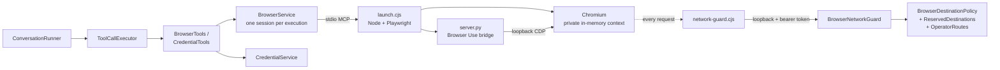
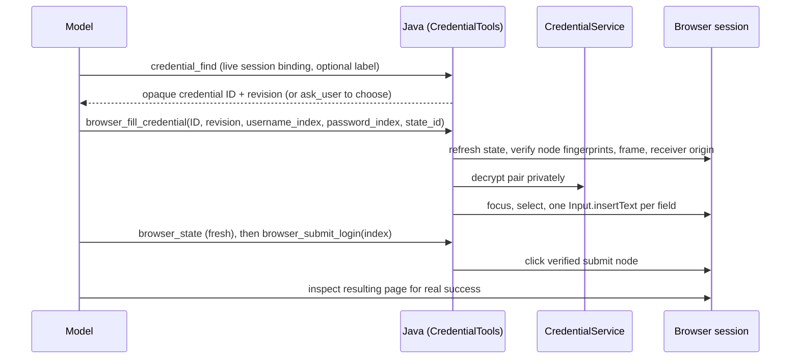

# Browser and saved logins

The `velocity-browser` module gives tasks an isolated, guarded Chromium browser driven by
[Browser Use](https://github.com/browser-use/browser-use) 0.13.10, plus tools that sign in with
credentials saved in the encrypted vault. The task's own model remains the only model loop:
Browser Use supplies DOM observations and actions, never its autonomous agent.

- [Architecture](#architecture)
- [Installation](#installation)
- [Configuration](#configuration)
- [Tools](#tools)
- [Observations and outcomes](#observations-and-outcomes)
- [Reading whole pages](#reading-whole-pages)
- [Sessions](#sessions)
- [Network boundary](#network-boundary)
- [Saved website credentials](#saved-website-credentials)

## Architecture



- Java (`agent/browser/`) owns identity, authorization, deadlines, durable calls, credentials,
  redaction and cleanup.
- `runtime/browser-use-runtime/` (installed separately) contains the Node launcher, the network
  hook and the Python bridge. Node only provisions Chromium and forwards every request to Java
  for a decision; Python only runs Browser Use.
- The runtime receives no model API keys, ignores `.env`, disables telemetry, downloads,
  extensions and recordings.

## Installation

Python 3.11+, Node.js 22.12+. From the repository root:

```powershell
# Windows
.\runtime\browser-use-runtime\setup.ps1 -Python python
npm ci --prefix runtime/browser-use-runtime
npm --prefix runtime/browser-use-runtime run install-browser
```

```sh
# Linux / macOS
python3 -m venv runtime/browser-use-runtime/.venv
runtime/browser-use-runtime/.venv/bin/python -m pip install -r runtime/browser-use-runtime/requirements.txt
npm ci --prefix runtime/browser-use-runtime
npm --prefix runtime/browser-use-runtime run install-browser   # or install-browser-with-deps
```

Install as the OS account that runs Velocity (or set `PLAYWRIGHT_BROWSERS_PATH` consistently).
Tasks never install packages or browsers. A virtual environment cannot be moved; recreate it.
Restart Velocity after installing, and start a **new** task — existing tasks keep the tool
contracts they were admitted with.

## Configuration

```properties
AGENT_BROWSER_ENABLED=true
AGENT_BROWSER_HEADLESS=true
AGENT_BROWSER_NODE_EXECUTABLE=node
AGENT_BROWSER_PYTHON_EXECUTABLE=C:/path/to/velocity/runtime/browser-use-runtime/.venv/Scripts/python.exe
AGENT_BROWSER_LAUNCHER_SCRIPT=runtime/browser-use-runtime/launch.cjs
AGENT_BROWSER_ALLOWED_HOSTS=
AGENT_BROWSER_PRIVATE_ORIGINS=
```

Use forward slashes in `.env`. The checked-in default is enabled and **headed**
(`AGENT_BROWSER_HEADLESS=false`); set both explicitly. The browser has no separate timeouts:
every operation uses the task's remaining deadline. Chromium starts lazily on first use, so the
System screen's `not_checked` means "configured, not yet launched".

## Tools

All browser tools are trusted, execution-scoped, serialized and non-cacheable.

| Tool | Operation |
| --- | --- |
| `browser_navigate` | Open an HTTP(S) URL; creates the session when none exists. Returns fresh state. |
| `browser_state` | Fresh native DOM text with element indices and a new `state_id`. |
| `browser_read_page` | Stable rendered text of the whole page or a named section, paginated. |
| `browser_click` | Click `index` from the current `state_id`. |
| `browser_type` | Replace text in a field (`index`, `state_id`). Password and file fields are refused. |
| `browser_select_option` | Choose option `text` (`index`, `state_id`). |
| `browser_scroll` | One viewport up or down. |
| `browser_press_key` | A key press; with private or unknown focus only navigation keys are allowed. |
| `browser_navigate_back` | Back in the current tab. |
| `browser_tabs` | List, open (`url`) or select/close (`page_id`) tabs. |
| `browser_wait_for` | Wait up to `time` seconds within the deadline. |
| `browser_close` | Release the browser. |
| `browser_screenshot` | PNG of the current page, saved as an output file and staged for delivery. [Screenshots](#screenshots). |
| `credential_find`, `browser_fill_credential`, `browser_submit_login` | [Saved logins](#saved-website-credentials). |

Not available: screenshots as model input, coordinate clicks, uploads, downloads, console or
network inspection, arbitrary JavaScript, imported profiles. Monitoring runs may navigate, read,
wait and manage existing tabs only; delegated children get only their profile's tools.

## Observations and outcomes

- Results carry `session_id`, `generation`, `state_id`, URL, title, indexed text and
  `content_trust: untrusted_data`. Copy IDs exactly.
- Indexed actions require the **current** `state_id`; every action invalidates it. Actions return
  fresh state when they can, saving a round trip.
- Text is bounded by the task's `output-preview-chars` allowance. A truncated observation
  authorizes no indices.
- Dispatch intent is saved before the bridge runs. Timeout, cancellation or connection loss after
  an action leaves an **uncertain** outcome: the session is discarded and the action is never
  replayed. Clicks, typing, Enter and even navigation can cause remote writes.
- `action_outcome: completed` with `code: state_unavailable` means the action ran but the follow-up
  read failed — inspect, don't repeat.

## Reading whole pages

`browser_read_page` reads rendered text beyond the viewport after content is stable for 750 ms.
Pass the current session binding, an optional plain `section` label (for example `Description`)
and `limit` (1–24,000, default 12,000). Continue with the returned `source_id` and `next_offset`
until `has_more` is false. `coverage` is `ok`, `partial`, `truncated`, `missing` or `blocked`
and describes the source, not the pagination. One immutable redacted source is kept per session;
any other browser operation invalidates it.

`coverage_note` says what the status rests on. The runtime inspects every closed `details`
element and every `aria-expanded="false"` toggle inside the content root (up to 50 per root). A
widget whose hidden part (the `details` body, the `aria-controls` targets, or its own hidden
descendants) contains text other than links, options, menu items and other controls is a
*collapsed section* with unread text; one that hides only controls, such as a filter or menu
dropdown, is a *collapsed control* and does not change the status. The note counts both kinds,
quotes up to five labels (`summary` text, `aria-label` or visible text), counts visible embedded
frames, objects and canvases, and states whether a loading indicator was present. `partial`
therefore means that unread sections, embedded content or a loading indicator remained, that a
heading-inferred section boundary is uncertain, or that several regions matched the requested
section; a page whose only collapsed elements are dropdowns reads `ok` with the dropdowns named.

## Screenshots

`browser_screenshot` asks the runtime for a CDP `Page.captureScreenshot` of the owned current page
(`full_page: true` captures beyond the viewport). Java checks the PNG signature and the
`agent.research.max-output-file-bytes` ceiling, saves the bytes as an `output` research artifact
(`f_…`) and stages it through the same receipt rule as `task_attach_report`, so the file is
uploaded to the Slack thread after the final answer and is downloadable from the task page. The
image is never returned to the model: the result carries only the saved file's metadata, the
page URL and title. A page whose origin received a saved credential pair is refused
(`credential_capture_denied`) because pixels cannot be redacted. Capturing is a read; the current
`state_id` stays valid. Not available to monitoring runs or delegated children.

## Sessions

- One stdio process and one private, memory-only Chromium context per execution; nothing is shared
  across executions or accounts.
- Sessions survive `waiting_for_user`. Terminal completion, cancellation, deletion, process loss
  and shutdown release them. They are not restored after restart.
- The disk profile under `target/browser-use/` exists only to provision CDP; pages never use it.

## Network boundary

`BrowserDestinationPolicy` is the single owner of destination rules. The Node hook forwards
every request, redirect hop, popup, frame, worker request and WebSocket handshake/frame to
`BrowserNetworkGuard`, which fails closed.

Rules, in order:

1. Only HTTP(S) URLs with canonical hosts (no trailing dots, odd numeric IPv4 forms, zone IDs,
   underscores or non-ASCII; use punycode).
2. **Reserved destinations** are always blocked: hosts a loaded feature keeps for its own
   server-owned integration (`ReservedDestinationPolicy`). Nothing is reserved by default.
3. **Operator routes** of this Velocity instance are always blocked.
4. If `allowed-hosts` is set, the host must be listed exactly.
5. Private, loopback, link-local, special-purpose and internal-suffix destinations are blocked
   unless the exact origin is in `private-origins`.

Documents get CSP `worker-src http: https:` and worker bootstraps `connect-src http: https:`, so
blob/data workers and worker WebSockets are blocked. Java's DNS view can differ from Chromium's;
for hard isolation use a dedicated OS account and controlled egress.

## Saved website credentials

The **Secrets** screen stores account-owned username/password pairs, encrypted with
`AGENT_SECRETS_KEY` (see [security — encryption at rest](security.md#encryption-at-rest)). The
agent can find a saved account and ask Java to fill and submit it; there is no way to read a
password back through any tool or API.

Setup:

```properties
AGENT_SECRETS_ENABLED=true
AGENT_SECRETS_KEY=<base64 of 32 random bytes>
AGENT_SECRETS_KEY_ID=primary
AGENT_SECRETS_PREVIOUS_KEYS=
AGENT_BROWSER_ENABLED=true
```

Each record has a service name, an agent-visible account label (no secrets), the pair, and exact
HTTPS origin lists (≤ 16 each):

| Field | Purpose |
| --- | --- |
| `application_origins` | Identifies the site for discovery. Does not permit sending the pair. |
| `credential_origins` | **Required.** Exact origins allowed to receive the pair (including a separate identity provider). |
| `callback_urls`, `resource_origins`, `post_login_origins` | Metadata; ordinary traffic still follows the browser policy. |

Login flow:



- `credential_find` outcomes: one match, several (the model must `ask_user`), `account_not_found`
  for an explicit unmatched label, `no_credentials`, or disabled/deleted/stale states.
- Requests carrying known pair values in a body or header must go to an exact saved credential
  origin; values in URLs are always rejected.
- Pair values never appear in tool arguments, results, logs, diagnostics or artifacts; known
  values and common encodings are redacted from later observations.
- Filling and submitting are mutations: an uncertain submission is never retried. Its safe
  `diagnostic` (phase `command_dispatch` or `submit_click`, reason codes such as
  `deadline_exceeded`) helps inspection but never authorizes a repeat.
- Monitoring and delegated children cannot use credentials. MFA and CAPTCHA may need a human.
- Iframe login fields are unsupported.

Vault API and storage: see [operator API — secrets](operator-api.md#secrets) and
[data and storage](data-storage.md). Records live in `agent_credentials` (AES-256-GCM, authenticated
against owner, record, revision and policy), use audit in `agent_credential_audit`. Limits:
`max-records` 100 and `max-receipts` 4096 per account.

**Key rotation.** Move the current key into `AGENT_SECRETS_PREVIOUS_KEYS` under its old ID, set a
new key and new ID, restart, then re-save each record to re-encrypt it. Keep old keys until no
record or backup needs them. A lost key cannot be recovered; affected pairs must be re-entered.
