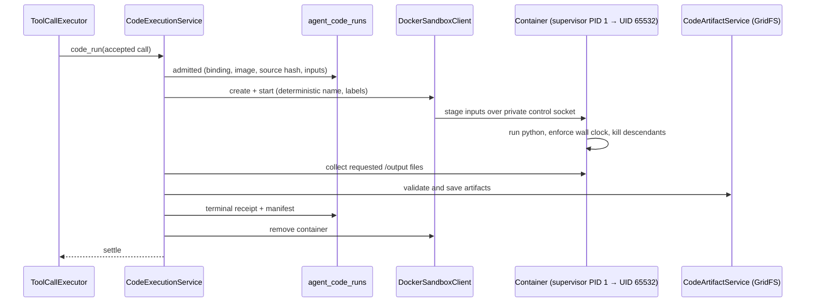

# Python code execution

The `velocity-code-execution` module adds the `code_run` tool: a Python program runs in a fresh,
network-less Docker container built from `runtime/code-execution-runtime/`, can read explicitly
imported task artifacts, and saves requested output files as downloadable artifacts. It also
contributes the bundled **PDF** and **Excel** skills.

The feature is enabled in `application.properties` but stays `unconfigured` until an image and
installation ID are set. There is no host-Python fallback.

- [Architecture](#architecture)
- [Install the runtime](#install-the-runtime)
- [Configure](#configure)
- [The code_run tool](#the-code_run-tool)
- [Limits](#limits)
- [Isolation](#isolation)
- [Durability and recovery](#durability-and-recovery)
- [PDF and Excel skills](#pdf-and-excel-skills)
- [Troubleshooting](#troubleshooting)

## Architecture



A gateway **settlement check** keeps a task unsettled while its sandbox is unconfirmed, and a
**deletion barrier** requires verified sandbox removal before task data is deleted.

## Install the runtime

Docker Engine with Linux containers (cgroup v2 CPU/memory/PID limits, default seccomp). From the
repository root:

```sh
docker build --platform linux/amd64 -t velocity-code-python:v3 runtime/code-execution-runtime
docker image inspect --format '{{.Id}}' velocity-code-python:v3
docker image inspect --format '{{index .Config.Labels "net.velocity.code.profile"}}' velocity-code-python:v3
```

The profile label must be `velocity-python-v3`: Python 3.12.12, pandas 2.3.3, NumPy 2.3.4,
matplotlib 3.10.7, openpyxl 3.1.5, pypdf 6.10.0, pdfplumber 0.11.9, ReportLab 4.4.9,
pypdfium2 5.13.0. Wheels are hash-verified. No OCR, Poppler, office suite or formula
recalculation is included.

## Configure

```properties
AGENT_CODE_EXECUTION_ENABLED=true
AGENT_CODE_EXECUTION_IMAGE=sha256:<64 hex digits from docker image inspect>
AGENT_CODE_EXECUTION_INSTALLATION_ID=velocity-local-worker
AGENT_CODE_EXECUTION_DOCKER_EXECUTABLE=docker
```

- The image must be an immutable `sha256:` ID or `repository@sha256:` digest; tags fail startup.
- The installation ID (8–64 lowercase letters, digits, hyphens) labels containers for exact
  cleanup. Keep it stable and unique per installation.
- Keep the JVM and Docker clocks in sync (250 ms tolerance is checked before dispatch).
- Disabled: no Docker contact and no recovery worker.

## The code_run tool

```json
{
  "code": "import pandas as pd\ndf = pd.read_csv('/input/sales.csv')\ndf.groupby('region')['amount'].sum().to_csv('/output/summary.csv')",
  "input_artifacts": [{"artifact_id": "<current task artifact>", "filename": "sales.csv"}],
  "output_files": ["summary.csv"]
}
```

- Only `code` is required; `language` can only be `python`.
- Inputs are artifacts of **this task** (files attached to the request, earlier code outputs,
  research documents, evidence, reports, text artifacts). They appear read-only under `/input`.
- Write deliverables to `/output`; only listed names are exported. Allowed types: CSV, TSV,
  TXT/log, Markdown, JSON, PNG, JPEG, XLSX, PDF; binary signatures are checked.
- Filenames: simple ASCII ≤ 100 characters, no paths or reserved names.
- Result: `run_id`, `status`, optional `exit_code`, bounded `stdout`/`stderr` with truncation
  flags, `duration_ms`, `output_artifacts` (size, checksum, media type), `failure_code`.
- A zero exit does not prove every file was saved; check `output_artifacts`.
- To send an output artifact to the requester (a chart PNG, an exported CSV), the model passes
  its `artifact_id` as `source_id` to `task_attach_file`; the module's `OutputFileSource` bean
  copies the bytes into a staged output file. See [agent runtime](agent-gateway.md#core-tools).
- Each run is a fresh interpreter: no network, no packages, no shell, no persistent state.
- Registered as a trusted `system.execute` mutation; excluded from monitoring and delegation.

## Limits

Fixed in code, not configurable:

| Boundary | Limit |
| --- | --- |
| Active sandboxes / queue | 1 / 4 per installation |
| Time | Remaining task deadline (queueing and staging included) |
| CPU / memory / processes | 1 CPU / 512 MiB / 64 |
| Writable storage | 128 MiB tmpfs |
| Source | 64 KiB |
| Retained stdout, stderr | 64 KiB each (≤ 2,048 characters each shown to the model) |
| Inputs, exports | 10 files each; 10 MiB per file, 25 MiB total |

## Isolation

- Network mode `none`, read-only root filesystem, no host mounts, no Docker socket, no `.env`,
  no Velocity environment, Docker logging off.
- Generated code runs as UID 65532 with no capabilities and no privilege escalation. The PID 1
  supervisor keeps only `SETUID`, `SETGID`, `KILL`, `DAC_READ_SEARCH` to drop identity, kill the
  whole process tree and read outputs after settlement. Its control socket is unreachable from
  the guest.
- Output files are opened without following links; links, devices, FIFOs and oversize files are
  rejected. Java computes sizes and checksums.
- Containers share the host kernel. For stronger isolation run Velocity and its Docker daemon on a
  dedicated, patched VM.

## Durability and recovery

- `agent_code_runs` journals `admitted → creating → running → collecting → terminal` (or
  `uncertain`) plus a cleanup flag. One launch per accepted call is enforced by unique indexes.
- The terminal receipt and committed artifact manifest are saved before the call settles; the
  container is removed afterwards.
- At startup and every five seconds, `CodeExecutionService` reconciles only journal-backed
  containers with matching labels: runs never dispatched fail as `interrupted_before_dispatch`;
  others are inspected and terminated. Missing evidence stays uncertain. **Code is never re-run.**
- Cancellation stops the guest tree and requires termination evidence; without it the run stays
  uncertain and the task stays unsettled.
- Artifacts live in GridFS `agent_code_files` and follow task deletion.

Console: **Tasks → Code & files**, backed by `/api/operator/tasks/{id}/code-runs`, `/artifacts`
and `/artifacts/{artifactId}/download` (attachment, `nosniff`, sandbox CSP, `no-store`).

## PDF and Excel skills

`CodeExecutionConfiguration` contributes two bundled skills, `pdf` ("Velocity PDF documents") and
`xlsx` ("Velocity Excel workbooks"), each with core instructions and a `workflow-example` reference
written for Velocity. Install them from **Knowledge → Skills → Browse built-in skills**, then start a
new task. Installing a skill grants no tools; the workflows need `code_run` to be configured.

## Troubleshooting

| Status | Action |
| --- | --- |
| `unconfigured` | Build the image and set its immutable ID and an installation ID. |
| `unavailable` | Check Linux container mode, Docker permissions, image/profile, cgroups, seccomp. |
| `cleanup_required` / uncertain | Restore the same Docker backend, image and installation ID and let recovery run. Never delete journals or prune containers by name prefix. |

Let all runs and cleanup settle before changing the image, installation ID or daemon.
