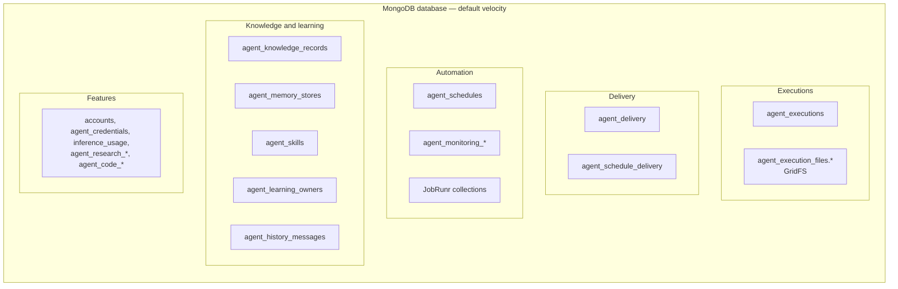

# Data and storage

MongoDB is the authoritative store for everything Velocity persists; nothing lives on the
filesystem. This guide lists every collection, explains the execution document, and covers
backups and the snapshot-format wipe.

- [Storage map](#storage-map)
- [Collections](#collections)
- [The execution document](#the-execution-document)
- [Snapshot format](#snapshot-format)
- [Backup and restore](#backup-and-restore)

## Storage map

## Collections

| Collection | Owner module | Contents | Rebuildable? |
| --- | --- | --- | --- |
| `accounts` | core | Account UUID ↔ Slack workspace/user. | No |
| `agent_executions` | core | Execution snapshot, correction inbox, receipts and deletion tombstones (one document per task). | No |
| `agent_execution_files` (GridFS `.files`, `.chunks`) | core | Full tool outputs, diagnostics, artifacts. | No |
| `agent_delivery` | core / Slack | Per-execution Slack delivery journal (intents, receipts, offsets). | No |
| `agent_schedule_delivery` | core / Slack | Journal for scheduled and monitoring Slack posts. | No |
| `agent_schedules` | core | Schedule definitions and recent occurrence history. | No |
| `agent_monitoring_jobs`, `_runs`, `_observations`, `_updates` | core | Monitoring objectives, check runs, findings and notifications. | No |
| `agent_knowledge_records` | core | Account datasets and records; `data_delete` removes a document outright (no tombstone, keys may be reused). | No |
| `agent_memory_stores` | core | User and environment facts, the derived profile (target `profile`), proposals, receipts. | No |
| `agent_skills` | core | Versioned skills, usage telemetry, curator proposals and install receipts (store format 2; a format 1 document is upgraded on read with empty usage and no proposals, and rewritten by its next change, no wipe). | No |
| `agent_learning_owners` | core | Learning review journal and cadence state. | No |
| `agent_history_messages` | core | Searchable projection of execution messages. | **Yes**, from executions |
| `agent_credentials`, `agent_credential_audit` | core | Encrypted saved logins; use audit. | No |
| `agent_research_files` (GridFS), `agent_research_controls` | core | Execution-owned evidence, documents, reports, requester-attached files and output files (screenshots, written or copied files staged for delivery); request budgets and tombstones. | No |
| `inference_usage` | core | Usage ledger with pinned prices. No TTL. | No |
| `agent_code_runs`, `agent_code_controls` | code execution | Code run bindings, lifecycle, receipts; deletion controls. | No |
| `agent_code_files` (GridFS), `agent_code_artifact_controls` | code execution | Generated files; upload intents and tombstones. | No |
| JobRunr collections | JobRunr | Jobs and recurring jobs (database `jobrunr.database.database-name`). | Recreated by reconciliation, but back up with the rest |

## The execution document

One `agent_executions` document holds a task's whole durable state:

| Area | Fields (abridged) |
| --- | --- |
| Identity | `executionId`, `conversationId`, `scope` (`TrustedScope`), `sourceTurn`, `purpose`, `continuedFrom`, `formatVersion` |
| Inference | `inference: {binding, fallback, transition, compact}` |
| Conversation | native `messages`, `sourceMessages`, `admissionContext` (frozen instructions, tool contracts, memory and skills) |
| Calls | accepted `calls` with state `accepted` → `dispatched` → `settled`, bindings, artifact references |
| Control | `status`, `pendingQuestions`, `goalGeneration`, `deliveryTurn`, `cancellationRequested`, consumed inbox IDs |
| Budget | `limits`, `activeMillis`, usage checkpoints, `queueSequence`, `queuedAt`, `partialReporting` |
| Results | `finalAnswer`, `taskOutcome`, `outputReports`, `failure`, `blockers` |
| Children | `childRuns` for `delegate_work` |
| Concurrency | `revision`, `createdAt`, `updatedAt` |

The snapshot, its inbox and its receipts must fit MongoDB's 16 MiB BSON limit. Large outputs go
to GridFS and do not count. Oversized writes fail; there is no filesystem fallback.

## Snapshot format

Only snapshot **format 5** is readable. `continuedFrom` was added to format 5 as an optional
field: executions saved before it decode with `null`, so it needs no wipe. A continuation's
document also carries `continuedFrom` at the top level for lookup; deletion tombstones drop it. A document in any other format fails as corrupt state,
and because admission, recovery and task lists enumerate every execution, one old document makes
them fail.

To move a database that holds another format to this build:

1. Stop Velocity and make sure nothing is in flight: no execution `running` or `waiting_for_user`,
   and no occurrence in `agent_schedules` with outcome `running` (monitoring uses the same
   schedules).
2. Back up the database.
3. Delete `agent_executions`, `agent_execution_files.files` and `agent_execution_files.chunks`.
4. Start the new build.

The wipe also deletes deletion tombstones, which is why step 1 matters: an occurrence still
`running` would be admitted again under the same ID and could repeat external effects. Delivery
journals, the history projection and learning entries keep dangling execution IDs; that is
harmless.

## Backup and restore

- Back up the **whole MongoDB database** (including JobRunr collections) as one consistent
  snapshot. Schedule state and JobRunr jobs must match.
- Back up `.env` encryption keys (`AGENT_SECRETS_*`) separately with
  restricted access. Without them encrypted records cannot be read; with them alone there is
  nothing to read.
- Restore into one Velocity process only. Two processes sharing a database break worker and queue
  coordination.
