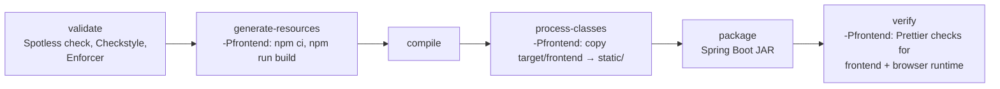

# Development

How to build, format and verify changes. Repository rules for contributors (human and agent)
are in [AGENTS.md](../AGENTS.md).

- [Toolchain](#toolchain)
- [Build commands](#build-commands)
- [Formatting](#formatting)
- [Verification policy](#verification-policy)
- [Frontend development](#frontend-development)
- [Working on the runtime](#working-on-the-runtime)

## Toolchain

| Tool | Version / source |
| --- | --- |
| JDK | 25 |
| Maven | checked-in wrapper (`sh ./mvnw`, `.\mvnw.cmd`) |
| Spring Boot | 4.1.1 (parent POM) |
| Node.js / npm | 22.12+ for the console and the browser runtime |
| Prettier | 3.6.2, pinned in `frontend/package.json` |
| Spotless + Eclipse JDT 4.37 | Java and POM formatting, `config/eclipse-formatter.xml` |
| Checkstyle 14.3.0 | required braces, `config/checkstyle.xml` |
| Ruff | pinned in `requirements-dev.txt`, configured in `ruff.toml` |

The Unix wrapper is committed without the executable bit; run it through `sh`.

## Build commands

```sh
# Compile every module and check Java formatting and braces (no Node needed).
sh ./mvnw compile

# Full release build: console, JAR, all formatting checks.
sh ./mvnw -Pfrontend clean verify

# Include the example feature module in the JAR.
sh ./mvnw -Pexample-feature package

# Frontend only.
npm ci --prefix frontend
npm run typecheck --prefix frontend
npm run format:check --prefix frontend
npm run build --prefix frontend
```

The JAR is `velocity-modules/velocity-app/target/velocity-0.0.1-SNAPSHOT.jar`. Without `-Pfrontend` it has no console.



## Formatting

Rules (also in [AGENTS.md](../AGENTS.md#readable-formatting)): 110-character target; four spaces
for Java and Python, two for JS/TS/JSON/XML/CSS/HTML/YAML; one statement per line; braces on every
Java `if`/`else`/`for`/`while`/`do`; annotations on their own lines; never reflow prompt text, text
blocks, embedded scripts or fixtures. `.editorconfig` and `.gitattributes` (LF) back this up.

```sh
# Java and POMs
sh ./mvnw spotless:apply
sh ./mvnw validate
sh ./mvnw spotless:apply "-DspotlessFiles=.*InferenceService\.java"   # regex on absolute path

# JavaScript / TypeScript
npm run format --prefix frontend
npm run format --prefix runtime/browser-use-runtime

# Python
python -m venv target/formatting-tools
target/formatting-tools/bin/python -m pip install -r requirements-dev.txt
target/formatting-tools/bin/python -m ruff format runtime/browser-use-runtime runtime/code-execution-runtime
```

Spotless fixes layout; add missing braces yourself. The runtime formatting scripts reuse the
frontend's Prettier install. `runtime/browser-use-runtime/rendered_content.js` is deliberately
excluded from Prettier — keep its layout.
Format only files you touch, and keep formatting separate from behavior changes.

## Verification policy

Automated tests have been removed while LLM inference availability is limited. Do **not** write,
restore or generate tests, fixtures, harnesses or test-only dependencies until the user asks.

Validate changes with:

1. `sh ./mvnw compile` (formatting, braces, Enforcer rules, compilation).
2. Frontend typecheck and format check when `frontend/` changes.
3. Ruff check when Python changes.
4. `sh ./mvnw -Pfrontend clean verify` for packaging changes.
5. For documentation-only changes: check commands and settings against source, check relative
   links, and run `git diff --check`.

Report what you ran. A passing build is not passing tests and does not establish runtime
behavior. Do not run live inference or Slack posts for ordinary verification. If a runtime check
is warranted, use a disposable database and the
[isolated settings](startup-and-shutdown.md#safe-isolated-starts), and never overwrite a
developer's `.env`.

## Frontend development

See [operator console — development loops](operator-console.md#development-loops) for Vite with
hot reload and the `console-dev` watched-build profile.

## Working on the runtime

Before changing an area, read its guide:

| Area | Guide |
| --- | --- |
| Gateway, runner, tools, recovery | [agent runtime](agent-gateway.md) |
| Startup, lifecycle, recovery order | [startup and shutdown](startup-and-shutdown.md) |
| Settings | [configuration](configuration.md) |
| Providers and streams | [inference](inference.md) |
| HTTP routes | [operator API](operator-api.md), [security](security.md) |
| Persistence | [data and storage](data-storage.md) |
| New module | [adding a feature](adding-a-feature.md) |

When you change a setting or behavior, update `application.properties`, the configuration
metadata and the matching guide in the same change.
