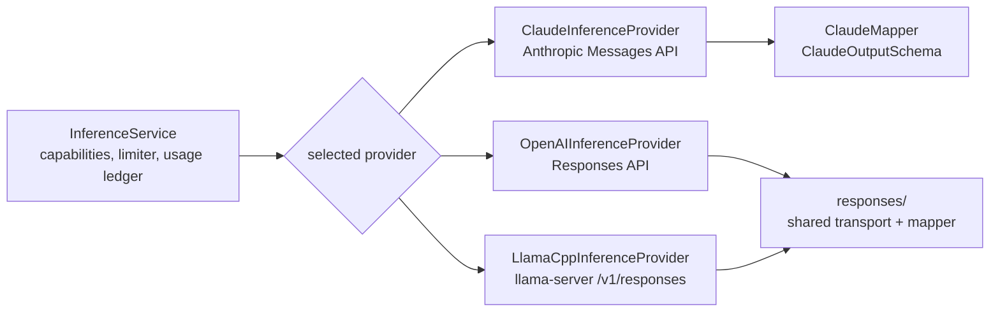
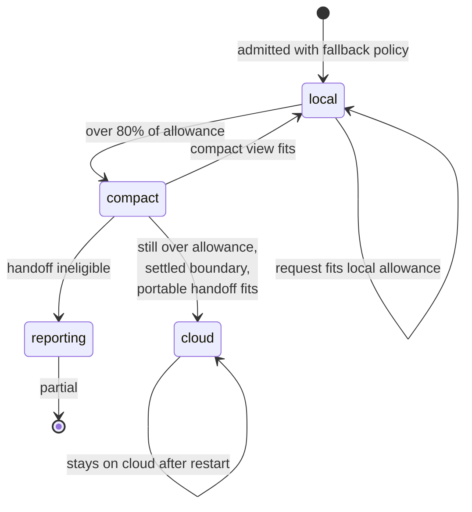

# Inference

Velocity talks to models through one provider-neutral API in `velocity-modules/velocity-core/.../inference/`. This guide
covers provider setup, task-scoped profiles and limits, token counting, cloud continuation,
the Java API for direct callers, and attachment reading.

- [Providers](#providers)
- [Profiles and limits](#profiles-and-limits)
- [Token counting and admission](#token-counting-and-admission)
- [Cloud continuation](#cloud-continuation)
- [Shared request concurrency](#shared-request-concurrency)
- [Using InferenceService directly](#using-inferenceservice-directly)
- [Streaming](#streaming)
- [Provider notes](#provider-notes)
- [Attachment transcription](#attachment-transcription)
- [Usage accounting](#usage-accounting)
- [Prompts](#prompts)

## Providers



`inference.provider` selects exactly one default provider: `claude`, `openai` or `llama-cpp`.
Empty (the default) leaves agent tasks and the playground unavailable while everything else
runs. Only the selected provider's settings are bound and validated and only its SDK client is
created. Spring owns and closes SDK clients; callers own and must close streams.

| Provider | Package | Credential | API |
| --- | --- | --- | --- |
| `claude` | `inference.claude` | `ANTHROPIC_API_KEY` | Anthropic Messages via `anthropic-java` |
| `openai` | `inference.openai` | `OPENAI_API_KEY` | OpenAI Responses via `openai-java` (`store=false`) |
| `llama-cpp` | `inference.llamacpp` | optional `LLAMA_CPP_API_KEY` | llama-server's OpenAI-compatible `/v1/responses` |

SDK automatic HTTP retries are disabled for generation and streaming. One usage record
represents one actual dispatch.

Generation classifies temporary failures as `TransientInferenceException` with a safe code; the
provider's error body is never kept:

| Failure | Code | Usage record |
| --- | --- | --- |
| HTTP 429 | `provider_rate_limited` | Settled at zero tokens |
| HTTP 503 or 529 | `provider_overloaded` | Settled at zero tokens |
| HTTP 408, 500, 502 or 504 | `provider_server_error` | Settled at zero tokens |
| Dropped connection (not a timeout or interrupt) | `provider_connection_failed` | Stays uncertain |

A numeric `Retry-After` header (capped at 60 seconds) travels with the exception. Count requests
mark the same failures as transient on `InputTokenCountException`. The task runner decides
whether to retry; see [agent runtime — the run loop](agent-gateway.md#the-run-loop).

## Profiles and limits

Agent tasks never use "whatever is configured now". At admission a task pins an
`InferenceBinding` to a named profile in `InferenceProfileRegistry`:

| Profile | Created when | Used by |
| --- | --- | --- |
| `default` | A provider is selected | Every new task, the playground, learning, attachment reading. |
| `cloud-fallback` | `inference.cloud-fallback.enabled=true` | Only llama.cpp tasks admitted while it was configured. |

A profile records provider, model, context capacity, input allowance, output allowance
(`max-tokens`), safety margin and a deterministic configuration fingerprint. A request may lower its
own output allowance: agent turns send the allowance they reserved, so a monitoring check's
`agent.monitoring.output-reserve` caps its turns below `max-tokens`. If the profile a
task is pinned to disappears or changes, recovery blocks the task with
`inference_profile_unavailable` or `inference_profile_incompatible` rather than sending saved
provider-native history to a different model.

The three primary limits are required whenever a provider is selected:

| Setting | Meaning |
| --- | --- |
| `INFERENCE_PRIMARY_INPUT_ALLOWANCE` | Maximum input per request, measured as the provider's own token count plus 2,048 tokens of headroom. |
| `INFERENCE_PRIMARY_CONTEXT_CAPACITY` | The model or server slot's context window. `0` means undeclared. |
| `INFERENCE_PRIMARY_SAFETY_MARGIN` | Unused reserve. |

A positive capacity must satisfy `input allowance + max tokens + safety margin ≤ capacity`.
Use the server's actual per-slot context, which can be smaller than the model's advertised
maximum:

```properties
INFERENCE_PROVIDER=llama-cpp
LLAMA_CPP_BASE_URL=http://127.0.0.1:8080/v1
LLAMA_CPP_MODEL=local-model
LLAMA_CPP_MAX_TOKENS=40000
INFERENCE_PRIMARY_CONTEXT_CAPACITY=140032
INFERENCE_PRIMARY_INPUT_ALLOWANCE=90000
INFERENCE_PRIMARY_SAFETY_MARGIN=10000
```

`90000 + 40000 + 10000 = 140000 ≤ 140032`. `*_MAX_TOKENS` is the output budget, not the
context window.

## Token counting and admission

Before each model turn the runner counts the exact mapped request — messages, native blocks,
instructions and tool schemas — with the provider's native endpoint:

| Provider | Count endpoint |
| --- | --- |
| OpenAI, llama.cpp | `POST {base}/responses/input_tokens` (llama.cpp: `/v1/responses/input_tokens`) |
| Claude | `POST /v1/messages/count_tokens` |

Count plus 2,048 headroom must fit the active profile's input allowance. A count request does
not generate output, does not count as a model turn and creates no billed usage record. A
missing or failing count endpoint fails the task before generation, after the runner's
transient-failure retries; there is no byte-based fallback for built-in providers. (Custom providers without counting use one unit per UTF-8
byte plus 2,048.)

Task inference — counting, queue waits, generation and streaming — runs inside the task's
remaining deadline (`InferenceDeadlineScope`). Calls outside a task keep a ten-second count
timeout and the configured queue wait.

The llama.cpp client retires idle pooled connections after three seconds (before
llama-server's five-second keep-alive) and may reconnect once for a count request after an EOF.

## Cloud continuation

Cloud continuation lets a **new llama.cpp task** switch once, one way, to a hosted OpenAI or
Claude profile when a request exceeds the local input allowance.



- Enabled by default (`INFERENCE_CLOUD_FALLBACK_ENABLED=true`). While enabled, startup
  requires `INFERENCE_CLOUD_FALLBACK_PROVIDER`, `_MODEL`, `_CONTEXT_CAPACITY`,
  `_INPUT_ALLOWANCE`, `_OUTPUT_RESERVE`, `_SAFETY_MARGIN` and the hosted API key. Set
  `INFERENCE_CLOUD_FALLBACK_ENABLED=false` if you do not use it.
- Only overflow triggers it. Authentication, connectivity, rate-limit and uncertain provider
  failures never switch providers, and there is no provider chain.
- The switch happens at a settled request boundary. Before the first cloud request the task
  persists the reason, source boundary and exact portable request. It then stays on cloud,
  including after restart.
- The portable handoff carries visible user and assistant text, corrections and settled tool
  outcomes. Provider reasoning, signatures, encrypted state and opaque blocks are excluded;
  images, documents or unknown native content make the task ineligible (`unsupported_content`).
- Nothing resets: deadline, token ceiling, usage, counters, identity and frozen tools carry
  over. Cloud requests resend history and can reach the 5,000,000-token default ceiling
  quickly; raise `AGENT_LIMITS_TASK_TOKEN_CEILING` deliberately.
- Enabling it sends task content (including tool outputs and frozen memory) to a paid API.
- Disabling it later does not move cloud tasks back; tasks pinned to the removed profile block.

Example with OpenAI GPT-6 Luna (1,050,000-token context, 128,000 max output, as checked on
2026-09-28):

```properties
INFERENCE_CLOUD_FALLBACK_ENABLED=true
INFERENCE_CLOUD_FALLBACK_PROVIDER=openai
INFERENCE_CLOUD_FALLBACK_MODEL=gpt-6-luna
INFERENCE_CLOUD_FALLBACK_CONTEXT_CAPACITY=1050000
INFERENCE_CLOUD_FALLBACK_INPUT_ALLOWANCE=1000000
INFERENCE_CLOUD_FALLBACK_OUTPUT_RESERVE=40000
INFERENCE_CLOUD_FALLBACK_SAFETY_MARGIN=10000
AGENT_LIMITS_TASK_TOKEN_CEILING=20000000
```

Verify current model limits and account access before choosing values.

## Shared request concurrency

All configured `InferenceService` instances share one `InferenceRequestLimiter`:

| Setting | Default |
| --- | --- |
| `inference.concurrency.max-requests` | 4 concurrent requests (counting, generation, open streams) |
| `inference.concurrency.queue-capacity` | 100 FIFO waiters |
| `inference.concurrency.max-wait-millis` | 30,000 ms for standalone callers |

Overflow fails before dispatch with `inference_queue_full` or `inference_queue_timeout`. A
stream holds its permit until closed. Embedders constructing their own `InferenceService` must
pass the shared limiter to get one pool.

## Using InferenceService directly

Inject `InferenceService`; shared types are in `net.velocity.inference.objects`.

```java
String answer = inference.infer("Explain this code.");

InferenceRequest request = InferenceRequest.webSearch("Compare the two approaches.")
        .withSystemPrompt("Prefer official documentation and cite your sources.");
InferenceResponse response = inference.infer(request);
```

| Factory | Enables |
| --- | --- |
| `text(input)` | Plain generation |
| `structuredOutput(input, schema)` | JSON constrained by a schema |
| `webSearch(input)` | Provider web search |
| `adaptiveThinking(input)` | Reasoning |
| `computerUse(input, screenshot)` / `computerUse(history)` | Computer-use tool proposals |

Features compose with `withWebSearch()`, `withAdaptiveThinking()`, `withComputerUse()` and
`withOutputSchema(schema)`. Instructions are chosen explicitly with
`withPromptPreset(PromptPreset.X)` (`STRUCTURED_EXTRACTION`, `WEB_RESEARCH`,
`SPECIFICATION_REVIEW`, `COMPUTER_USE`) or `withSystemPrompt(...)`; presets never enable
features. For full control use `new InferenceRequest(history, systemPrompt, options)`.

`inference.capabilities()` lists what the selected adapter implements. Requests needing a
missing capability fail with `UnsupportedOperationException` before dispatch.

Message content is portable `InferenceContent`: `Text`, `Image` (PNG, JPEG, GIF, WebP; needs
`VISION`) and `Document` (PDF bytes sent to the provider as a native document — a Claude
`document` block or an OpenAI Responses `input_file` — with no local rendering; needs
`DOCUMENT`, which Claude and OpenAI implement and llama.cpp does not), plus tool calls, results
and provider-native blocks.

Schemas and JSON metadata are plain Java maps and lists — no SDK types leak out.

An output schema uses the bounded `JsonSchema` dialect (`type`, `properties`, `required`,
`additionalProperties`, `items`, `enum`, `minimum`/`maximum`, `minLength`/`maxLength`,
`minItems`/`maxItems`, `description`, `title`). A provider may enforce fewer of those
constraints than the schema states (see the Claude note below), so a caller parses the response,
bounds any value the provider could have left unbounded, and validates the result against its
full schema with `JsonSchema.validate`. The request's schema is never rewritten for the caller.

## Streaming

Always close the stream:

```java
try (InferenceStream stream = inference.stream(request)) {
    stream.events().forEach(event -> {
        if (event.type() == InferenceEvent.Type.TEXT_DELTA) {
            System.out.print(event.delta());
        }
        if (event.type() == InferenceEvent.Type.COMPLETE) {
            InferenceResponse done = event.response();
            // Check done.stopReason() before parsing structured output.
        }
    });
}
```

`COMPLETE` carries the assembled response, stop reason and usage. Incomplete terminal
responses still emit `COMPLETE` with partial output; failures and streams that end without a
terminal event throw.

## Provider notes

**Responses content and history.** `ProviderBlock` preserves content with no common shape
(reasoning items, search calls, computer calls, messages with citations). Replay such blocks
only to their originating provider; cross-provider blocks are rejected before dispatch.
`InferenceResponse.text()` is the readable text; `content()` and `toMessage()` keep everything
needed for replay.

**OpenAI.** Sends the full history with `store=false`, requests encrypted reasoning, never uses
`previous_response_id`. Structured output uses `text.format` with `strict=true`; adaptive
thinking maps to `reasoning.effort=medium`, `summary=auto`.

**Claude.** `max-tokens` is the output budget. The Anthropic SDK can reject large non-streaming
budgets before sending; use streaming for long outputs.

Structured output sends the schema as `output_config.format`. The Messages API rejects size,
range and pattern constraints in that schema with a 400 — `minLength`, `maxLength`, `pattern`,
`minimum`, `maximum`, `exclusiveMinimum`, `exclusiveMaximum`, `multipleOf`, `minItems`,
`maxItems`, `uniqueItems` and `format` values other than `date-time`, `time`, `date`,
`duration`, `email`, `hostname`, `uri`, `uuid`, `ipv4` and `ipv6` — and the Java SDK sends the
schema verbatim (the Python and TypeScript SDKs strip them). The adapter therefore removes those
keywords from the wire schema (`ClaudeOutputSchema`) for generation, streaming and
`count_tokens` alike, walking nested `properties`, `items`, `additionalProperties`,
`anyOf`/`allOf`/`oneOf` and `$defs`; `type`, `required`, `enum`, `const`, descriptions and
`additionalProperties: false` are kept. The request's own schema is unchanged, so callers must
validate the parsed response against it client-side and bound any value a stripped keyword would
have limited. Shapes the API still rejects, such as `additionalProperties` other than `false` or
recursive references, fail the request explicitly.

### Prompt caching

With `inference.claude.prompt-caching` (default `true`), every Claude request, including token
counts and the Claude cloud continuation, carries three ephemeral cache breakpoints: on the
system prompt, on the last tool definition and on the last cacheable block of the latest
message (thinking blocks are skipped). Tools, system prompt and conversation form the cached
prefix in that order, so each model turn of an agent loop reads everything up to the previous
turn from the cache and pays the cached-read rate for it. The markers exist only in the outgoing
request; persisted messages are unchanged. Prefixes shorter than the provider's minimum (1,024
tokens on most models) are simply not cached. Cache read and creation tokens are reported in
`Usage`, priced through `usage.prices[]` and visible in the `velocity.inference.tokens` metric
([observability](observability.md#metrics)).

**llama.cpp.** Requires a llama-server build with `/v1/responses` and
`/v1/responses/input_tokens`. Include `/v1` in the base URL. Structured output uses the
server's top-level `json_schema` extension. Web search and computer use are rejected. Some
servers report `completed` at the token limit, so validate structured output.

**Agent tools.** Tasks advertise Java tools as ordinary function tools. Browser automation
uses text observations; provider-native computer-use and screenshots are never registered for
tasks.

## Attachment transcription

Research attachments and files the requester attached to the task (`task_file_open`) are read
through the **owning task's active pinned profile**, charged to the task's usage. There is no
separate file model: an attached file is an `upload` artifact until the model opens it, so a
task that never reads a file spends nothing on it.

| Format | Preparation |
| --- | --- |
| TXT, CSV, TSV, Markdown, JSON, XML, YAML, logs, raw RTF, HTML, DOCX | Strict UTF-8 decoding into bounded chunks (`chunk:N`). No formulas, entities, scripts or linked resources are evaluated. |
| PDF | Rendered to PNG pages by Poppler `pdfinfo` / `pdftoppm` (`page:N`); needs a vision-capable model. |
| PNG, JPEG | Sent as bounded images (`image:1`); needs vision. |

Transcription can omit or misread content; partial coverage and truncation are recorded with
the extraction. Saved extractions are readable without another model call. Limits are under
`agent.research.files.*`.

Each unit is requested as structured output (`text`, `complete`, `limitations`) and validated
against the full transcription schema after the response is bounded: text beyond
`max-output-chars-per-unit` is cut at the limit and the unit is marked partial with a
limitation, and model-reported limitation entries are capped at eight of 256 characters, since
the provider may not enforce those bounds itself (Claude strips them from the wire schema). A
token count the provider rejects outright ends transcription with the limitation "The inference
provider rejected the file transcription request"; a transient count failure reports the
provider as unavailable. Neither message carries the provider's error body.

## Usage accounting

`InferenceResponse.Usage` normalizes input, output and total tokens plus cache read, cache
creation (aggregate, five-minute, one-hour) and reasoning subtotals. Input includes cache
tokens once; reasoning is part of output. Usage marked `incomplete`, or with unsupported
categories, never becomes a complete estimate. See [usage and costs](usage-costs.md).

## Prompts

- Core agent instructions, Slack framing and core tool descriptions: `inference/SystemPrompts`.
- Feature prompts: the feature's `<Feature>Prompts` class (`BrowserPrompts`, `CodeExecutionPrompts`, `ExamplePrompts`, `McpPrompts`, `WebSearchPrompts`).
- Prompt text that core code reads stays in `SystemPrompts` (for example the research tool
  descriptions used by `ResearchTools` and the shared child-run instructions).
- Prompts are Java text blocks; keep their text unchanged when formatting.
