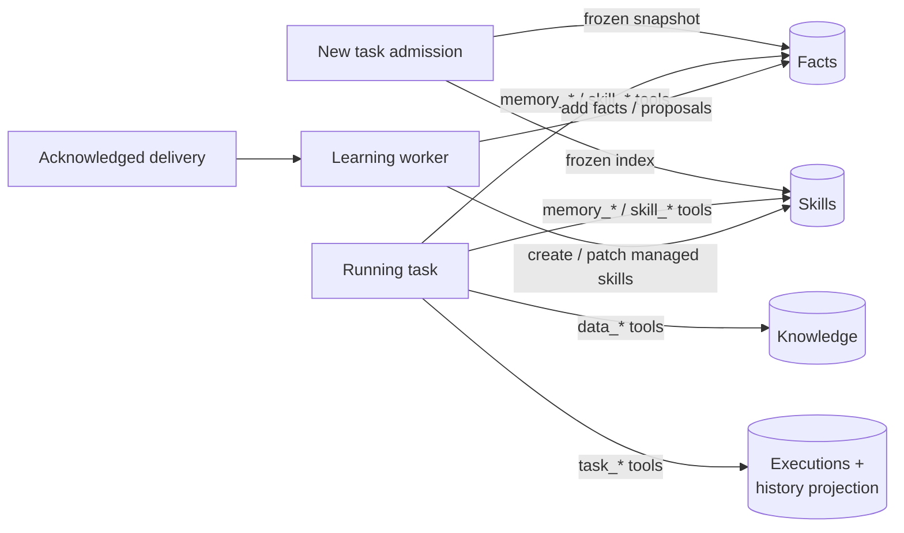
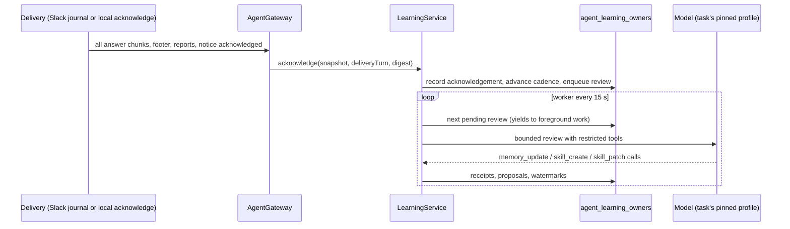

# Knowledge, memory and learning

Velocity gives the agent four kinds of persistent context, all owned by a Velocity account and stored
in MongoDB:

| Store | What it holds | How the agent uses it | Code |
| --- | --- | --- | --- |
| **Knowledge** | Arbitrary JSON records grouped in datasets | `data_*` tools on demand; writes confirmed by the requester | `agent/knowledge` (`velocity-platform`) |
| **Memory (facts)** | Short user and environment facts | Injected into every new task at admission | `agent/memory` (`velocity-platform`) |
| **Skills** | Versioned reusable procedures | Index injected at admission; loaded on demand | `agent/skills` (`velocity-platform`) |
| **History** | The account's past executions | `task_*` tools, optional lexical search | `agent/history` (`velocity-platform`) |

**Learning** is a background process that reviews acknowledged conversations and proposes or
saves facts and skills. Velocity never trains model weights.



All stored content is untrusted data. It never overrides current instructions or grants tools.

## Knowledge

Seven account-scoped tools; MongoDB (`agent_knowledge_records`) is authoritative. A dataset is a
table, a record is a row keyed by a stable key, and `content` holds the fields. There is no
explicit "create table" step: the first save into a new dataset name creates it.

| Tool | Purpose |
| --- | --- |
| `data_catalog` | Discover records (`mode: records`, optional `dataset`, `search`) or datasets (`mode: datasets`, `after` cursor). |
| `data_query` | Filter one dataset with an AND of up to 10 field filters; a field may carry a lower and an upper bound together. |
| `data_aggregate` | Count, sum, average, minimum or maximum over the records the same filters match, optionally grouped by one field. |
| `data_get` | Read one record by `id` or `dataset` + `key`, chunked when large. |
| `data_save` | Create (`expected_revision: 0`) or fully replace a record. |
| `data_update` | Change part of a record: `set` paths, `append` to arrays, `unset` paths, replace title, description or tags. |
| `data_delete` | Remove one record at its current revision. |

Workflow: **discover → query → read**, **aggregate** for counts and totals, and for changes
**locate → update or delete**. The agent is guided to reuse existing datasets and field names,
to query by the natural identifier before creating a record, to store dates as ISO strings and
amounts as numbers, and, for money owed, to keep a running `balance` with an `events` array so a
question is answered by reading one record rather than by arithmetic at question time. Example
save:

```json
{
  "dataset": "meeting_notes",
  "key": "velocity-planning-2026-09-19",
  "title": "Velocity planning meeting — September 19",
  "description": "Decisions and follow-up work.",
  "tags": ["velocity", "planning"],
  "content": {"decisions": ["Use MongoDB for durable knowledge"]},
  "expected_revision": 0
}
```

Query example:

```json
{
  "dataset": "meeting_notes",
  "filters": {"tags": {"contains": "planning"}},
  "fields": ["content.decisions"],
  "sort_by": "updated_at",
  "descending": true,
  "limit": 20
}
```

Aggregate example, answering "how much is outstanding per borrower" from the loans lent this
year:

```json
{
  "dataset": "loans",
  "filters": {"content.direction": {"eq": "lent"}, "content.date": {"gte": "2026-01-01", "lt": "2027-01-01"}},
  "operation": "sum",
  "field": "content.balance",
  "group_by": "content.counterparty",
  "group_limit": 20
}
```

The result reports `count` (records matched), `skipped_non_numeric` (matched records whose field
was missing or not a number), and either a single `value` or `groups` of `group`, `count`, `value`
and `skipped_non_numeric`, sorted by value descending, with `group_limit_reached` when more groups
existed. `count` needs no `field` and returns the matched count as `value`.

Update example, recording a partial repayment on a loan record at revision 3:

```json
{
  "dataset": "loans",
  "key": "sam",
  "expected_revision": 3,
  "set": {"content.balance": 300},
  "append": {"content.events": {"date": "2026-10-15", "type": "repayment", "amount": 200}}
}
```

### Confirmed writes

While `agent.knowledge.confirm-writes` is `true` (the default), `data_save`, `data_update` and
`data_delete` are registered with a `ConfirmingHandler`, so the
[per-call approval hold](agent-gateway.md#per-call-approval) applies to them even when
`agent.approval.enabled` is off. Before the call runs, Java renders a preview from the actual
arguments and the current record: the fields of a new record, each changed field as
`old → new` with appended items, or the full contents of the record about to be deleted. The
requester sees it in the Slack thread with Approve and Decline buttons, or in the console task
view, and the model is told to put the exact values in the arguments rather than describe them.
An invalid call, a missing record or a revision mismatch is previewed as such, so the requester
knows the call will change nothing. Unattended work (scheduled occurrences, delegated children)
has no one to ask and runs the write directly; the delivered result reports what was saved.
`agent.approval.exempt-tools` switches confirmation off per tool.

Limits and rules:

- Dataset 1–64 and key 1–128 characters (letters, digits, `_`, `-`; start alphanumeric). Title
  ≤ 200, description ≤ 1,000, up to 20 tags of ≤ 64 characters.
- Content is a JSON object ≤ 256 KiB serialized, ≤ 16 levels deep; keys cannot contain dots,
  NUL or a leading `$`; numbers must fit BSON / Decimal128.
- Query operators: `eq` (exact, case-sensitive), `gt`, `gte`, `lt`, `lte`, `in` (≤ 20 values),
  `exists`, `contains` (an exact tag, or a case-insensitive literal substring of a string
  `content` field, ≤ 100 characters). A field takes one operator, or a range of one lower (`gt`
  or `gte`) and one upper (`lt` or `lte`) bound, such as a month. Paths are metadata fields or
  `content.<field>`. ISO dates in content compare as strings; `created_at` and `updated_at` take
  ISO timestamps. No raw MongoDB, user-supplied regex or scripts.
- Pages: `limit` 1–100 (default 20), `offset` ≤ 1,000,000. Follow `next_offset` while
  `has_more`; narrow the query if `pagination_limit_reached`.
- `data_get` returns whole content up to 20,000 characters, otherwise `json_text` chunks of up
  to 4,000 UTF-16 units. Pin later chunks with `expected_revision`.
- `data_update` takes `id` or `dataset` + `key` and the current `expected_revision`; `set` and
  `append` map 1–50 `content.<path>` entries to values, `unset` lists 1–50 paths. Intermediate
  objects are created on the way, `append` creates a missing array, and the merged record is
  validated like a save and written with the same revision check. At least one change is
  required.
- `data_delete` takes `id` or `dataset` + `key` and the current `expected_revision`. The delete is
  a hard delete filtered on owner, id and revision, so a stale call cannot remove a record that
  changed since it was read. The key can be reused afterwards.
- `data_aggregate` takes the `dataset` and `filters` of `data_query`, an `operation` of `count`,
  `sum`, `avg`, `min` or `max`, a `content.<path>` `field` (required except for `count`), and
  optionally `group_by` (one content path or metadata field) with `group_limit` 1–100 (default
  20). It is a `$match` plus `$group` pipeline: only values stored as numbers feed the
  accumulator, a value reached through an array is skipped, and a group key that is not a string
  is reported as its JSON text. A `sum` over nothing numeric is `0`; `avg`, `min` and `max` omit
  `value` instead. Numbers are stored as Decimal128 and come back as JSON numbers.
- There are no declared schemas: `schema_status: observed_only`, `observed_fields` is a sample.
- Repository operations have a 2-second server time limit.
- No OR between filters, no embeddings, vector search or attachment storage.

## Memory

Two fact stores per account: **user** (preferences, identity facts) and **environment**
(installation facts). New tasks receive enabled facts in their frozen admission context.

A third store, **profile**, holds the *derived user profile*: one bounded paragraph
(`profile-max-chars`, 1,500) of model inference about who the user is, what they work on and
how they want to be addressed, in the spirit of Hermes' `USER.md` and Honcho's user
representation. It is written only by background profile reviews (every
`agent.learning.profile-review-every-fact-reviews` completed fact reviews), never by a task;
its entries carry `evidence_kind: derived`, and admission renders it under the facts inside a
`<derived_profile>` block that tells the model it is inference which may be wrong and that
saved facts and current instructions take precedence. The operator can edit, reset or disable
it under Knowledge → Facts like the other stores (`memory disable profile` in Slack).

| Tool | Purpose |
| --- | --- |
| `memory_inspect` | Entries with stable IDs, revisions, capacity, provenance and pending proposals. |
| `memory_update` | Atomic batch of `add`, `replace`, `remove` against one store with `expected_revision`. |
| `memory_proposal` | Apply or reject a pending proposal — only when the user's own message is the exact command. |
| `memory_control` | Enable or disable a store — same exact-command rule. |

```json
{"target":"user","expected_revision":0,"operations":[{"action":"add","content":"Prefers concise answers."}]}
```

- Only `status: "saved"` with `database_committed: true` means a fact changed.
- Capacity is rendered characters (`user-max-chars` 1,500, `environment-max-chars` 2,200);
  facts are never silently evicted.
- Receipts bind owner, execution, accepted call and input, so a crash is reconciled, never
  replayed.
- Text that looks like a credential or tries to change authority is rejected
  (`StoredTextSafety`). This is defense in depth, not proof of safety.
- Disabling a store stops new writes and omits it from new tasks; running tasks keep their
  frozen context.

Exact Slack commands the user can send:

```text
memory proposal apply user <proposal-uuid>
memory proposal reject user <proposal-uuid>
memory disable user
memory enable user
```

(`environment` in place of `user` for the other store.)

## Skills

| Tool | Purpose |
| --- | --- |
| `skill_list` | Names, IDs, routing descriptions, revisions (`search`, `offset`, `limit`). |
| `skill_load` | Complete core instructions, version metadata and reference manifest. |
| `skill_reference` | Inert supporting text pinned to a version. |
| `skill_create`, `skill_patch` | Create or update with optimistic revisions and receipts. |

- Up to `maximum-skills` (20) per account; core and references ≤ 6,000 characters each; up to
  six versions retained.
- User-created skills are protected. Learning may modify only enabled, unpinned, agent-managed
  skills, and only from a fresh read of the exact revision.
- Operator controls (`/api/operator/skills/control`) enable, disable, pin, unpin or opt a skill
  into agent management.
- **Bundled skills** come from `BundledSkillSource` beans. Code execution contributes `pdf` and
  `xlsx`. Install them from Knowledge → Skills (`/api/operator/skills/install` with
  `bundle_id`). Nothing installs at startup; reinstalling never overwrites an edited copy.
- **Usage telemetry.** Each skill carries `load_count`, `patch_count`, `last_loaded_at`,
  `last_patched_at` and `reused_after_patch` (a task loaded the skill after its latest patch).
  Loads count only from tasks: review reads and console reads are inspection. Patches count
  from any author. The counters are best effort (a lost write race is ignored), appear in
  `skill_list`, `skill_load` and the console, and never appear in receipts.
- **Self-check.** With `agent.skills.self-check-enabled` (`true`), a root generic task that
  loaded a skill gets one extra model turn when it produces its final answer: a fixed notice
  asks it to patch any loaded skill that was missing steps, had wrong commands or lacked a
  pitfall it hit, then reply `DONE`. The answer given before the check is the one delivered;
  nothing the model says during the check replaces it. The check runs once per task, is
  skipped with under 60 seconds of active time left, and is charged like any other model
  turn. On a slow local model it adds roughly one prefill per task that used a skill.
- **Journey.** Knowledge → Journey (`GET /api/operator/learning/journey`) lists saved facts,
  skill versions and the reviews that committed or staged something, newest first, with
  provenance. It is a read-only view assembled from the stores; corrections happen under
  Facts and Skills.

## History

| Tool | Purpose |
| --- | --- |
| `task_list` | The account's other executions, newest first (`status`, `offset`, `limit` ≤ 20). |
| `task_get` | One field (`request`, `goal`, `answer`) in 4,000-unit chunks, pinned by revision. |
| `task_search`, `task_messages`, `task_message_window` | Lexical search and paging over projected messages (when `agent.history.search-enabled`). |

The current execution is excluded. Results carry `content_trust: untrusted_data`. The
`history-projection` worker indexes up to 200 executions every 30 seconds into
`agent_history_messages` (a rebuildable projection; executions stay authoritative), at most
16,000 characters per message.

## Learning



- **Eligibility.** Only interactive work whose delivery is fully acknowledged: Slack after the
  journal acknowledges everything, or the console after
  `POST /api/operator/tasks/{id}/acknowledge`. Scheduled, monitoring, child and playground work
  never produce learning evidence.
- **Cadence.** Fact reviews every `fact-review-every-user-turns` (1, so after every
  acknowledged user turn) and skill reviews every `skill-review-every-tool-iterations` (10)
  completed tool batches, per account. The worker yields to foreground work, so reviews run
  when the account is idle.
- **Requested skill reviews.** On a settled successful task, Tasks → "Learn a skill from this
  task" (`POST /api/operator/tasks/{id}/learn` with optional `name` and `focus`) queues a skills
  review of that one task outside the cadence, like a Hermes `/learn`. The review receives the
  guidance, must search existing skills first, and any skill it creates is user-owned and
  protected from automatic edits. In Slack, ask the agent directly to save the workflow as a
  skill; the foreground `skill_create` is equally user-owned.
- **Profile reviews.** After every `profile-review-every-fact-reviews` (5) completed fact
  reviews, a `profile` review reads the current user facts and profile plus the newest
  digests and rewrites the derived profile in one `memory_update`. It applies directly (the
  text is derived, not a user statement), posts no Slack notice, and never moves the fact or
  skill cadence.
- **Curator.** Every `curator-every-days` (7) days after the first acknowledgement, a
  `curator` review receives the skill library with its usage telemetry and may fold unique
  steps into an umbrella skill with `skill_patch` and stage a retirement with the review-only
  `skill_curate` tool (agent-managed, enabled, unpinned skills it has freshly loaded; one
  pending proposal per skill, at most 20). Nothing is disabled until the operator applies the
  proposal under Knowledge → Skills (`POST /api/operator/skills/proposal`); applying disables
  the skill and keeps its versions. `0` days disables the curator.
- **Notifications.** When a review saves a fact, stages a proposal, or creates or updates a
  skill for a task that came from Slack, `agent.learning.notifications` (`on`) posts one
  bounded notice to the source thread: counts with `on`, one generic line per change with
  `verbose` (skill names, never fact text), nothing with `off`. The intent is journaled
  before the post, through the same journaled delivery schedules use, so a notice is posted at
  most once and an uncertain post is never resent. Console-origin tasks are not notified;
  the Journey view shows every change.
- **Input.** Each acknowledged interaction is stored as a digest of at most
  `maximum-interaction-chars` (6,000): the request, user corrections, tool call counts with
  failures, the final answer, then as many of the most recent original messages as fit, with
  their message IDs so facts can cite them. A review receives the newest
  `maximum-review-interactions` (3) digests, capped at `maximum-input-chars` (30,000) in total.
- **Model.** Reviews run on the source task's pinned profile unless `agent.learning.profile`
  names a configured profile, which then runs every review (Hermes-style routing to a cheaper
  or faster model). Startup fails if the named profile is missing.
- **Bounds.** 100,000 total tokens, 120 seconds (`maximum-millis`), 5 model turns, 8 tool
  calls, 6 fact writes. A review profile whose output allowance exceeds
  `maximum-output-tokens` (8,192) cannot run reviews (`review_output_reserve_exceeds_budget`);
  raise the cap to at least the model's max tokens. A local model that needs more than two
  minutes for a 6,000-character digest needs a larger `maximum-millis`, a smaller digest, or a
  review profile.
- **Restrictions.** Reviews can only call learning operations — no browser, network,
  messaging, scheduling or dataset writes. Replacing or removing a fact creates a proposal for
  the user instead of applying it. Like the foreground runner, a review tolerates native
  reasoning and output blocks and fails only on a native call it cannot dispatch
  (`review_unsupported_native_call`).
- **Accounting.** Review inference is recorded under the `learning` usage activity. A review
  that times out before any usage arrives keeps its conservative token reservation, since the
  provider may still have processed the request.
- **Failures.** A failed review records a stable outcome (`review_time_limit`,
  `review_inference_transient`, `review_inference_rejected`, `review_unsupported_native_call`,
  …) and a bounded `failure_detail`, both shown under Knowledge → Learning and logged at warn
  level. Failed reviews are not retried. After `maximum-consecutive-failures` (2) failures of
  one mode in a row, the cadence watermark advances past the failing inputs
  (`advanced_watermark`) so the next review sees new interactions instead of repeating the
  same failure. The journal keeps at most 5,000 acknowledgements and 50 reviews per account.
- Both `agent.learning.enabled` and `agent.learning.worker-enabled` must be true. The worker is
  process-local and independent of JobRunr.
