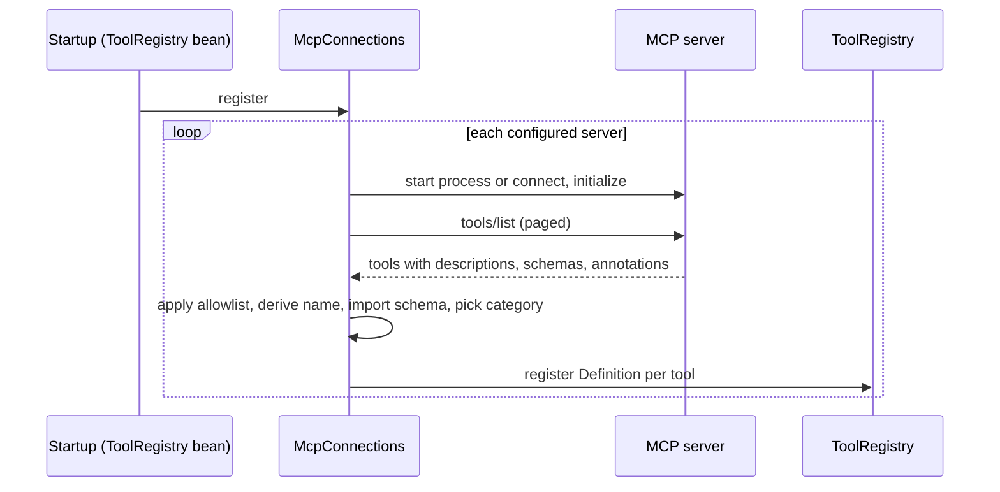

# MCP connector

The `velocity-mcp` module connects Velocity to external [Model Context Protocol](https://modelcontextprotocol.io)
servers chosen by the operator and registers each server's tools as ordinary Velocity tools named
`mcp_<server>_<tool>`. A server can be a local child process spoken to over stdio (the common
`npx`/`uvx` packaging) or a remote Streamable HTTP endpoint. Java keeps every rule it keeps for
built-in tools: explicit bounded schemas, trusted registration metadata, authorization, per-call
approval, timeouts, output artifacts and untrusted-data framing. The server remains an external
program; Velocity never runs its code in-process and never trusts what it returns.

- [Enabling](#enabling)
- [Declaring servers](#declaring-servers)
- [Discovery and tool names](#discovery-and-tool-names)
- [Schemas](#schemas)
- [Reads, writes and approval](#reads-writes-and-approval)
- [Results](#results)
- [Failures and uncertainty](#failures-and-uncertainty)
- [Sessions and limits](#sessions-and-limits)
- [Trust boundaries](#trust-boundaries)
- [Status and API](#status-and-api)
- [Settings](#settings)

## Enabling

```properties
MCP_ENABLED=true
mcp.servers[0].name=files
mcp.servers[0].transport=stdio
mcp.servers[0].command=npx.cmd
mcp.servers[0].args[0]=-y
mcp.servers[0].args[1]=@modelcontextprotocol/server-filesystem
mcp.servers[0].args[2]=C:/work/shared
```

Startup fails when the feature is enabled with no server entry, a malformed entry (bad name,
unknown transport, missing command or URL, invalid header, unknown category, out-of-range
timeout) or two entries with the same name. Whether a configured server is actually reachable is a
different question: discovery at startup tries each server once, an unreachable one is logged
and shown as `unavailable` in status, and the rest of the application starts normally. Its tools
appear after a restart once it answers. With the feature disabled nothing is registered and the
model never sees these tools.

## Declaring servers

Servers are an indexed list, so they are declared with dotted keys in the Git-ignored `.env` (or as
`MCP_SERVERS_0_NAME`-style process environment variables), not in `application.properties`.

| Key (`mcp.servers[n].`) | Required | Meaning |
| --- | --- | --- |
| `name` | yes | `[a-z][a-z0-9_]{0,23}`, unique. Part of every tool name, so it is permanent once tasks have used the server. |
| `transport` | yes | `stdio` or `http`. |
| `command`, `args`, `directory`, `environment.*` | stdio | Program, arguments, working directory (default: Velocity's) and extra environment variables of the child process. The child inherits only `PATH`, the system and temp directories, the home and application-data directories and the locale variables, plus what `environment.*` adds; put API keys there rather than in `args`. On Windows name the `.cmd` shim explicitly (`npx.cmd`, `uvx.exe`). Use `args[0]`, `args[1]`, … when an argument contains a comma. |
| `url`, `headers.*` | http | The MCP endpoint (`https://`, or plain `http://` to a loopback host only; no credentials in the URL) and request headers such as `Authorization`. |
| `tools` | no | Allowlist of the server's tool names to register; empty means every tool. Names the server does not publish are counted as `missingTools` in status. |
| `category` | no | Pins every tool of the server to one kernel category (`network.read`, `network.write`, `system.execute`, `repository.read`, `repository.write`, `system.read`) instead of deriving it from the server's annotations. |
| `request-timeout`, `max-result-chars` | no | Per-server overrides of the installation settings. |

Two more examples:

```properties
# A remote server behind a bearer token.
mcp.servers[1].name=issues
mcp.servers[1].transport=http
mcp.servers[1].url=https://mcp.example.com/mcp
mcp.servers[1].headers.Authorization=Bearer <token>
mcp.servers[1].tools=list_issues,get_issue,create_issue

# A local server whose every tool may change state: pin the category and keep confirmation on.
mcp.servers[2].name=deploy
mcp.servers[2].transport=stdio
mcp.servers[2].command=uvx
mcp.servers[2].args=deploy-mcp
mcp.servers[2].category=system.execute
```

## Discovery and tool names



The registered name is `mcp_` + server name + `_` + the server's tool name with every character
outside `[A-Za-z0-9_-]` replaced by `_`, truncated to 64 characters. A name that collides with
another registered tool is skipped and counted in `skippedTools`. At most 256 tools per server are
registered.

The tool list is read **once, at startup**. Each task freezes the tool contracts it was admitted
with, so a server that later changes a tool's description or schema has no effect until Velocity
restarts, and after that restart tasks admitted with the old contract stop with
`admitted_tool_incompatible`, exactly as for a changed Java tool. Treat a server's published
tool set as part of the installation's configuration.

The model sees the server's own description prefixed with `[MCP server <name>]`. A server's
self-reported *instructions* (the MCP `initialize` field) are never added to the system prompt:
they are remote text.

## Schemas

Velocity only registers tools whose input schema fits the kernel's bounded JSON Schema dialect
(`type`, `properties`, `required`, `additionalProperties`, `items`, `enum`, numeric and length
bounds, `description`, `title`). The import is **permissive, never stricter than the server**:

- Supported keywords are copied; `pattern`, `format`, `default`, `examples`, `$ref`, `$defs`,
  `anyOf`/`oneOf`/`allOf`, `const` and every other keyword are dropped.
- A type list such as `["string", "null"]` takes the first non-null type; a property with no
  type is inferred from `properties`, `items` or a homogeneous `enum`.
- A property whose type cannot be determined is left out of `properties`, so any JSON value
  passes validation, and it is named in the tool description under "arguments without a listed
  type". When a property was left out, `additionalProperties: false` is dropped for that object.
- A schema that cannot be imported at all becomes `{"type": "object"}` and the description says
  that all arguments are untyped.

The executor validates every call against the imported schema before dispatch; the server still
validates the real thing and its `invalid params` error is reported as `invalid_request`.

## Reads, writes and approval

| Decision | Rule |
| --- | --- |
| Category | `mcp.servers[n].category` when set; otherwise `network.read` for a tool whose annotations say `readOnlyHint: true`, and `network.write` for everything else. An unannotated tool is a write. |
| Monitoring | Reads are `observation` tools that monitoring checks may use; writes are denied there. |
| Parallelism | MCP tools never run in a parallel read group; calls to one server are serialized. |
| Approval | Writes fall under `agent.approval.categories` when the approval policy is enabled. With `mcp.confirm-writes` (default `true`) every write is additionally a confirming tool: the task pauses for the requester with a preview naming the server, tool, category and the exact arguments, whatever the approval policy says. Scheduled occurrences, monitoring runs and delegated children have no requester, so a confirming tool runs there without a pause; the approval policy's own holds still deny it in unattended runs. |
| Timeout | `request-timeout` plus five seconds, further capped by the task's remaining time. |

Guidance tells the model to prefer reads, to treat writes as irreversible external effects, not
to work around a declined call, and to inspect the destination before repeating a write after an
uncertain outcome.

## Results

Every call returns one bounded envelope, validated against the registered output schema:

```json
{
  "status": "ok",
  "server": "issues",
  "tool": "mcp_issues_get_issue",
  "content": [{"type": "text", "text": "..."}],
  "structured_json": "{...}",
  "truncated": false,
  "content_trust": "untrusted_data"
}
```

- `status` is `ok`, `error` (the server set `isError`; its content is still returned as untrusted
  text), `invalid_request` (the server rejected the arguments) or `unavailable`.
- `content` keeps text items and embedded text resources, clipped so that all text together stays
  within `max-result-chars`; images, audio and binary resources are listed with their MIME type
  and `omitted: true`; resource links keep URI, name and description.
- `structured_json` carries the server's structured content as a JSON string within the same
  budget. `truncated` says whether anything was cut.
- Control characters other than newlines and tabs are replaced. The full envelope is stored as
  the call's artifact like any other tool output; the model sees the usual preview.

## Failures and uncertainty

| Situation | Read tool | Write tool |
| --- | --- | --- |
| Server unreachable, request never sent | `status: unavailable` | `status: unavailable` |
| Server answered with a JSON-RPC error | `status: error` or `invalid_request` | same (the request was received and refused) |
| Timeout, dropped process or connection after the request was written | `status: unavailable` | **uncertain**: the call settles `uncertain`, the task's further mutations are blocked until inspected, and nothing is replayed |
| Task cancelled mid-call | cancelled | uncertain |
| Response larger than about four times `max-result-chars` | `status: unavailable` | uncertain |

The uncertain-outcome diagnostic carries the server name and a fixed reason code
(`transport_failed`, `cancelled`), never the server's text. A failed session is discarded and
rebuilt on the next call, which for a stdio server means a new process: servers that keep state in
memory lose it then.

## Sessions and limits

- One long-lived session per server for the whole process, created at startup discovery, closed at
  shutdown. Calls to the same server are **serialized**; up to four root tasks may wait on one
  server, so a slow server slows every task that uses it.
- The stdio child receives one JSON line per request (at most 1 MiB) and may answer with lines of
  at most `4 × max-result-chars + 64 KiB` characters; a longer line fails the call and the process.
  The HTTP transport applies the same bound to each response body.
- A child process and its descendants are terminated on reset and shutdown.
- Startup waits for discovery server by server, so with `connect-timeout` 30 s and an unreachable
  server the boot takes up to 30 s longer. Lower the timeout or disable the entry.
- The module logs discovery outcomes and fixed failure codes only. MCP SDK diagnostics are turned
  off in `application.properties` (`logging.level.io.modelcontextprotocol=OFF`) because they can
  quote a server's messages.

## Trust boundaries

- The operator chooses the servers, their commands, URLs and headers; nothing in a request body,
  a task or a model argument can add a server or change where a call goes.
- Everything a server returns is untrusted data: it is wrapped, bounded, marked
  `content_trust: untrusted_data`, rendered escaped in the console and never becomes instructions.
- Tool names, descriptions and schemas come from the server and are cleaned and bounded before
  registration, but a malicious server can still describe its tools misleadingly. Only connect
  servers you would run as your own user, and use `tools` allowlists and `category` pins to
  narrow what the model may call.
- MCP servers are not subject to the browser or download destination policies; a server can reach
  whatever its process or host can reach. Isolate the host network for hard egress limits.
- Credentials for a server travel only in its child environment or HTTP headers and are never
  logged, returned or shown in status.

## Status and API

`GET /api/operator/status` carries an `mcp` section with `enabled`, `confirmWrites`,
`registeredTools` and, per server, `name`, `transport`, `state` (`pending`, `connected`,
`unavailable`, `closed`), `registeredTools`, `skippedTools` and `missingTools` counts.
`GET /api/operator/mcp` returns the same plus the registered tool names and the missing allowlist
names; both are behind the local operator boundary and send `Cache-Control: no-store`. The
console shows the section under Integrations & System.

## Settings

| Property | Environment variable | Default | Notes |
| --- | --- | --- | --- |
| `mcp.enabled` | `MCP_ENABLED` | `false` | Needs at least one server entry. |
| `mcp.connect-timeout` | `MCP_CONNECT_TIMEOUT` | `30s` | Start or reach a server and initialize; 1s–10m. |
| `mcp.request-timeout` | `MCP_REQUEST_TIMEOUT` | `60s` | One tool call; 1s–10m; capped by the task's remaining time. |
| `mcp.max-result-chars` | `MCP_MAX_RESULT_CHARS` | `100000` | Text per result before truncation; 1,000–1,000,000. |
| `mcp.confirm-writes` | `MCP_CONFIRM_WRITES` | `true` | Every write waits for the requester with a preview. |
| `mcp.servers[n].*` | dotted keys in `.env` | *none* | See [declaring servers](#declaring-servers). |
