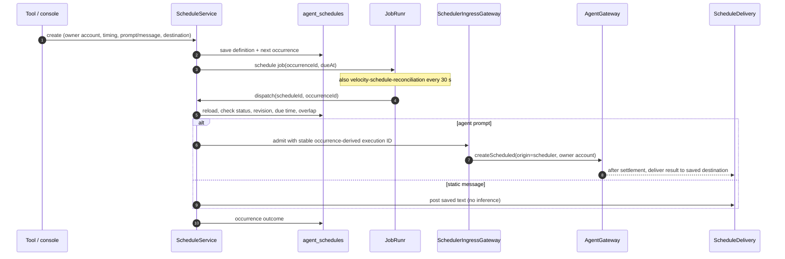
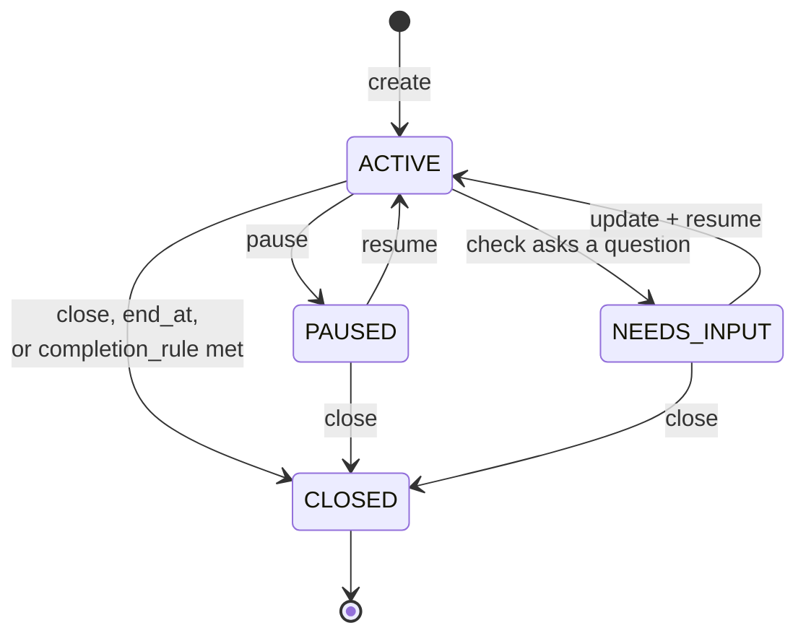

# Scheduling and monitoring

Velocity can run saved prompts and send saved messages on a schedule, and can watch an ongoing
objective with repeated bounded checks. Both are built on one durable scheduler
(`velocity-modules/velocity-platform/.../agent/scheduling/`) driven by JobRunr. Monitoring adds its own definitions and
findings (`agent/monitoring/`).

- [Enabling](#enabling)
- [How dispatch works](#how-dispatch-works)
- [Schedules](#schedules)
- [Timing](#timing)
- [Missed runs, overlap and cancellation](#missed-runs-overlap-and-cancellation)
- [Slack delivery](#slack-delivery)
- [Monitoring](#monitoring)
- [Storage](#storage)

## Enabling

Two independent switches must both be on for anything to run:

```properties
AGENT_SCHEDULING_ENABLED=true                 # application default: true
jobrunr.background-job-server.enabled=true    # JobRunr default: false
AGENT_SCHEDULING_MAXIMUM_LATENESS=60s
```

Without the worker, schedules can be saved (registration shows `pending`) but never execute.
Scheduled agent prompts also need inference; static messages need only Slack. Run exactly one
process per installation.

## How dispatch works



- Definitions and occurrences are persisted **before** JobRunr registration. Job arguments carry
  only IDs; dispatch reloads the record.
- The occurrence-derived execution ID prevents a second admission after a crash.
- `ScheduleRecovery` keeps trying (every 30 s) to register the recurring
  `velocity-schedule-reconciliation` job and one immediate pass. Reconciliation repairs missing
  occurrence jobs and settles running occurrences and delivery.
- Scheduled tasks keep the creator's `ownerAccountId`; their origin is `scheduler`. They read
  and write the same account resources as direct conversations.

## Schedules

| Tool | Inputs |
| --- | --- |
| `schedule_execution` | `name`, `prompt`, `timing`; optional `destination` |
| `schedule_message` | `name`, `message`, `timing`, `destination` (required) |
| `schedule_list` | `{}` — every schedule owned by the account |
| `schedule_get` | `id` — definition plus the 20 latest occurrences |
| `schedule_update` | `id`, `expected_revision`; any of `name`, `timing`, `prompt`/`message`, `destination`, `clear_destination` |
| `schedule_pause`, `schedule_resume`, `schedule_cancel` | `id`, `expected_revision` |

Limits: names ≤ 200 characters, prompts ≤ 100,000, messages ≤ 40,000 (sent as one Slack post).
The action type never changes. Cancelled and completed schedules cannot be edited or resumed.

Results include `id`, `revision`, `status` (`active`, `paused`, `cancelled`, `completed`),
normalized `timing`, `next_occurrence` (UTC) and `next_occurrence_local`, `registration`
(`registered` or `pending` with `registration_failure`), `missed_run_policy` and
`overlap_policy`. Occurrence outcomes: `pending`, `running`, `succeeded`, `failed`,
`uncertain`, `skipped`, `cancelled`.

The console and `/api/operator/schedules` create **agent-prompt** schedules only. Slack
destinations and static messages require a verified Slack conversation.

## Timing

`timing` takes exactly one of:

| Field | Meaning |
| --- | --- |
| `at` | ISO timestamp for a one-time run. |
| `delay_seconds` | Positive integer; stored as an absolute instant. |
| `cron` | Spring **six-field** cron: `second minute hour day-of-month month day-of-week`. |

plus optional IANA `timezone` (default: the application zone, `app.time-zone`).

```json
{"name":"Weekday summary","prompt":"Summarize today's activity.",
 "timing":{"cron":"0 0 17 * * MON-FRI","timezone":"America/New_York"},
 "destination":{"transport":"slack","channel_id":"C123ABC"}}
```

- Five-field Unix cron and macros are rejected.
- Past timestamps, invalid zones and impossible recurrences fail validation.
- A one-time local time in a DST gap is rejected; an ambiguous one needs an explicit offset.
- Recurring cron skips nonexistent local times and runs ambiguous ones once (earlier offset).
- Due times are eligibility times, not exact-second guarantees.

## Missed runs, overlap and cancellation

- An overdue **one-time** occurrence runs once after recovery.
- A **recurring** occurrence later than `maximum-lateness` is marked `skipped`; missed slots are
  never replayed.
- A recurring schedule runs one occurrence at a time. If the previous agent is still running or
  waiting for input, the new slot is skipped. A scheduled task that calls `ask_user` stays
  waiting until someone answers it (for example from the console).
- Pause and cancel affect future occurrences only. An admitted agent may still finish and
  deliver. Use task cancellation to stop it.
- An admission rejected for capacity is recorded as failed (`agent_queue_full`); it is not
  retried.

## Slack delivery

- Destination access is checked at creation, at update and again before each send.
- Every send writes a journal intent first (`agent_schedule_delivery`). A send without a
  confirmed acknowledgement becomes `uncertain` and is never resent automatically.
- Agent results wait for worker settlement and include the usage and cost footer, frozen with
  the answer. Static messages are sent verbatim without a footer.
- Every supported Markdown pipe table (each ≤ 100 rows, 20 columns, 10,000 characters) is
  rendered as a native Slack table when the post fits in 50 blocks; the original text stays as
  the fallback.

## Monitoring

A monitoring job saves an ongoing objective and checks it with separate, bounded agent runs.
There are no domain-specific monitor types: the objective, criteria and sources are free text.



**Creating.** Use `monitor_create` from Slack or the Monitoring screen. Provide a name, the
original request and an objective; optionally criteria, exclusions, sources, notification
instructions, a completion condition or exact `completion_rule`, `timing`, `notification_policy`
(`changes_only` or `digest` with `digest_timing`), `initial_summary` and `end_at`. Defaults:
daily at 09:00 New York, `changes_only`, and a silent baseline on the first check.

**Each check** is a scheduler-origin execution with `CumulativeLimitsPolicy` limits
(`agent.monitoring.*`: 20 model turns, 20 tool calls, 50,000 tokens, 5 minutes, 16,000 output
tokens per model request). It sees the
saved definition, a working summary, prior evidence and checkpoints — not the original
conversation. Only observation tools are available; the browser may navigate and read but not
click, type or submit. `ask_user` ends the check and moves the job to `NEEDS_INPUT`.

**Results** are one strict JSON object: `outcome` (`success`, `partial`, `needs_input`,
`failed`), summary, freshness, questions, limitations, `observations` (stable source and item
IDs, structured facts, evidence), `updates` (`new_match`, `material_change`, `condition`),
per-source `coverage`, `checkpoints` and optional `completion_evidence`. Java validates shape and
the result's internal references (observation keys and coverage sources); the facts remain model
findings. An observation's `prior_observation_id` is advisory: the stored prior link always comes
from the latest saved observation for the same job, source and item, so a claim that names an
unknown observation or one of a different item is dropped for that finding and recorded in the
run's `limitations` while the rest of the result is still applied. A result that still cannot be
planned fails the run with a summary that names the reason.

A check that reaches a budget boundary ends `partial` after the tools-disabled reporting turn
described in [the agent runtime](agent-gateway.md#context-sizing-compaction-and-reporting).
Its final answer is parsed like a successful one: a valid report is accepted with the boundary
added to `limitations`, and an `outcome` of `success` is downgraded to `partial`, so a bounded
check can still record observations and checkpoints but never closes a completion rule. A final
answer that is not the JSON contract, including the fallback text written when the model answers
the reporting turn with tool calls twice, fails the run with a summary that names the boundary.
The reporting turn begins when the remaining tokens cannot cover the next request (its counted
input plus the output reserve) and a final report of the same size; see
[the reporting reserve](agent-gateway.md#task-deadline-and-limits).

**Deduplication** uses source/item identity plus a fingerprint of normalized facts, never
generated text, so unchanged items do not notify again.

**Notifications** without a Slack destination are saved as console updates. Slack destinations
need Slack authority and use the same journaled delivery as schedules. Digests are assembled on
the reconciliation pass on their own cadence.

**Limits**: at most 50 open jobs per account, 4 concurrent runs, minimum cadence 300 seconds,
50 results per check, 12,000-character notifications. History older than 90 days is pruned,
keeping at least 100 recent runs and anything unresolved.

## Storage

| Collection | Contents |
| --- | --- |
| `agent_schedules` | Definitions and occurrences (format version 2). Ordinary schedules keep full history; monitoring schedules prune settled occurrences. |
| `agent_schedule_delivery` | Scheduled and monitoring Slack send journal. |
| `agent_monitoring_jobs`, `_runs`, `_observations`, `_updates` | Monitoring definitions, runs, findings and notifications. |
| JobRunr collections | Occurrence and recurring reconciliation jobs. |

Back these up together with the executions and the JobRunr store.
