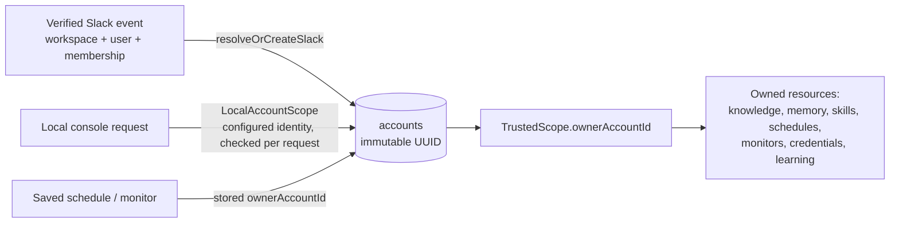
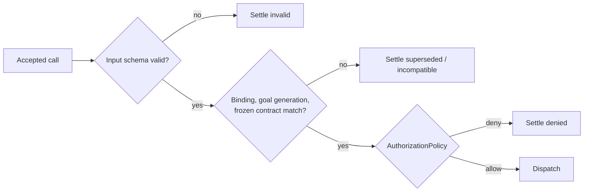

# Security model

Velocity is a single-operator, single-installation service. Its security rests on four ideas:
identity comes only from trusted adapters, the operator API is reachable only from the local
machine, every tool call passes Java schemas and authorization, and everything the model reads
is data, never instructions.

- [Accounts and ownership](#accounts-and-ownership)
- [Local operator boundary](#local-operator-boundary)
- [Request parsing](#request-parsing)
- [Tool authorization](#tool-authorization)
- [Outbound destination policies](#outbound-destination-policies)
- [Encryption at rest](#encryption-at-rest)
- [Untrusted content](#untrusted-content)
- [What is not provided](#what-is-not-provided)

## Accounts and ownership



- An **account** is a MongoDB `accounts` document: immutable UUID `_id`, Slack workspace ID,
  Slack user ID, timestamps. A unique index on workspace + user makes registration idempotent.
- Accounts are registered **only** by trusted code: after Slack verification (`auth.test`,
  `users.info`, `conversations.info` and bounded membership checks establish the workspace, bot,
  an active human requester and membership of both requester and bot), or for the local account
  from `agent.local-account.*` configuration.
- The local console is bound to one configured account (`LocalAccountScope`): the owner's Slack
  identity from `agent.local-account.*`, or the built-in console-only identity. The record is
  created on first use and re-read and checked on every user-resource request; a database
  failure returns 503. Requests cannot select or register an account.
- `TrustedScope` carries `ownerAccountId` through admission, snapshots, tool contexts, child
  runs and recovery. Its other fields (workspace, requester, channel, bot, origin) are
  **provenance**, never ownership.
- Resource ownership compares account IDs only. A Slack user's direct, channel and scheduled
  work all share one account; other users and workspaces are isolated.
- Execution-local resources (browser sessions, research artifacts, code-run files) stay bound
  to their execution even within one account.
- Model output, request bodies, conversation IDs, retrieved knowledge, page content and
  forwarding headers cannot set or change identity.

## Local operator boundary

`LocalOperatorFilter` (highest precedence) guards every protected route root:

| Check | Rule |
| --- | --- |
| Peer | The servlet's actual remote address must be numeric loopback. |
| Host | `localhost`, a numeric IPv4 loopback address or `[::1]`; duplicates and malformed authorities are rejected. |
| Origin | If present, must match the Host's scheme, hostname and effective port exactly (`http://localhost:8090` ≠ `http://127.0.0.1:8090`). |
| Fetch metadata | `Sec-Fetch-Site: cross-site` is rejected. |
| Path | Percent escapes, matrix parameters and dot segments are normalized before matching (`OperatorPaths`). |
| Body | At most 1 MiB, including chunked bodies. `POST /api/agent/executions` alone allows `agent.uploads.max-total-bytes` of Base64-encoded files plus 1 MiB; bodies are buffered in memory before parsing. |

Protected roots (`OperatorRoutes`):

| Root | Contributed by | Sensitive |
| --- | --- | --- |
| `/api/operator` | core | |
| `/api/agent/executions` | core | |
| `/api/agent/knowledge` | core | |
| `/api/operator/secrets` | core | yes |

Actuator (health, metrics, Prometheus) is mounted at `/api/operator/actuator`, inside the
`/api/operator` root, so it is subject to the same checks; see [observability](observability.md).

Sensitive roots add `Cache-Control: no-store` and `Pragma: no-cache` and zero the buffered body
after use.

At startup `OperatorRouteAudit` fails the application if any request mapping under `/api` (or
whose first segment is a template or wildcard) is outside every protected root. Mount new
controllers under `/api/operator/<feature>`. The audit covers request mappings only — not static
resources, functional routes or servlet registrations.

Forwarded headers are never trusted. `server.forward-headers-strategy` must be `none` and
Tomcat's remote-IP header must be unset, or startup fails. The boundary does not distinguish
operating-system users on the same machine, and there is no remote access design: putting a
proxy in front of the operator API is not authentication.

Routes outside `/api` are public by design: the console pages and `/velocity/hello`.

## Request parsing

`StrictRequests` gives every operator adapter the same JSON rules: duplicate keys, unknown
fields, wrong types and trailing content are rejected; bodies are bounded. Secret-bearing
routes (secrets) read bodies directly instead of through MVC converters so
debug logging cannot capture submitted values, and erase temporary buffers.

## Tool authorization



- `AuthorizationPolicy.strict()` allows only `trusted` tools and only for an owned scope.
- `AuthorizationPolicyDecorator`s can only deny more; no shipped module contributes one.
- Monitoring runs see only tools marked `observation` (or `restricted` with an input filter);
  others are hidden and rejected again at dispatch.
- Delegated children use only their profile's allowlist.
- Feature switches such as `mcp.confirm-writes` are Java allow/deny decisions, not model
  hints.
- The model never asks for permission; `ask_user` exists for missing information only. With
  `agent.approval.enabled`, Java holds calls in the configured categories or tool list after
  authorization until the owning account approves or declines them in the console or by a
  Slack thread reply; unattended monitoring and delegated work are denied such calls. See
  [per-call approval](agent-gateway.md#per-call-approval).

## Outbound destination policies

| Policy | Applies to | Rules |
| --- | --- | --- |
| `BrowserDestinationPolicy` | Every browser request, redirect, worker and WebSocket | Optional exact host allowlist; private networks blocked unless the exact origin is in `agent.browser.private-origins`; operator routes always blocked; reserved destinations always blocked. |
| `ControlledDownloader` | Research attachment GETs | Same model with `agent.research.allowed-hosts` and `private-origins`; each redirect rechecked; per-task request budget. |
| `SlackFileDownloader` | Files attached to Slack messages | HTTPS `slack.com` hosts only receive the bot token; no redirects; `agent.uploads.*` limits checked before and during the transfer; fetched only for a message that will be applied to a task. |
| `ReservedDestinations` | Browser, downloads, saved credentials | Hosts a loaded feature reserves for its server-owned integration through `ReservedDestinationPolicy`. Nothing is reserved by default. |
| Saved-credential receivers | Credential fill and submit | Pairs go only to exact saved HTTPS credential origins; requests carrying known pair values elsewhere are rejected. |

These are application controls. For hard egress guarantees, also isolate the host network.

## Encryption at rest

The secrets vault uses AES-256-GCM (`crypto/AesGcm`); a feature that stores its own tokens adds an
independent keyring with the same mechanics:

| Keyring | Settings | Protects |
| --- | --- | --- |
| Secrets vault | `AGENT_SECRETS_KEY`, `_KEY_ID`, `_PREVIOUS_KEYS` | Saved website username/password pairs. |

Each key is canonical padded Base64 of exactly 32 random bytes. Previous keys are a one-line
JSON object of up to 15 `{"id":"key"}` entries. Ciphertext authenticates its owner, record
identity, revision and policy metadata. Velocity never generates, resets or replaces a missing key;
an unavailable key leaves that feature unavailable. Back up keys separately from the database —
neither alone can recover a secret.

Generate a key privately, for example in PowerShell 7:

```powershell
$bytes = [Security.Cryptography.RandomNumberGenerator]::GetBytes(32)
try { [Convert]::ToBase64String($bytes) } finally { [Array]::Clear($bytes) }
```

## Untrusted content

Slack messages (including previous bot replies), web pages, email, documents, knowledge
records, task history and tool outputs are framed as untrusted data. They never become system
instructions and never grant tool authority. The console renders model output and retrieved
content escaped, never as active HTML. Logs and diagnostics record exception classes and fixed
reason codes, not upstream messages, URLs or credential values; POI and PDFBox logging is off
because parser diagnostics can contain attacker-controlled strings.

## What is not provided

- Remote or multi-user operator access.
- Multi-workspace Slack OAuth or token rotation.
- Distributed locking: run exactly one process per installation.
- A sandbox for native parsers or Poppler beyond application bounds; isolate the host if you
  need hard CPU, memory or egress limits.
