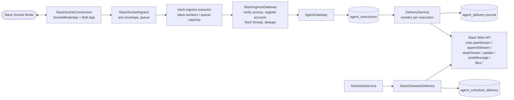
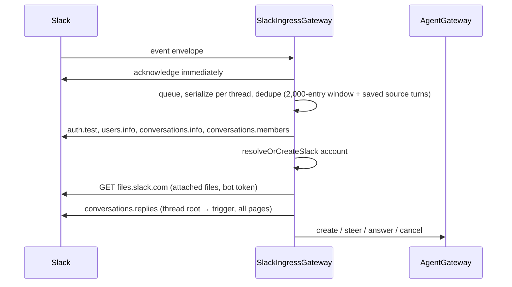

# Slack

The `velocity-slack` module connects one Slack workspace over **Socket Mode** (an outbound
WebSocket — no public URL). Mentions and direct messages become agent tasks, and saved progress,
answers, input controls and reports are delivered back into the originating thread. Disabled by
default.

- [Architecture](#architecture)
- [Create and install the app](#create-and-install-the-app)
- [Configure and start](#configure-and-start)
- [Using the agent in Slack](#using-the-agent-in-slack)
- [Ingress](#ingress)
- [Delivery](#delivery)
- [Reports, files and tables](#reports-files-and-tables)
- [Troubleshooting](#troubleshooting)

## Architecture



| Class | Role |
| --- | --- |
| `SlackConfiguration` | Beans: Slack SDK client, ingress executor, Bolt `App`, `SlackAgentRuntime` (init `recover`), `SocketModeApp`, `SlackSocketConnection`, scheduled delivery. Only present when `slack.enabled=true`. |
| `SlackSocketConnection` | `SmartLifecycle` at the highest phase: starts the socket during startup (waits up to 20 s for `hello`), stops it first at shutdown. |
| `SlackIngressGateway` | Trusted identity, access checks, account registration, thread history, deduplication, task controls. Never calls inference. |
| `DeliveryService` | Journaled delivery of progress, answers, controls, notices and reports. |
| `SlackScheduleDelivery` | Single-message posts for schedules and monitoring. |

## Create and install the app

1. At [api.slack.com/apps](https://api.slack.com/apps) choose **Create New App → From a
   manifest** and paste [`app-manifest.yaml`](../velocity-modules/velocity-slack/src/main/resources/slack/app-manifest.yaml).
   It enables Socket Mode, the Messages tab, interactivity and the required event subscriptions.
2. **Basic Information → App-Level Tokens**: create a token with `connections:write`. This is
   `SLACK_APP_TOKEN` (`xapp-…`).
3. **OAuth & Permissions**: install to the workspace; the **Bot User OAuth Token** is
   `SLACK_BOT_TOKEN` (`xoxb-…`). Both tokens must belong to the same app.
4. Keep event subscriptions `app_mention`, `message.im`, `message.channels`, `message.groups`, and
   keep **Interactivity** on.
5. Invite `@Velocity` to channels. Reinstall after any scope change.

Bot scopes used:

| Scope | Purpose |
| --- | --- |
| `app_mentions:read` | Receive mentions. |
| `chat:write` | Streams, answers, controls, notices. |
| `files:write` | Upload saved reports to the thread. |
| `files:read` | Download files attached to a mention, direct message or thread reply into the task. |
| `channels:history`, `groups:history`, `im:history`, `mpim:history` | Read whole threads; receive message events. |
| `users:read` | Verify an active human requester. |
| `channels:read`, `groups:read`, `im:read`, `mpim:read` | Verify the conversation and membership. |

## Configure and start

```properties
SLACK_ENABLED=true
SLACK_BOT_TOKEN=xoxb-...
SLACK_APP_TOKEN=xapp-...
SLACK_BOT_NAME=Velocity
SLACK_WORKERS=4
SLACK_QUEUECAPACITY=100
```

An inference provider is also needed for tasks. Start normally; the log shows
`Slack Socket Mode connected` once Slack's `hello` arrives. If it does not arrive within 20
seconds, startup fails and the client is released. After startup the SDK handles reconnection.

## Using the agent in Slack

- `@Velocity …` in an invited channel, or a direct message, starts a task.
- Files attached to the message are attached to the task like console uploads
  ([operator API — attached files](operator-api.md#tasks)): the same types and
  `agent.uploads.*` limits apply, the first user message lists them as metadata, and the model
  reads them with `task_file_list`, `task_file_open` and `document_read`. A message with files
  and no text still starts or continues a task; its request reads
  `[Slack message with no text; attached files: …]`. A thread reply with files is applied as a
  correction or answer (never as `cancel`, `approve` or `decline`) and its files join the task's
  earlier ones under the same limits. A rejected file (unsupported type, too large, too many,
  not downloadable) is reported in the thread and nothing is applied, so the message can be
  re-sent.
- The reply opens a native activity area (titled with `SLACK_BOT_NAME`, then a short request
  summary) showing the task and each tool call, refreshed about every two seconds from saved
  state. No model reasoning or tool output is shown.
- The final answer follows, with a footer on success:
  `Response complete 1234 (1000 input · 234 output) · Estimated cost: $0.0042 USD`.
- A short status reply then mentions the requester so completion is visible.
- While a task is active, **its requester** can reply in the thread to correct it, answer a
  question, say `cancel` / `stop`, or, while the task waits for a
  [tool approval](agent-gateway.md#per-call-approval), press **Approve** or **Decline** on the
  card or reply `approve` or `decline`; either decides every held call at once. The message
  above the card describes each held action in plain language (the tool's own preview when it
  has one, such as the exact fields a knowledge save will write, otherwise its arguments). A
  correction reply supersedes the held calls instead. Other users cannot control it.
  Unmentioned channel replies only continue an existing task.

## Ingress



- Bot events, edits and subtypes never trigger tasks, with one exception: a human message with
  attached files arrives as subtype `file_share` and is handled like a plain message. A channel
  mention with a file produces both a `message.channels` and an `app_mention` event for the same
  `ts`; they deduplicate to one task.
- Attached files are downloaded only once the message is eligible (a mention, a direct message
  or a reply in a thread with an active task) and access is verified, so files shared in
  unrelated channel threads are never fetched. Downloads go to HTTPS `*.slack.com` hosts only,
  with the bot token, no redirects, and the `agent.uploads.*` count and size limits checked
  before and during the transfer; URLs and tokens are never logged. File names are reduced to
  storage-safe ASCII names (`Q3 report (final).pdf` becomes `Q3_report_final.pdf`) and
  duplicates within one message get `_2`, `_3` suffixes. Bytes are untrusted data.
- The full thread (parent through the trigger) is fetched page by page with no message cap, saved
  as untrusted context, and sized by the runtime — never silently truncated or summarized. A
  failed fetch admits nothing and is reported in the thread with any `Retry-After`. Earlier
  thread messages that carried files keep a placeholder naming the files; their contents are not
  retrieved.
- Acknowledgement precedes queuing, so work queued in memory can be lost on overload
  (`queue_rejected`) or restart. Deduplication is single-process, not exactly-once.
- Cancel, Approve and Decline buttons are bound to execution, revision, delivery turn, scope,
  thread, questions and action; stale or mismatched buttons are rejected, and Approve and Decline
  are accepted only while the task waits for an approval with no question pending.

## Delivery

Every Slack write follows **intent → call → receipt** in the `agent_delivery` journal (one record
per execution, delivery turn and destination).

- Streams use `chat.startStream` / `chat.appendStream` / `chat.stopStream` with
  `task_display_mode: plan`. Answers are appended once in chunks of ≤ 12,000 code points after the
  worker settles.
- A missing acknowledgement marks the operation **uncertain** and pauses delivery. Velocity never
  retries it or posts a replacement. Recovery can positively match input-control posts and status
  notices by operation metadata within 100 thread messages; streams cannot be matched and need
  operator inspection.
- If Slack reports `message_not_in_streaming_state`, the answer is written once with
  `chat.update` (markdown up to 12,000 code points, else up to 49 plain-text sections).
- Status notices that Slack positively rejects for rate limiting are retried at most three times,
  ≥ 1 minute apart (or `Retry-After`).
- HTTP: 20 s call, 15 s read/write, 10 s connect; no automatic retries or redirects.
- Execution state is independent of delivery state. Deleting a task removes its journal, not
  remote Slack messages.
- On startup `SlackAgentRuntime.recover` resumes a monitor for every Slack-origin execution.
- Learning notices (`agent.learning.notifications`) are posted to the source thread through the
  journaled schedule delivery (`schedule_` journal records keyed by the review ID), so each
  review posts at most once and an uncertain post is never resent. See
  [learning](knowledge-memory-learning.md#learning).

## Reports, files and tables

- `task_attach_report` stages saved reports; `task_attach_file` and `browser_screenshot` save and
  stage output files (a written CSV, Markdown or text file, a copy of an attached file, document,
  evidence or code run output, or a PNG of the browser page). Reports and files share ten slots per
  task. After settlement they are uploaded to the original thread with
  `files.getUploadURLExternal`, a byte POST, and `files.completeUploadExternal`, each journaled
  separately. Uncertain stages pause; nothing is re-uploaded blindly. Every staged file stays
  downloadable from the console. Files are uploaded only after a successful final answer; a
  cancelled or failed task delivers none.
- Scheduled results and monitoring updates are single `chat.postMessage` posts. Every Markdown
  pipe table in the text (each ≤ 100 rows, 20 columns, 10,000 characters) becomes a native Slack
  table block, with the surrounding text as `mrkdwn` sections, as long as the result fits in 50
  blocks; otherwise the whole post is sent as text. The original text is kept as the fallback.

## Troubleshooting

| Log or symptom | Meaning |
| --- | --- |
| `stage=slack_ingress outcome=rejected` | Validation or access check failed. |
| `stage=slack_ingress outcome=queue_rejected` | Ingress queue full after acknowledgement. |
| History error posted in thread | Thread fetch failed; nothing was admitted. Check scopes, membership, retry delay. |
| `stage=slack_files outcome=rejected code=...` and a notice in the thread | An attached file was refused (`too_many_files`, `file_too_large`, `total_too_large`, `unavailable`, `download_denied`, `download_failed`, `transport_error`, `storage_rejected` for an unsupported type or name); nothing was applied. `download_denied` usually means the `files:read` scope is missing or the app was not reinstalled after adding it. |
| `stage=runner outcome=failed` | The task failed; inspect it in the console. |
| `stage=delivery outcome=delivery_paused` | Delivery paused after an exception. |
| `stage=delivery operation=... outcome=uncertain` | A Slack write was not acknowledged; inspect the thread. |
| `Could not start Slack Socket Mode` at startup | Check tokens, `connections:write`, network egress. |

Slack tokens authenticate only Slack; provider credentials are separate. One workspace per
installation; no multi-workspace OAuth or token rotation.
