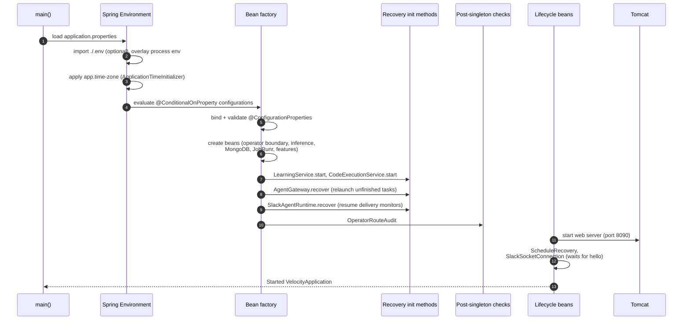
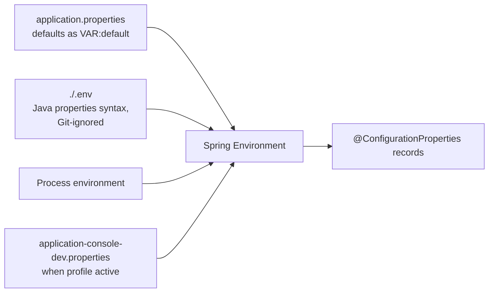
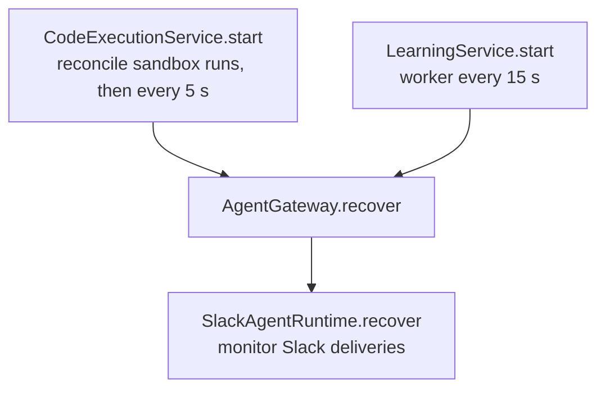
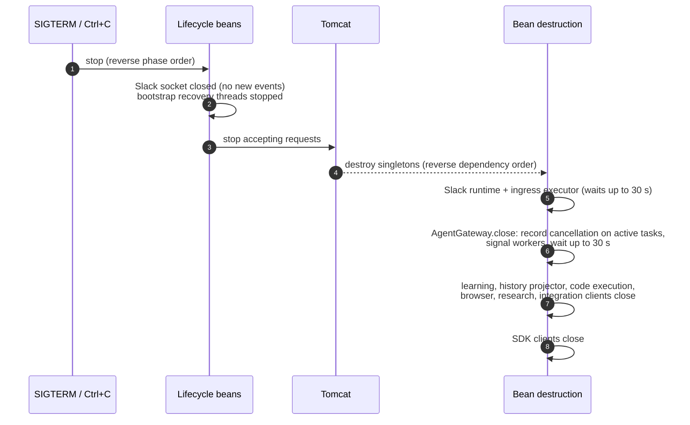

# Startup and shutdown

This guide explains exactly what happens when Velocity starts and stops: where configuration comes
from, which checks can stop startup, what work resumes automatically, which background workers
begin, and how in-flight tasks are treated at shutdown. For first-time setup steps, see
[getting started](getting-started.md).

- [Launch commands](#launch-commands)
- [Startup sequence](#startup-sequence)
- [Configuration loading](#configuration-loading)
- [Conditional features](#conditional-features)
- [Fail-fast checks](#fail-fast-checks)
- [Recovery at startup](#recovery-at-startup)
- [Lifecycle start order](#lifecycle-start-order)
- [Confirming a healthy start](#confirming-a-healthy-start)
- [Shutdown](#shutdown)
- [Safe isolated starts](#safe-isolated-starts)
- [Troubleshooting](#troubleshooting)

## Launch commands

Always launch from the **repository root**. Velocity resolves `.env`, `data/`, `runtime/` and
`target/frontend/` relative to the working directory.

| Goal | Command (Unix shell) | Windows |
| --- | --- | --- |
| Run with the operator console | `sh ./mvnw -Pfrontend -pl velocity-modules/velocity-app -am spring-boot:run` | `.\mvnw.cmd -Pfrontend -pl velocity-modules/velocity-app -am spring-boot:run` |
| Run backend only (no console assets) | `sh ./mvnw -pl velocity-modules/velocity-app -am spring-boot:run` | `.\mvnw.cmd -pl velocity-modules/velocity-app -am spring-boot:run` |
| Serve a watched frontend build | `sh ./mvnw -Dspring-boot.run.profiles=console-dev -pl velocity-modules/velocity-app -am spring-boot:run` | same with `.\mvnw.cmd` |
| Run the packaged JAR | `java -jar velocity-modules/velocity-app/target/velocity-0.0.1-SNAPSHOT.jar` | same |

The Unix wrapper is committed without the executable bit, so invoke it through `sh`. The
`velocity-app` Spring Boot plugin sets its working directory to the reactor root, so
`spring-boot:run` behaves the same as running the JAR from the root. Only `velocity-app` runs; every
library module sets `spring-boot.run.skip=true`.

## Startup sequence



In words:

1. **Environment.** Spring loads `velocity-modules/velocity-app/src/main/resources/application.properties`, imports
   `./.env` if present, and overlays process environment variables (which win). An optional
   profile such as `console-dev` adds `application-console-dev.properties`.
2. **Time zone.** `ApplicationTimeInitializer` (an `EnvironmentPostProcessor` in `velocity-core`)
   reads `app.time-zone`, stores it in `ApplicationTime` and sets the JVM default zone to match,
   before logging starts. Logs, JSON timestamps, schedule defaults and the `date_time` tool share
   that zone; persisted instants remain absolute. An unknown zone ID stops startup here.
3. **Conditional configuration.** Property-guarded configuration classes are included or
   skipped (see [conditional features](#conditional-features)). Inactive providers and
   disabled integrations bind no settings and create no SDK clients.
4. **Property binding and validation.** Every active `@ConfigurationProperties` record is bound
   and validated. Invalid active values stop startup.
5. **Bean creation.** Spring creates the operator-boundary validator, inference profiles and
   SDK clients, MongoDB template, JobRunr storage and scheduler, repositories, tool registry,
   authorization policy and every feature's contributions. Building the tool registry includes
   [MCP server discovery](mcp.md#discovery-and-tool-names) when `mcp.enabled` is on, so startup
   waits up to `mcp.connect-timeout` for each configured server; one that does not answer is
   reported as unavailable rather than failing the boot.
6. **Recovery.** Init methods reconcile durable state: code-run cleanup, then the gateway
   relaunches unfinished tasks and Slack resumes delivery monitoring. This happens **before**
   the web server accepts requests, and it requires MongoDB.
7. **Post-singleton checks.** The operator route audit verifies every `/api` mapping is
   protected.
8. **Lifecycle start.** Tomcat starts listening, then schedule bootstrap recovery and (when
   enabled) the Slack Socket Mode connection start.
9. **Ready.** Spring logs `Started VelocityApplication`. The console is at
   `http://localhost:8090/`.

## Configuration loading



- `application.properties` is the **single source of defaults**. Each deployment setting is
  written `property=${ENV_VAR:default}`; the `*Properties` records declare no defaults of their
  own.
- `spring.config.import=optional:file:.env[.properties]` reads `.env` from the working
  directory as a Java properties file. Use unquoted `KEY=value` lines and forward slashes in
  paths. A missing `.env` is not an error.
- Process environment variables override `.env`. You can also set a canonical property name
  directly in `.env` (for example `agent.delegation.max-children=4`).
- Settings written `${VAR}` without a default (provider models and limits, cloud-fallback
  limits, `SAM_GOV_API_KEY`) are read only while their provider or feature is active.

The full list is in [configuration reference](configuration.md).

## Conditional features

These switches decide which beans exist. Everything else is always created and checks its own
enabled flag at run time.

| Switch | Default | Effect when on | Effect when off |
| --- | --- | --- | --- |
| `inference.provider` | empty | Creates the selected provider's SDK client and the `default` inference profile. | No default profile. Task creation and the playground return HTTP 503; everything else works. |
| `inference.cloud-fallback.enabled` | **true** | Validates the fallback provider, model, four limits and hosted API key; creates the `cloud-fallback` profile. | Fallback settings are not bound or validated. |
| `slack.enabled` | false | Creates the Slack SDK, ingress executor, delivery runtime and Socket Mode connection. Startup fails if the socket does not connect. | No Slack beans; scheduled Slack delivery is unavailable. |
| `jobrunr.background-job-server.enabled` | false (JobRunr default) | JobRunr executes scheduled and recurring jobs. | Jobs are stored but never run. |
| `agent.scheduling.enabled` | **true** | Schedule tools and the reconciliation bootstrap are active (also needs the JobRunr worker to run). | Schedules cannot be dispatched. |

> **Note.** The checked-in defaults enable cloud continuation and web search. An installation
> without a hosted API key or a Tavily key must turn them off explicitly, as the
> [getting started](getting-started.md#minimal-env) example does.

## Fail-fast checks

Startup stops with an exception when any of these hold. The message names the setting.

| Check | Where | Trigger |
| --- | --- | --- |
| Operator boundary | `AgentConfiguration.validateOperatorBoundary` | `server.forward-headers-strategy` is not `none`, or `server.tomcat.remoteip.remote-ip-header` is set. |
| Provider selection | `InferenceConfiguration.validateInferenceSelection` | `inference.provider` is not empty, `claude`, `openai` or `llama-cpp`. |
| Provider settings | `ClaudeProperties`, `OpenAIProperties`, `LlamaCppProperties`, `PrimaryInferenceProperties` | Missing model, nonpositive max tokens, invalid llama.cpp base URL, missing or invalid primary limits, or limits that do not fit the declared context capacity. |
| Provider credentials | `InferenceConfiguration.requiredApiKey` | Selected hosted provider (or enabled cloud fallback) without `ANTHROPIC_API_KEY` / `OPENAI_API_KEY`. |
| Cloud fallback | `CloudFallbackProperties` | Enabled without provider, model or any of the four numeric limits. |
| Slack | `SlackProperties`, `SlackSocketConnection` | Enabled with a blank token or name, nonpositive worker/queue sizes, or no Socket Mode `hello` within 20 seconds. |
| Code execution | `CodeExecutionProperties` | Image is not an immutable digest or local image ID, or installation ID is malformed. |
| Browser | `BrowserProperties` | Enabled with blank executable or launcher paths. |
| Time zone | `ApplicationTimeInitializer` | `app.time-zone` is not a known IANA zone ID. |
| Local account | `LocalAccountProperties` | Only one of the two `agent.local-account.*` identities is set, or one is longer than 256 characters. |
| Secrets | `SecretsProperties` | Capacity limits below their minimums. A missing key does **not** fail startup; the vault reports unavailable. |
| MCP connector | `McpProperties` | Enabled without a server entry; a malformed or duplicate `mcp.servers[n]` entry. An unreachable server does **not** fail startup; it reports `unavailable`. |
| Extension contracts | `ToolRegistry`, `DelegationProfileRegistry`, `OperatorRoutes`, `SystemStatusContributor`, `UsageActivities`, `BundledSkills` | Duplicate tool names, profiles, status keys, activity names or skill IDs; invalid route roots. |
| Route audit | `OperatorRouteAudit` | A request mapping under `/api` is outside every protected operator root. |
| MongoDB | `AgentGateway.recover` and JobRunr storage | MongoDB unreachable when recovery lists saved executions. |
| Snapshot format | `MongoExecutionRepository` | A saved execution in a format other than 5 fails as corrupt state during recovery. See [data and storage](data-storage.md#snapshot-format). |

No check makes a live model call or contacts Slack (other than opening the socket), Docker,
Chromium or third-party APIs.

## Recovery at startup

Recovery runs during bean initialization, in dependency order. Code execution and learning are
dependencies of the gateway, so they settle first.



`AgentGateway.recover` walks every saved execution in queue order:

1. Skips terminal executions.
2. Verifies the owner account still matches its registered Slack identity; otherwise the task
   becomes `blocked` with `execution_authority_invalid`.
3. Restores tool settlements from durable receipts (`ToolCallExecutor.recoverSettlements`).
   A dispatched call with no receipt becomes uncertain and is not repeated.
4. For scheduler-origin tasks, re-validates the saved schedule occurrence and monitoring
   association.
5. Checks that the pinned inference profile still exists and is compatible. A missing profile
   blocks with `inference_profile_unavailable`; a changed one with
   `inference_profile_incompatible`. Saved history is never sent to a different model.
6. A `waiting_for_user` task with an unconsumed answer or correction becomes `running`.
7. A task with a recorded cancellation request becomes `cancelled`.
8. A `running` task is relaunched when `agent.automatic-resumption=true` (the default).
   Otherwise its undispatched calls settle and it becomes `blocked` with
   `automatic_resumption_disabled`.

Relaunched tasks re-enter the FIFO queue with their original tickets, then the queue drains.
**Unfinished tasks therefore start making model and tool calls during startup.** Use
[isolated settings](#safe-isolated-starts) when you do not want that.

Other recovery that happens at startup:

| Feature | Recovery |
| --- | --- |
| Slack delivery | Every Slack-origin execution gets a delivery monitor. Saved intents with receipts are reused; uncertain writes stay paused for inspection and are never resent. |
| Code execution | Runs left `admitted` fail as `interrupted_before_dispatch`; dispatched runs are inspected and terminated through Docker; cleanup evidence is retained. |
| Schedules | The reconciliation job (registered at lifecycle start) re-creates any missing occurrence jobs within 30 seconds. |
| Learning | Pending reviews resume on the worker's first tick (10 seconds after start). |
| History search | Pending projections resume on the projector's first tick (10 seconds after start). |

## Lifecycle start order

After all singletons exist, Spring starts lifecycle beans by phase:

| Phase | Bean | What it does |
| --- | --- | --- |
| Web server phase | Embedded Tomcat | Starts listening on `server.port` (default 8090). |
| Default phase | `ScheduleRecovery` | When agent scheduling is enabled, tries every 30 seconds to register the `velocity-schedule-reconciliation` recurring job (30-second interval) and enqueue one immediate reconcile. Stops retrying once registered. |
| Default phase | `PublicSyncScheduleRecovery` | When Public scheduled ingestion is enabled, registers the `velocity-public-ingestion-reconcile` recurring job (one-minute interval) the same way. |
| Default phase | `SlackSocketConnection` | Opens Socket Mode and waits up to 20 seconds for Slack's `hello`. Failure releases the client and aborts startup. Logs `Slack Socket Mode connected`. |

JobRunr's own background server starts only when `jobrunr.background-job-server.enabled=true`.

## Confirming a healthy start

1. The log ends with `Started VelocityApplication` and, if Slack is on,
   `Slack Socket Mode connected`.
2. `curl http://localhost:8090/velocity/hello` returns `Hello from Velocity!`. This proves HTTP
   liveness only.
3. Open `http://localhost:8090/system` (**Integrations & System**). It shows the effective
   state of inference, Slack, browser, scheduling, JobRunr, secrets, web search, MCP and
   code execution, without secrets.
4. Use the MongoDB check on that page (`GET /api/operator/status/mongo`) to confirm database
   connectivity explicitly.
5. `GET /api/operator/status/concurrency` reports active and queued root tasks.

Status values distinguish *enabled/configured* from *checked*. Browser availability does not
launch Chromium, and JobRunr's enabled flag is not a worker heartbeat.

## Shutdown



What shutdown means for your work:

- **Active tasks are cancelled.** `AgentGateway.close` durably sets `cancellationRequested` on
  every task that has a running worker, signals it, and waits up to 30 seconds. Those tasks end
  as `cancelled` (immediately, or on the next startup if the worker did not finish).
  Cancellation never undoes remote effects that already happened.
- **Queued tasks survive.** A `running` task that was still waiting for a slot keeps its
  ticket and resumes on the next start.
- **Waiting tasks survive.** `waiting_for_user` tasks remain waiting.
- **A crash is different.** If the process is killed without a graceful shutdown, active tasks
  remain `running` and are relaunched by recovery (subject to automatic resumption).
- **Slack delivery** monitors are interrupted. Saved intents remain and are reconciled on the
  next start.
- **Slack events** acknowledged but not yet admitted are held in memory and are lost.

## Safe isolated starts

Starting with a developer's real configuration can resume tasks and connect integrations.
For a validation run, use a disposable database and switch external effects off. Set these in
the process environment so the developer's `.env` stays untouched:

```properties
MONGODB_URI=mongodb://localhost:27017/velocity_scratch
JOBRUNR_DATABASE_DATABASENAME=velocity_scratch
INFERENCE_PROVIDER=
INFERENCE_CLOUD_FALLBACK_ENABLED=false
SLACK_ENABLED=false
AGENT_AUTOMATIC_RESUMPTION=false
AGENT_SCHEDULING_ENABLED=false
jobrunr.background-job-server.enabled=false
AGENT_BROWSER_ENABLED=false
AGENT_CODE_EXECUTION_ENABLED=false
WEB_SEARCH_ENABLED=false
MCP_ENABLED=false
AGENT_LEARNING_WORKER_ENABLED=false
```

Process environment values override `.env`, but `.env` is still read for anything you do not
override. If you need a run that ignores `.env` entirely, launch from a directory that has none
and point the relative paths (the browser runtime path) at the checkout explicitly.

## Troubleshooting

| Symptom | Likely cause and fix |
| --- | --- |
| `Unsupported inference.provider` | Set `INFERENCE_PROVIDER` to `claude`, `openai`, `llama-cpp` or empty. |
| `Set OPENAI_API_KEY ... for the selected inference provider` while using llama.cpp | Cloud fallback is enabled by default. Set `INFERENCE_CLOUD_FALLBACK_ENABLED=false` or configure it fully. |
| Binding errors for `inference.primary.*` | A provider is selected but the three primary limits are missing. They have no defaults. |
| `Could not start Slack Socket Mode` | Check `SLACK_APP_TOKEN` (`xapp-`, `connections:write`), `SLACK_BOT_TOKEN`, network egress, and that both belong to one app. |
| `The local agent operator API requires unmodified peer addresses` | Remove forwarded-header settings. Remote access is not supported. |
| `Request mappings under /api are outside every protected operator route root` | A controller was added outside `/api/operator/...`. See [adding a feature](adding-a-feature.md). |
| Startup hangs then fails on MongoDB | MongoDB is not reachable at `MONGODB_URI`. |
| Corrupt-state errors listing executions | Executions in an old snapshot format remain. Follow [the wipe procedure](data-storage.md#snapshot-format). |
| Console pages return 503 | The local account could not be read or created in `accounts`, usually because MongoDB is unreachable. See [getting started](getting-started.md#the-local-account). |
| Console returns 404 at `/` | Started without `-Pfrontend` and without a watched build in `target/frontend/`. |
