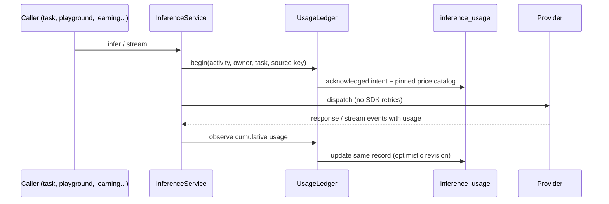

# Usage and estimated costs

Velocity records every dispatched inference request in a durable ledger and computes **estimated**
USD costs from operator-configured prices. Estimates are not provider invoices. Code lives in
`velocity-modules/velocity-core/.../usage/`.

- [How a request is recorded](#how-a-request-is-recorded)
- [Prices](#prices)
- [Activities and ownership](#activities-and-ownership)
- [Reporting API](#reporting-api)
- [Where costs appear](#where-costs-appear)
- [Retention](#retention)

## How a request is recorded



- Intent is written **before** dispatch. A failed or interrupted request keeps whatever usage
  was observed and stays incomplete; nothing is replayed to recover accounting.
- The price catalog is pinned at request start, so later configuration changes never reprice
  history.
- The actual response model selects the rate; the requested model is used only when the
  response omits it.
- Token counting requests are not recorded.

## Prices

Prices are explicit configuration under `usage.*`; rates are never fetched. The defaults
(version `published-2026-10-16-local-zero`, Standard USD per million tokens; Claude rates
checked 2026-10-16, GPT-6 Luna 2026-10-02):

| Provider / model | Input | Output | Cache read | Cache write |
| --- | ---: | ---: | ---: | --- |
| `openai` / `gpt-6-luna` | 0.10 | 0.50 | 0.01 | 0.125 |
| `claude` / `claude-haiku-4-5-20251001` | 1 | 5 | 0.10 | 1.25 (5 min), 2 (1 h) |
| `claude` / `claude-haiku-5-5` | 0.10 | 0.50 | 0.01 | 0.125 (5 min), 0.20 (1 h) |
| `llama-cpp` / `qwen-local` | 0 | 0 | 0 | 0 (operator choice; the llama-server `--alias`) |

GPT-6 Luna also has a long-context rule: above 272,000 input tokens, input and cache rates ×2
and output ×1.5 for the whole request.

Claude Haiku 5.5 is priced by prompt length: above 100,000 input tokens, cache reads and writes
included, input, cache and output rates are all ×5 for the whole request.

Any model not listed is **unpriced**, not free. To change prices, override the full indexed
list (Spring replaces lists as a whole) and bump the version:

```properties
USAGE_PRICING_VERSION=my-catalog-v2
usage.prices[0].provider=claude
usage.prices[0].model=example-model
usage.prices[0].input-per-million=2
usage.prices[0].output-per-million=8
usage.prices[0].cache-read-per-million=0.5
usage.prices[0].cache-creation5m-per-million=4
usage.prices[0].cache-creation1h-per-million=5
```

Rules: input and output rates are required; cache rates are optional and a missing one leaves
that category unpriced; values are nonnegative decimals (at most 15 significant digits, 12
decimals, $1,000,000,000); at most 256 entries; duplicate provider/model pairs fail startup.
Cache tokens are subtracted from ordinary input before pricing; five-minute and one-hour cache
creation partition the aggregate; reasoning is part of output and is not charged twice.

## Activities and ownership

| Activity | Owner | In task totals |
| --- | --- | --- |
| `task` | Task account | Yes |
| `delegated` | Root task account | Yes |
| `attachment` | Task account | Yes |
| `scheduled`, `monitoring` | Persisted schedule account | Yes |
| `learning` | Source account | No (account totals only) |
| `playground` | none | No |
| `unattributed` | none | No |

Features add activity names with a `UsageActivityContributor`. Names are persisted in every
record, so a released name is permanent.

## Reporting API

All routes are behind the local operator boundary, resolve the linked local account, accept no
account selector and send `Cache-Control: no-store`.

| GET route | Returns |
| --- | --- |
| `/api/operator/usage/summary` | Today and month-to-date totals with coverage notes. |
| `/api/operator/usage?from=YYYY-MM-DD&to=YYYY-MM-DD` | Inclusive range of 1–366 days; optional exact `provider`, `model`, `activity`. |
| `/api/operator/tasks/{id}/usage` | One owned task's root, delegated and attachment costs with rate breakdown; other accounts' tasks return 404. |
| `/api/operator/usage/tasks?ids=a,b` | Up to 100 tasks. |

Day and month boundaries use the application zone (`app.time-zone`). Each request belongs to its start day.
Amounts are decimal strings (`estimatedUsd`) with `status` `complete`, `partial`, `unpriced`
or `unavailable`; unknown amounts are `null`, never zero.

## Where costs appear

- **Slack footer** on successful answers: `Response complete {total} ({input} input ·
  {output} output) · Estimated cost: $0.0042 USD`. The footer is frozen in the delivery journal
  before posting, so later price changes never alter a sent message.
- **Console**: Overview (today and this month), **AI Usage** (`/usage`), and the cost detail of
  each task.

## Retention

The `inference_usage` collection has no TTL. Deleting a task does not delete its usage records,
so spending totals never drop. Records hold IDs, token categories and price snapshots — no
prompts, outputs or credentials. Include the collection in backups.
